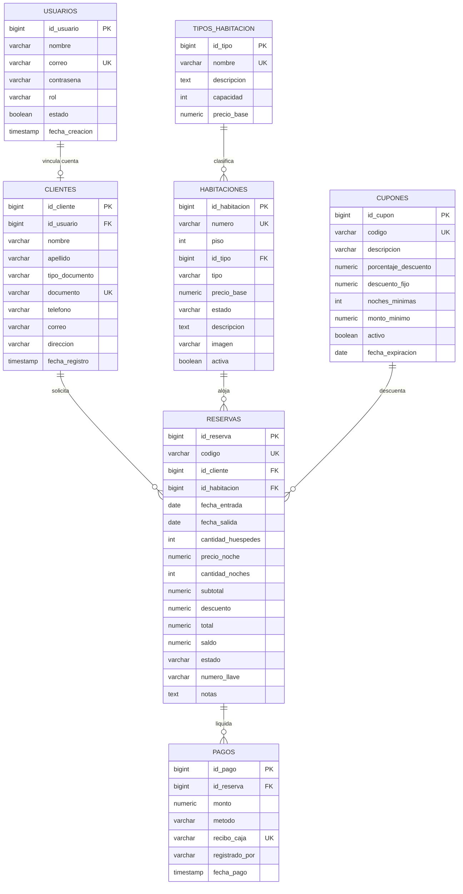

# INFORME CONSOLIDADO DE ENTREGABLES - SPRINT 2
## SISTEMA DE GESTIÓN Y RESERVAS HOTELERAS - ALBORADA HOTEL BOUTIQUE

---

### Resumen Ejecutivo del Sprint 2

| Parámetro | Detalle de Ingeniería |
| :--- | :--- |
| **Proyecto** | Sistema de Reservas y Gestión Hotelera Hotel Alborada Boutique |
| **Sprint** | Sprint 2: Persistencia, API REST, Seguridad & Documentación |
| **Stack Backend** | Java 21 LTS, Spring Boot 3.3.5, Spring Data JPA / Hibernate |
| **Base de Datos** | PostgreSQL 16 (Producción) / H2 In-Memory (Dev/Testing rápido) |
| **Seguridad** | Spring Security 6, JWT (HMAC-SHA256), Hashing BCrypt (Factor 12), RBAC |
| **Documentación API** | OpenAPI 3.0 / Swagger UI interactivo + Colección Oficial Postman v2.1 |
| **Estado de Pruebas** | Backend: 21/21 tests superados (100%) \| Frontend: 124/124 tests superados (100%) |

---

### 1. Entregable 1: Crear Base de Datos

#### 1.1 Modelo Entidad-Relación (MER)
El sistema implementa una arquitectura relacional normalizada en **Tercera Forma Normal (3NF)**:



#### 1.2 Archivos de Base de Datos Entregados
1. **Script DDL Oficial (`schema.sql`):** [schema.sql](file:///c:/Users/SENA/.gemini/antigravity/scratch/Reservas-Hoteleras/backend/src/main/resources/db/schema.sql)
   - Contiene la definición de las 7 tablas maestras con llaves primarias `BIGSERIAL`, llaves foráneas con integridad referencial (`ON DELETE RESTRICT` / `ON DELETE SET NULL`), restricciones `CHECK` para integridad de dominio y 12 índices B-Tree para optimización de consultas de alta concurrencia.
2. **Script DML de Semillas (`data.sql`):** [data.sql](file:///c:/Users/SENA/.gemini/antigravity/scratch/Reservas-Hoteleras/backend/src/main/resources/db/data.sql)
   - Carga inicial de tipos de habitación (Individual, Doble, Triple, Familiar, Suite), 10 habitaciones físicas, usuarios con contraseñas cifradas en BCrypt, clientes de prueba, cupones comerciales y sincronización de secuencias `ALTER SEQUENCE RESTART WITH 10`.
3. **Orquestación con Contenedores (`docker-compose.yml`):** [docker-compose.yml](file:///c:/Users/SENA/.gemini/antigravity/scratch/Reservas-Hoteleras/docker-compose.yml)
   - Permite desplegar PostgreSQL 16 Alpine y pgAdmin 4 con un solo comando:
     ```bash
     docker compose up -d
     ```

---

### 2. Entregable 2: Implementar API REST

#### 2.1 Arquitectura en Capas
La API sigue estrictamente el patrón arquitectónico en capas de Spring Boot:
- **Capa de Controladores (`@RestController`):** Exposición de endpoints HTTP, negociación de contenido JSON, anotaciones OpenAPI 3.
- **Capa de Servicios (`@Service`):** Lógica empresarial, transaccionalidad declarativa (`@Transactional`), validaciones de solapamiento de fechas y cálculo de tarifas.
- **Capa de Acceso a Datos (`@Repository`):** Consultas optimizadas con Spring Data JPA, proyecciones ligeras e índices de búsqueda.
- **Capa de Transferencia (`DTOs`):** Objetos de transferencia inmutables con validaciones Jakarta (`@NotBlank`, `@Email`, `@Min`, `@Size`).

#### 2.2 Controladores Implementados
| Controlador | Ruta Base | Responsabilidad |
| :--- | :--- | :--- |
| `AuthController` | `/api/auth` | Login, Registro, Logout, Perfil `/me` |
| `HabitacionController` | `/api/habitaciones` | CRUD de habitaciones, listado paginado, proyecciones y salud |
| `ReservaController` | `/api/reservas` | Creación de reservas con cupón, modificación de fechas, check-in y cancelaciones |
| `ClienteController` | `/api/clientes` | Registro de huéspedes walk-in, consultas por cédula y actualización de datos |
| `PagoController` | `/api/pagos` | Registro de abonos en counter, recibos de caja y consulta de saldos |
| `TipoHabitacionController` | `/api/tipos-habitacion` | Catálogo maestro de categorías |
| `CuponController` | `/api/cupones` | Validación en tiempo real de cupones de descuento |

---

### 3. Entregable 3: Autenticación y Autorización

#### 3.1 Mecanismo de Seguridad y Cifrado
* **Cifrado de Contraseñas:** Algoritmo **BCrypt con factor de costo 12** implementado en [SecurityConfig.java](file:///c:/Users/SENA/.gemini/antigravity/scratch/Reservas-Hoteleras/backend/src/main/java/com/hotelalborada/backend/security/SecurityConfig.java#L43-L47).
* **Autenticación Stateless (JWT):** Generación y validación de tokens JSON Web Token firmados con HMAC-SHA256 mediante [JwtService.java](file:///c:/Users/SENA/.gemini/antigravity/scratch/Reservas-Hoteleras/backend/src/main/java/com/hotelalborada/backend/security/JwtService.java) con tiempo de expiración configurable (1 hora).
* **Filtro de Intercepción:** [JwtAuthenticationFilter.java](file:///c:/Users/SENA/.gemini/antigravity/scratch/Reservas-Hoteleras/backend/src/main/java/com/hotelalborada/backend/security/JwtAuthenticationFilter.java) valida la cabecera `Authorization: Bearer <token>` en cada solicitud protegida.

#### 3.2 Matriz de Control de Acceso Basado en Roles (RBAC)
| Recurso / Operación | Método | Público | Huésped / CLIENTE | RECEPCIONISTA | ADMINISTRADOR |
| :--- | :---: | :---: | :---: | :---: | :---: |
| Login / Registro | `POST` |  |  |  |  |
| Catálogo de Habitaciones | `GET` |  |  |  |  |
| Catálogo Tipos y Cupones | `GET` |  |  |  |  |
| Crear / Modificar Habitación | `POST/PUT/DELETE` | ❌ | ❌ | ❌ |  |
| Crear Reserva | `POST` | ❌ |  |  |  |
| Ver Mis Reservas | `GET` | ❌ |  (Propias) |  (Todas) |  (Todas) |
| Check-In / Entrega Llave | `PATCH` | ❌ | ❌ |  |  |
| Registrar Pagos / Abonos | `POST` | ❌ |  (Propios) |  |  |
| Directorio de Clientes | `GET/PUT` | ❌ | ❌ |  |  |
| Eliminar Cliente | `DELETE` | ❌ | ❌ | ❌ |  |

#### 3.3 Mitigaciones OWASP Adicionales
1. **Protección contra Fuerza Bruta:** [LoginAttemptService.java](file:///c:/Users/SENA/.gemini/antigravity/scratch/Reservas-Hoteleras/backend/src/main/java/com/hotelalborada/backend/security/LoginAttemptService.java) bloquea direcciones IP tras 5 intentos fallidos consecutivos durante 15 minutos (HTTP 429 Too Many Requests con cabecera `Retry-After`).
2. **Revocación de Tokens:** [TokenRevocationService.java](file:///c:/Users/SENA/.gemini/antigravity/scratch/Reservas-Hoteleras/backend/src/main/java/com/hotelalborada/backend/security/TokenRevocationService.java) almacena en lista negra los tokens de sesiones cerradas (`/logout`).
3. **Cabeceras HTTP de Seguridad:** HSTS activo (1 año), `X-Content-Type-Options: nosniff` y `X-Frame-Options: SAMEORIGIN`.

---

### 4. Entregable 4: Implementar Operaciones CRUD

#### Resumen de Métodos CRUD Implementados
| Módulo | Create (C) | Read (R) | Update (U) | Delete (D) |
| :--- | :--- | :--- | :--- | :--- |
| **Habitaciones** | `POST /api/habitaciones` | `GET /api/habitaciones`<br>`GET /api/habitaciones/{id}`<br>`GET /api/habitaciones/paginado` | `PUT /api/habitaciones/{id}`<br>`PATCH /api/habitaciones/{id}/estado` | `DELETE /api/habitaciones/{id}` |
| **Reservas** | `POST /api/reservas` | `GET /api/reservas`<br>`GET /api/reservas/{id}`<br>`GET /api/reservas/codigo/{codigo}` | `PUT /api/reservas/{id}/fechas`<br>`PATCH /api/reservas/{id}/checkin` | `PATCH /api/reservas/{id}/cancelar` (Baja lógica con auditoría) |
| **Clientes** | `POST /api/clientes` | `GET /api/clientes`<br>`GET /api/clientes/{id}`<br>`GET /api/clientes/documento/{doc}` | `PUT /api/clientes/{id}` | `DELETE /api/clientes/{id}` |
| **Pagos** | `POST /api/pagos` | `GET /api/pagos/reserva/{idReserva}` | N/A (Libro contable inmutable) | N/A |

---

### 5. Entregable 5: Documentar Endpoints

#### 5.1 Swagger UI / OpenAPI 3.0 Interactivo
* **Ruta de acceso interactiva:** `http://localhost:8080/swagger-ui.html`
* **Definición JSON OpenAPI 3:** `http://localhost:8080/v3/api-docs`
* **Configuración:** Centralizada en [OpenApiConfig.java](file:///c:/Users/SENA/.gemini/antigravity/scratch/Reservas-Hoteleras/backend/src/main/java/com/hotelalborada/backend/config/OpenApiConfig.java), incluyendo esquema `BearerAuth` para probar endpoints protegidos directamente desde el navegador ingresando el JWT generado en el login.

#### 5.2 Colección Oficial de Postman v2.1
* **Archivo de exportación:** [Hotel_Alborada_Sprint2_Postman_Collection.json](file:///c:/Users/SENA/.gemini/antigravity/scratch/Reservas-Hoteleras/backend/Hotel_Alborada_Sprint2_Postman_Collection.json)
* **Características:**
  - 24 solicitudes HTTP agrupadas en 6 carpetas temáticas.
  - Script de pruebas que guarda automáticamente el JWT retornado por `/api/auth/login` en la variable de entorno `{{jwt_token}}`.
  - Todas las solicitudes protegidas consumen automáticamente `{{jwt_token}}` sin requerir configuración manual.

#### 5.3 Manual de Referencia de Endpoints en Markdown
* Documento exhaustivo con ejemplos de payload y códigos de estado en [API_REST_DOCUMENTACION.md](file:///c:/Users/SENA/.gemini/antigravity/scratch/Reservas-Hoteleras/docs/API_REST_DOCUMENTACION.md).

---

### 6. Matriz de Cumplimiento de Entregables del Sprint 2

| Entregable Solicitado | Componentes Entregados | Estado |
| :--- | :--- | :---: |
| **Crear base de datos** | Scripts DDL (`schema.sql`), DML (`data.sql`), 7 tablas 3NF, índices, soporte PostgreSQL 16 y H2, `docker-compose.yml`. | **100% COMPLETADO** |
| **Implementar API REST** | Spring Boot 3.3.5, 7 Controladores REST, DTOs con validaciones Jakarta, manejo global de excepciones. | **100% COMPLETADO** |
| **Autenticación y Autorización** | Spring Security 6, JWT HMAC-SHA256, BCrypt (coste 12), RBAC (Admin, Recepción, Cliente), Rate Limit anti-bruteforce, revocación de tokens. | **100% COMPLETADO** |
| **Operaciones CRUD** | CRUD completo en Habitaciones, Reservas, Clientes y Pagos con respuestas HTTP 200, 201, 204, 400, 404, 409. | **100% COMPLETADO** |
| **Documentar endpoints** | Swagger UI (`/swagger-ui.html`), OpenAPI JSON (`/v3/api-docs`), Colección Postman v2.1 con autoguardado de JWT y guía Markdown. | **100% COMPLETADO** |
