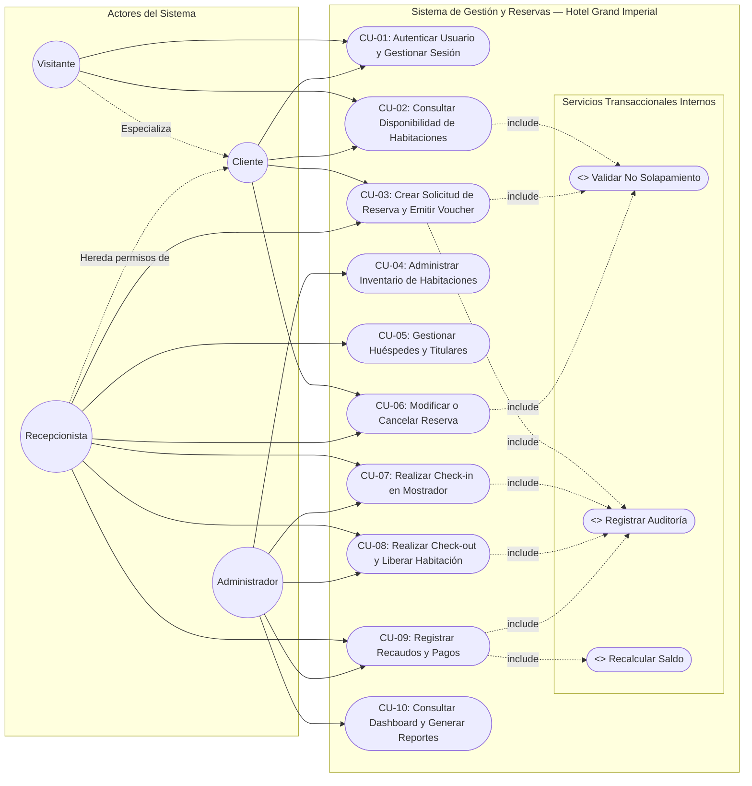

# ESPECIFICACIÓN DE REQUISITOS DE SOFTWARE (SRS — IEEE 830 / ISO/IEC/IEEE 29148)

**Proyecto:** Sistema de Gestión y Reservas Hoteleras — Hotel Grand Imperial  
**Aprendiz:** ALVARO ANDRES PAPAMIJA  
**Programa de Formación:** Análisis y Desarrollo de Software (ADSO) — SENA  
**Ficha:** 2670142 / Convocatoria ADSO  
**Versión:** 1.0.0 | **Estado:** Aprobado  
**Fecha de Emisión:** Noviembre de 2026  

---

# PARTE 1: ESPECIFICACIÓN DE REQUISITOS DE SOFTWARE (SRS - IEEE 830)

## 1. Introducción y Marco General

### 1.1 Propósito del Documento
El presente documento tiene como propósito formalizar la Especificación de Requisitos de Software (SRS) para el **Sistema de Gestión y Reservas Hoteleras del Hotel Grand Imperial**, bajo los lineamientos metodológicos del estándar internacional **IEEE 830-1998** (evolucionado en la norma **ISO/IEC/IEEE 29148:2018**). 

Este artefacto constituye el contrato técnico y funcional entre los interesados del negocio (administración del hotel, personal de recepción, clientes) y el equipo de desarrollo de software del programa ADSO - SENA, garantizando la trazabilidad de los requisitos durante todas las etapas del ciclo de vida del software (análisis, diseño arquitectónico, codificación, pruebas y despliegue).

### 1.2 Alcance y Objetivos del Sistema
- **Objetivo General:** Desarrollar e implementar una plataforma web transaccional centralizada para administrar habitaciones, tarifas, huéspedes, reservas en tiempo real, cobros y operaciones de mostrador (check-in/check-out), mitigando el error humano de sobreventa y registros físicos manuales.
- **Objetivos Específicos:**
  1. Automatizar la consulta y reserva de habitaciones con validación estricta de solapamiento de fechas y capacidad.
  2. Implementar un módulo seguro de autenticación y autorización basado en JSON Web Tokens (JWT) con separación de roles (Administrador, Recepcionista, Cliente).
  3. Gestionar el control financiero operativo de caja: registro de abonos parciales, liquidación de saldos y emisión de comprobantes de pago.
  4. Optimizar las operaciones de mostrador mediante flujos rápidos de Check-in y Check-out vinculados a estados físicos de habitación.
  5. Proporcionar un tablero de control (Dashboard) y reportes consolidados en tiempo real para la toma de decisiones gerenciales.
  6. Cumplir a cabalidad con la normatividad colombiana de protección de datos personales (Ley 1581 de 2012) mediante bitácora de auditoría inmutable.

- **Alcance Operativo:**
  - Gestión integral de habitaciones clasificadas por tipo, tarifa, comodidades, piso y capacidad física.
  - Motor de consulta de disponibilidad que evalúa solapamiento de fechas en reservas activas.
  - Autenticación segura mediante JSON Web Tokens (JWT) y separación estricta de privilegios por roles (Administrador, Recepcionista, Cliente).
  - Control de ingresos contables mediante registro de abonos parciales, liquidación de saldos y emisión de recibos.
  - Auditoría informática de eventos críticos bajo el marco de la Ley 1581 de 2012 (Habeas Data Colombia).
  - Emisión de comprobantes digitales de reserva con código único y Código QR de verificación rápida.

- **Límites y Exclusiones del Sistema:**
  - El sistema no procesa directamente transacciones interbancarias en el MVP (las transacciones electrónicas se asientan como comprobante manual / transferencia informada hasta la integración de pasarela de pagos en fase posterior).
  - El sistema no sustituye el software contable tributario externo (ERP/DIAN), pero genera los insumos de facturación y recaudo exportables.

### 1.3 Personal Involucrado y Matriz de Stakeholders

| Rol / Actor | Descripción | Responsabilidad en el Proyecto |
|---|---|---|
| **Instructor Técnico SENA** | Evaluador metodológico y técnico del programa ADSO. | Aprobación de especificaciones, estándares y entregables de software. |
| **Aprendiz Desarrollador** | Responsable de análisis, diseño, arquitectura e implementación. | Elaboración del SRS, backlog, diagramas UML, codificación y pruebas. |
| **Administrador del Hotel** | Gerencia general del Hotel Grand Imperial. | Parametrización de tarifas, habitaciones, auditoría de usuarios y reportes gerenciales. |
| **Recepcionista** | Personal operativo en mostrador de recepción. | Registro de huéspedes, check-in, check-out, recaudos y asignación de habitaciones. |
| **Cliente / Huésped** | Huésped registrado o visitante que reserva por el canal web. | Consulta de disponibilidad, reserva en línea, visualización de vouchers y pagos. |

### 1.4 Definiciones, Acrónimos y Abreviaturas
- **SRS:** Software Requirements Specification (Especificación de Requisitos de Software).
- **IEEE:** Institute of Electrical and Electronics Engineers.
- **SENA:** Servicio Nacional de Aprendizaje (Colombia).
- **ADSO:** Análisis y Desarrollo de Software.
- **JWT:** JSON Web Token (estándar abierto RFC 7519 para tokens seguros de autenticación).
- **RBAC:** Role-Based Access Control (Control de Acceso Basado en Roles).
- **SPA:** Single Page Application (Aplicación de Página Única).
- **API:** Application Programming Interface (Interfaz de Programación de Aplicaciones).
- **ACID:** Atomicidad, Consistencia, Aislamiento y Durabilidad (propiedades de transacciones de BD).
- **KPI:** Key Performance Indicator (Indicador Clave de Rendimiento).
- **QR:** Quick Response Code (Código de respuesta rápida para validación de vouchers).
- **COP:** Peso Colombiano (moneda oficial del sistema).
- **MoSCoW:** Técnica de priorización (Must have, Should have, Could have, Won't have).
- **Habeas Data:** Derecho fundamental regulado por la Ley 1581 de 2012 para la protección de datos personales en Colombia.

### 1.5 Referencias Normativas y Marco Legal
1. **IEEE Std 830-1998:** Recommended Practice for Software Requirements Specifications.
2. **ISO/IEC/IEEE 29148:2018:** Systems and software engineering — Life cycle processes — Requirements engineering.
3. **Ley 1581 de 2012 (Colombia):** Régimen General de Protección de Datos Personales (Habeas Data).
4. **Decreto 1377 de 2013 (Colombia):** Reglamentación parcial de la Ley 1581 de 2012 sobre recolección y tratamiento de datos personales.
5. **Ley 2068 de 2020 (Ley de Turismo Colombia):** Obligaciones de registro de huéspedes y Registro Nacional de Turismo (RNT).

---

## 2. Descripción General del Sistema

### 2.1 Perspectiva del Producto
El sistema para el **Hotel Grand Imperial** surge para transformar los procesos operativos del hotel, reemplazando el uso de planillas físicas y hojas de cálculo desarticuladas por una plataforma web integrada. La plataforma opera bajo un modelo desacoplado: una interfaz de usuario responsiva (SPA en React con Tailwind CSS) que consume servicios web expuestos por una API REST construida sobre una arquitectura en capas, garantizando persistencia relacional transaccional (ACID).

### 2.2 Características de los Usuarios (Perfiles)
1. **Visitante (No autenticado):** Navega por el catálogo de habitaciones, consulta disponibilidad por fechas y solicita registro como nuevo cliente.
2. **Cliente (Autenticado):** Gestiona su perfil, realiza reservas en línea, visualiza su historial de reservas, descarga vouchers con código QR y registra abonos.
3. **Recepcionista:** Opera en el front-desk del hotel. Gestiona registros de huéspedes físicos, atiende reservas telefónicas o presenciales, ejecuta los flujos de check-in y check-out, cobra saldos y actualiza estados de habitaciones.
4. **Administrador:** Posee acceso total. Administra el catálogo de habitaciones (tipos, precios, pisos), administra las cuentas de recepcionistas y clientes, supervisa la bitácora de auditoría y accede al tablero gerencial (KPIs) y reportes consolidados.

### 2.3 Restricciones Generales
- **Seguridad:** Cifrado unidireccional de claves mediante algoritmo bcrypt (mínimo 10 rondas de salt). Sesiones manejadas exclusivamente por JWT con expiración configurable.
- **Concurrencia:** Control transaccional en base de datos para impedir reservas simultáneas de una misma habitación en rangos de fechas coincidentes.
- **Multiplataforma:** Interfaz adaptable a pantallas de escritorio, portátiles, tablets y smartphones (viewport mínimo 360px).
- **Cumplimiento Legal:** Obligatoriedad de registrar la aceptación de tratamiento de datos personales en el registro de clientes y auditoría de eventos.

---

## 1.2 Catálogo de Requisitos Funcionales (RF-01 a RF-25)

| Código | Módulo | Nombre del Requisito | Descripción Detallada | Prioridad (MoSCoW) | Actor Principal |
|---|---|---|---|---|---|
| **RF-01** | Seguridad | Registro de clientes | Permitir que usuarios externos creen cuentas con nombre, correo electrónico y contraseña encriptada. | Must Have | Cliente |
| **RF-02** | Seguridad | Inicio de sesión | Validar credenciales contra la base de datos y expedir un token JWT con tiempo de caducidad. | Must Have | Todos |
| **RF-03** | Seguridad | Cierre de sesión | Invalidar la sesión en el cliente y destruir el token de autorización en el almacenamiento local. | Must Have | Todos |
| **RF-04** | Usuarios | Gestión de usuarios | El administrador puede crear, editar, listar y desactivar cuentas de recepcionistas y clientes. | Should Have | Administrador |
| **RF-05** | Habitaciones | Creación de habitaciones | Registrar habitaciones definiendo número, categoría, precio/noche, capacidad, piso e imagen. | Must Have | Administrador |
| **RF-06** | Habitaciones | Modificación de habitaciones | Actualizar tarifas, descripciones, comodidades o características de habitaciones existentes. | Should Have | Administrador |
| **RF-07** | Habitaciones | Desactivación de habitaciones | Realizar desactivación lógica (activo = 0) sin vulnerar la integridad referencial de reservas pasadas. | Must Have | Administrador |
| **RF-08** | Habitaciones | Administración de tipos de habitación | Crear y parametrizar categorías (Sencilla, Doble, Matrimonial, Familiar, Suite Presidencial). | Should Have | Administrador |
| **RF-09** | Huéspedes | Registro de huéspedes | Registrar información de huéspedes impidiendo duplicidad en tipo_documento + numero_documento. | Must Have | Recepción / Admin |
| **RF-10** | Reservas | Motor de disponibilidad | Consultar habitaciones libres en el rango de fechas [check-in, check-out] y cantidad de personas. | Must Have | Todos |
| **RF-11** | Reservas | Filtrado de inventario | Filtrar habitaciones disponibles por rango de precio, categoría y capacidad de personas. | Could Have | Todos |
| **RF-12** | Reservas | Creación de reservas | Vincular una habitación desocupada a un huésped y un período de estadía válido. | Must Have | Cliente / Recepción |
| **RF-13** | Reservas | Validación de cronología | Exigir estrictamente que la fecha de check-out sea posterior a la de check-in ($S > E$, estadía mínima 1 noche). | Must Have | Sistema |
| **RF-14** | Reservas | Liquidación automática del costo | Calcular el valor multiplicando el precio base por noche por el número exacto de noches (`Total = precio_noche * noches`). | Must Have | Sistema |
| **RF-15** | Reservas | Modificación de reservas | Modificar fechas o número de personas revalidando la disponibilidad en tiempo real. | Should Have | Recepción / Admin |
| **RF-16** | Reservas | Cancelación de reservas | Anular una reserva activa y liberar la habitación en el motor de disponibilidad inmediatamente. | Must Have | Cliente / Recepción |
| **RF-17** | Reservas | Historial de reservas | Consultar reservas activas, canceladas o finalizadas con filtros de fecha y estado. | Should Have | Todos (según rol) |
| **RF-18** | Pagos | Registro de pagos | Asentar pagos asociados a una reserva (Efectivo, Transferencia o Tarjeta manual). | Must Have | Recepción / Admin |
| **RF-19** | Pagos | Liquidación de saldos | Calcular en tiempo real el saldo: `Saldo Pendiente = Total - Pagos Realizados`. | Must Have | Sistema |
| **RF-20** | Estadía | Ejecución de Check-in | Registrar la hora de llegada del huésped, asociar llave y cambiar la habitación a 'Ocupada'. | Must Have | Recepcionista |
| **RF-21** | Estadía | Ejecución de Check-out | Registrar la salida, marcar la reserva 'Finalizada' y liberar la habitación a 'Disponible'. | Must Have | Recepcionista |
| **RF-22** | Reportes | Reportes consolidados | Generar reportes ejecutivos de ocupación mensual, ingresos por canal y cancelaciones. | Should Have | Administrador |
| **RF-23** | Gerencia | Tablero de mando (Dashboard) | Presentar indicadores clave (KPIs) en tiempo real: ocupación %, ingresos totales, habitaciones. | Should Have | Administrador |
| **RF-24** | Seguridad | Aislamiento de reservas propias | Restringir al cliente para que única y exclusivamente visualice y gestione sus reservas. | Must Have | Cliente |
| **RF-25** | Seguridad | Control de acceso por roles (RBAC) | Restringir el acceso a rutas del frontend y endpoints de la API según privilegios de rol. | Must Have | Sistema |

---

## 1.3 Requisitos No Funcionales (RNF-01 a RNF-10)

| Código | Atributo de Calidad | Especificación Técnica | Métrica / Criterio de Aceptación |
|---|---|---|---|
| **RNF-01** | Usabilidad | Diseño UI/UX intuitivo basado en paleta hotelera (#1e3a8a / #d97706), tipografía legible y modales rápidos. | Puntuación System Usability Scale (SUS) > 80; tiempo para completar reserva < 2 min. |
| **RNF-02** | Seguridad | Cifrado unidireccional de contraseñas con bcryptjs (10 salt rounds). Tokens JWT con firma criptográfica. | 0 passwords en texto plano en BD; tokens con expiración de 8h y claims firmados. |
| **RNF-03** | Rendimiento | Consultas a la API resueltas en menos de 200 ms gracias a índices relacionales en fechas y documentos. | Latencia percentil 95 ($P_{95}$) < 300 ms con concurrencia nominal de 50 usuarios. |
| **RNF-04** | Disponibilidad | Base de datos relacional transaccional (ACID) con persistencia garantizada. | Nivel de disponibilidad del servicio del 99.5 % en entorno de producción. |
| **RNF-05** | Compatibilidad | Soporte verificado en Chrome, Edge, Firefox y Safari sin plugins adicionales. | 100 % de compatibilidad en las últimas 2 versiones estables de navegadores evergreen. |
| **RNF-06** | Responsividad | Maquetación adaptativa mediante CSS/Tailwind operable en móviles (360px+), tablets y computadores. | Cero desbordamientos horizontales en viewport desde 360px hasta 4K. |
| **RNF-07** | Mantenibilidad | Arquitectura modular desacoplada: Frontend (React SPA) y Backend (REST API en 3 capas). | Código desacoplado; separación de lógica de negocio, datos y controladores. |
| **RNF-08** | Integridad | Control contra condiciones de carrera: impide dobles reservas para una habitación en las mismas fechas. | Cero transacciones solapadas en pruebas de estrés concurrentes automatizadas. |
| **RNF-09** | Escalabilidad | API REST estándar lista para integrarse a pasarelas bancarias o motores channel manager. | Endpoints RESTful con formato JSON estandarizado y códigos de estado HTTP estándar. |
| **RNF-10** | Protección de Datos | Cumplimiento del principio de confidencialidad de la Ley 1581 de 2012 y registro de auditoría. | Tabla `auditoria` inmutable con logs de fecha, usuario, acción y dirección IP/agente. |

---

## 1.4 Reglas del Negocio (RN)

- **RN-01 (Solapamiento de Fechas):** Una habitación no puede tener dos reservas activas (Pendiente o Confirmada) cuyos intervalos temporales se crucen:
  $$E_{\text{nueva}} < S_{\text{existente}} \quad \land \quad S_{\text{nueva}} > E_{\text{existente}}$$
  Donde $E$ representa la fecha de entrada (check-in) y $S$ representa la fecha de salida (check-out).
- **RN-02 (Cronología Mínima):** La fecha de check-out debe ser estrictamente posterior al check-in. Estadía mínima: 1 noche ($S > E$).
- **RN-03 (Límite de Capacidad Física):** El número total de ocupantes (adultos + niños) no puede superar la `capacidad_maxima` configurada para la habitación seleccionada.
- **RN-04 (Inhabilitación por Mantenimiento):** Una habitación con estado 'En mantenimiento' queda excluida automáticamente del motor de búsqueda y no puede ser reservada bajo ninguna circunstancia.
- **RN-05 (Liberación por Cancelación):** Si una reserva pasa a estado 'Cancelada', su intervalo de fechas queda inmediatamente liberado en el motor de disponibilidad para otros usuarios.
- **RN-06 (Vinculación Obligatoria de Titular):** Toda reserva requiere obligatoriamente un titular con documento registrado, nombres, apellidos, teléfono y correo electrónico verificado.
- **RN-07 (Inmutabilidad de Reservas Finalizadas):** Una reserva en estado 'Finalizada' (tras la ejecución formal del check-out) no puede regresar a estado pendiente, confirmada ni ser modificada.
- **RN-08 (Protección Privada de Datos):** Los usuarios con rol Cliente solo tienen acceso a sus propias reservas (`usuario_id = req.user.id`). Cualquier intento de consulta o modificación sobre IDs ajenos es rechazado con HTTP 403 Forbidden.
- **RN-09 (Bitácora de Auditoría Obligatoria):** Toda creación de reserva, cambio de estado, registro de pago, ejecución de check-in o check-out se almacena de forma inmutable con usuario, acción y timestamp en la tabla `auditoria`.
- **RN-10 (Política de Anticipos y Pagos):** Toda reserva en estado 'Pendiente' requiere el registro de al menos un anticipo mínimo (o liquidación completa) para ser marcada como 'Confirmada'. Al momento del check-in, el saldo no puede superar el límite autorizado por la administración.
- **RN-11 (Horarios Estándar de Entrada y Salida):** El horario oficial de Check-in inicia a partir de las 15:00 horas del día de llegada; el Check-out se ejecuta a más tardar a las 12:00 horas del día de salida. El motor liquida noches completas de alojamiento.
- **RN-12 (Políticas y Plazos de Cancelación):** El cliente puede solicitar cancelación de su reserva con al menos 24 horas de antelación a la fecha de llegada pactada. Las cancelaciones extemporáneas quedan a criterio administrativo.
- **RN-13 (Validación de Documentos y Normativa Colombiana):** Todo huésped registrado debe presentar y validar un documento de identidad legal vigente en Colombia (Cédula de Ciudadanía, Cédula de Extranjería, Pasaporte o Tarjeta de Identidad para menores), en concordancia con el Registro Nacional de Turismo.
- **RN-14 (Inmutabilidad de Tarifas Pactadas):** El precio por noche pactado en una reserva confirmada se mantiene inalterable durante toda la estadía, aun cuando la administración modifique posteriormente el catálogo general de tarifas del hotel.

---

# PARTE 2: HISTORIAS DE USUARIO Y PRODUCT BACKLOG

**Metodología:** Scrum Ágil  
**Formato de Historias:** Como [rol], quiero [funcionalidad], para [beneficio].  
**Formato de Criterios de Aceptación:** Sintaxis Gherkin (Dado - Cuando - Entonces / BDD).

---

### HU-01: Registro de Usuarios Clientes
- **Como:** Visitante del sitio web del hotel.
- **Quiero:** Registrar mis datos personales y crear una contraseña.
- **Para:** Disponer de una cuenta privada y reservar habitaciones en línea.
- **Prioridad:** Alta (Must Have) | **Estimación:** 3 Story Points (SP)
- **Criterios de Aceptación:**
  - **Escenario 1 (Exitoso):**  
    *Dado* que ingreso nombre, correo no existente y clave de 6+ caracteres,  
    *Cuando* presiono "Completar Registro",  
    *Entonces* el sistema guarda el usuario con rol Cliente, encripta la contraseña con bcrypt y devuelve un token JWT.
  - **Escenario 2 (Correo Duplicado):**  
    *Dado* que ingreso un correo previamente registrado,  
    *Cuando* intento registrarme,  
    *Entonces* el sistema muestra el error: "El correo electrónico ya se encuentra registrado" (HTTP 400).

---

### HU-02: Inicio de Sesión y Autenticación
- **Como:** Usuario registrado (Admin, Recepcionista o Cliente).
- **Quiero:** Ingresar mi correo y contraseña.
- **Para:** Acceder a las funciones permitidas según mi rol.
- **Prioridad:** Alta (Must Have) | **Estimación:** 3 SP
- **Criterios de Aceptación:**
  - **Escenario 1 (Credenciales Válidas):**  
    *Dado* que mis credenciales son correctas y mi estado de cuenta es 'activo',  
    *Cuando* inicio sesión,  
    *Entonces* el sistema autoriza el acceso (HTTP 200), entrega el JWT y me redirige a mi panel correspondiente.
  - **Escenario 2 (Credenciales Inválidas):**  
    *Dado* que la contraseña o el correo son erróneos,  
    *Cuando* envío el formulario de ingreso,  
    *Entonces* el sistema rechaza la petición con código HTTP 401 Unauthorized sin revelar si falló el correo o la clave.

---

### HU-03: Creación de Habitaciones en Inventario
- **Como:** Administrador del hotel.
- **Quiero:** Registrar nuevas habitaciones con número, tipo, precio por noche, piso y capacidad.
- **Para:** Ampliar la oferta de alojamiento disponible para los clientes.
- **Prioridad:** Alta (Must Have) | **Estimación:** 5 SP
- **Criterios de Aceptación:**
  - **Escenario 1 (Habitación Nueva Exitosa):**  
    *Dado* que ingreso el número 105 (no existente), tarifa \$150.000 COP y capacidad 2,  
    *Cuando* guardo la habitación,  
    *Entonces* la habitación queda guardada en base de datos en estado 'Disponible'.
  - **Escenario 2 (Número Duplicado):**  
    *Dado* que ingreso un número de habitación que ya existe en el hotel,  
    *Cuando* intento guardarla,  
    *Entonces* la operación es rechazada con HTTP 400: "La habitación con el número X ya se encuentra registrada".

---

### HU-04: Modificación y Desactivación Lógica de Habitaciones *(Añadido)*
- **Como:** Administrador del hotel.
- **Quiero:** Actualizar las características, comodidades o desactivar lógicamente una habitación.
- **Para:** Mantener el catálogo actualizado sin eliminar el historial de reservas asociadas a dicha habitación.
- **Prioridad:** Media (Should Have) | **Estimación:** 5 SP
- **Criterios de Aceptación:**
  - **Escenario 1 (Actualización de tarifa y servicios):**  
    *Dado* que selecciono una habitación existente y modifico su precio por noche a \$180.000 COP,  
    *Cuando* presiono "Guardar Cambios",  
    *Entonces* los nuevos valores se actualizan inmediatamente en el catálogo sin alterar reservas pasadas.
  - **Escenario 2 (Desactivación lógica con reservas activas):**  
    *Dado* que desactivo una habitación (`activo = 0`),  
    *Cuando* el motor de búsqueda filtra habitaciones,  
    *Entonces* no aparece para futuras búsquedas, pero se mantiene la integridad referencial de reservas históricas.

---

### HU-05: Administración de Tipos de Habitación y Registro de Huéspedes *(Añadido)*
- **Como:** Recepcionista o Administrador.
- **Quiero:** Parametrizar tipos de habitación y registrar huéspedes impidiendo duplicados en el documento.
- **Para:** Clasificar adecuadamente la oferta hotelera y alimentar la base de huéspedes bajo normativa legal.
- **Prioridad:** Alta (Must Have) | **Estimación:** 5 SP
- **Criterios de Aceptación:**
  - **Escenario 1 (Registro de Huésped Nuevo):**  
    *Dado* que ingreso tipo de documento 'CC' y número '1085244111' que no existen en el sistema,  
    *Cuando* confirmo el guardado,  
    *Entonces* el huésped queda registrado y disponible para asociarse a reservas.
  - **Escenario 2 (Documento Duplicado):**  
    *Dado* que ingreso un documento que ya existe en la tabla de huéspedes,  
    *Cuando* intento crear un nuevo registro,  
    *Entonces* el sistema reutiliza la ficha existente y notifica: "El huésped ya se encuentra registrado".

---

### HU-06: Búsqueda de Disponibilidad en Tiempo Real
- **Como:** Cliente o recepcionista.
- **Quiero:** Seleccionar fecha de llegada, fecha de salida y cantidad de personas.
- **Para:** Conocer qué habitaciones están libres sin riesgo de solapamiento.
- **Prioridad:** Alta (Must Have) | **Estimación:** 8 SP
- **Criterios de Aceptación:**
  - **Escenario 1 (Búsqueda Válida):**  
    *Dado* que selecciono rango [15/12/2026 al 18/12/2026] para 2 personas,  
    *Cuando* presiono "Buscar Disponibles",  
    *Entonces* el sistema excluye habitaciones en mantenimiento y aquellas con reservas solapadas, calculando: `Total = precio_noche * noches`.
  - **Escenario 2 (Fechas Inválidas):**  
    *Dado* que la fecha de salida es menor o igual a la de entrada,  
    *Cuando* inicio la búsqueda,  
    *Entonces* se bloquea la búsqueda con el error: "La fecha de salida debe ser posterior a la fecha de entrada".

---

### HU-07: Creación de Reserva y Emisión de Voucher
- **Como:** Cliente autenticado o recepcionista.
- **Quiero:** Seleccionar una habitación libre y confirmar la reserva.
- **Para:** Asegurar el alojamiento en las fechas deseadas y tener constancia formal.
- **Prioridad:** Alta (Must Have) | **Estimación:** 8 SP
- **Criterios de Aceptación:**
  - **Escenario 1 (Reserva Exitosa):**  
    *Dado* que selecciono una habitación disponible e ingreso los datos del titular,  
    *Cuando* confirmo la reserva,  
    *Entonces* el sistema re-valida la disponibilidad antes del INSERT, genera un código único (ej. `RES-202611-9575`) y despliega el Voucher digital con Código QR dinámico.
  - **Escenario 2 (Condición de Carrera):**  
    *Dado* que otro usuario reservó la misma habitación milisegundos antes,  
    *Cuando* el sistema intenta realizar el registro,  
    *Entonces* aborta la transacción relacional e informa: "La habitación seleccionada acaba de ser reservada por otro usuario".

---

### HU-08: Modificación de Reservas Activas *(Añadido)*
- **Como:** Recepcionista o Administrador.
- **Quiero:** Modificar las fechas o la habitación de una reserva activa.
- **Para:** Atender solicitudes de cambio de los clientes garantizando no solapar fechas.
- **Prioridad:** Media (Should Have) | **Estimación:** 5 SP
- **Criterios de Aceptación:**
  - **Escenario 1 (Extensión de estadía con disponibilidad):**  
    *Dado* que modifico la fecha de check-out agregando 2 noches más a una habitación sin cruces,  
    *Cuando* confirmo la modificación,  
    *Entonces* el sistema actualiza el registro, recalcula el valor total y ajusta el saldo pendiente.
  - **Escenario 2 (Conflicto de fechas en modificación):**  
    *Dado* que las nuevas fechas solicitadas se solapan con otra reserva existente de esa habitación,  
    *Cuando* intento guardar los cambios,  
    *Entonces* el sistema cancela la operación y muestra: "La habitación no está disponible para el nuevo período seleccionado".

---

### HU-09: Consulta de Historial y Mis Reservas *(Añadido)*
- **Como:** Cliente registrado o Recepcionista.
- **Quiero:** Visualizar el listado histórico de reservas con filtros por estado y fecha.
- **Para:** Hacer seguimiento a mis estadías o consultar información histórica de reservas hoteleras.
- **Prioridad:** Media (Should Have) | **Estimación:** 3 SP
- **Criterios de Aceptación:**
  - **Escenario 1 (Aislamiento de reservas del cliente):**  
    *Dado* que inicio sesión como Cliente,  
    *Cuando* ingreso al módulo "Mis Reservas",  
    *Entonces* únicamente puedo visualizar las reservas asociadas a mi identificador de usuario.
  - **Escenario 2 (Filtro por estado para recepcionista):**  
    *Dado* que el recepcionista accede a la vista global de reservas,  
    *Cuando* filtra por estado 'Confirmada',  
    *Entonces* visualiza todas las reservas vigentes pendientes de check-in.

---

### HU-10: Control de Pagos y Abonos
- **Como:** Recepcionista o administrador.
- **Quiero:** Registrar pagos en efectivo, transferencia o tarjeta asociados a una reserva.
- **Para:** Controlar los ingresos y liquidar los saldos pendientes.
- **Prioridad:** Alta (Must Have) | **Estimación:** 5 SP
- **Criterios de Aceptación:**
  - **Escenario 1 (Abono Parcial y Actualización de Saldo):**  
    *Dado* que registro un abono de \$100.000 COP a una reserva de \$300.000 COP,  
    *Cuando* confirmo el pago,  
    *Entonces* el sistema asienta el comprobante, recalcula `Nuevo Saldo = Total - Suma(Pagos) = $200.000 COP`, dejando el estado de pago en 'Parcial'.
  - **Escenario 2 (Liquidación Total):**  
    *Dado* que el pago ingresado cubre exactamente el saldo pendiente,  
    *Cuando* se registra la transacción,  
    *Entonces* el estado de pago cambia automáticamente a 'Pagado' y se habilita el recibo oficial imprimible.

---

### HU-11: Registro de Check-in (Entrada de Huésped)
- **Como:** Recepcionista.
- **Quiero:** Registrar el ingreso del huésped en el mostrador.
- **Para:** Asignar la llave física y cambiar la habitación a estado ocupado.
- **Prioridad:** Alta (Must Have) | **Estimación:** 5 SP
- **Criterios de Aceptación:**
  - **Escenario 1 (Check-in Exitoso):**  
    *Dado* que la reserva se encuentra en estado 'Confirmada' o 'Pendiente',  
    *Cuando* el recepcionista asocia la llave y confirma la entrada,  
    *Entonces* el sistema almacena la fecha y hora exacta (`fecha_checkin = NOW()`), cambia el estado de la habitación a 'Ocupada' y registra el evento en auditoría.
  - **Escenario 2 (Reserva Inválida):**  
    *Dado* que una reserva ya fue cancelada o finalizada,  
    *Cuando* se intenta realizar check-in,  
    *Entonces* el sistema rechaza la acción con mensaje: "No es posible realizar check-in a una reserva no vigente".

---

### HU-12: Registro de Check-out (Salida de Huésped)
- **Como:** Recepcionista.
- **Quiero:** Registrar la salida del cliente al culminar su estadía.
- **Para:** Cerrar la cuenta y liberar la habitación para el equipo de aseo.
- **Prioridad:** Alta (Must Have) | **Estimación:** 5 SP
- **Criterios de Aceptación:**
  - **Escenario 1 (Check-out con cuenta en cero):**  
    *Dado* que el huésped tiene check-in previo y saldo pendiente \$0 COP,  
    *Cuando* el recepcionista confirma la salida,  
    *Entonces* el sistema graba `fecha_checkout = NOW()`, pasa la reserva a 'Finalizada' y cambia la habitación a 'Disponible'.
  - **Escenario 2 (Advertencia por saldo pendiente):**  
    *Dado* que el cliente tiene saldo pendiente > \$0 COP,  
    *Cuando* se abre la ventana de check-out,  
    *Entonces* el sistema muestra una alerta roja destacada con el monto adeudado exigiendo liquidación previa o autorización expresa.

---

### HU-13: Gestión de Usuarios y Control de Acceso por Roles (RBAC) *(Añadido)*
- **Como:** Administrador del hotel.
- **Quiero:** Crear, editar, activar y desactivar usuarios asignando sus respectivos roles.
- **Para:** Garantizar el principio de menor privilegio y seguridad en la plataforma.
- **Prioridad:** Alta (Must Have) | **Estimación:** 5 SP
- **Criterios de Aceptación:**
  - **Escenario 1 (Creación de Recepcionista):**  
    *Dado* que ingreso datos válidos y selecciono rol 'Recepcionista',  
    *Cuando* guardo el usuario,  
    *Entonces* el usuario puede ingresar al sistema accediendo únicamente a los módulos operativos de mostrador.
  - **Escenario 2 (Intento de acceso no autorizado por cliente):**  
    *Dado* que un usuario con rol 'Cliente' intenta consumir la ruta administrativa `/api/admin/reportes`,  
    *Cuando* se valida el token JWT en el backend,  
    *Entonces* el sistema responde con código HTTP 403 Forbidden y bloquea el acceso.

---

### HU-14: Cancelación de Reserva según Políticas
- **Como:** Cliente o recepcionista.
- **Quiero:** Cancelar una reserva activa antes de la fecha de llegada.
- **Para:** Liberar el cupo si se presentaron imprevistos de viaje.
- **Prioridad:** Media (Should Have) | **Estimación:** 3 SP
- **Criterios de Aceptación:**
  - **Escenario 1 (Cancelación Oportuna):**  
    *Dado* que la reserva está 'Pendiente' o 'Confirmada' y faltan más de 24 horas para la llegada,  
    *Cuando* el usuario confirma la anulación ingresando un motivo,  
    *Entonces* la reserva pasa a 'Cancelada' y la habitación se libera inmediatamente en el motor de disponibilidad.
  - **Escenario 2 (Cancelación de Reserva Finalizada):**  
    *Dado* que una reserva se encuentra en estado 'Finalizada',  
    *Cuando* se intenta cancelar,  
    *Entonces* el sistema bloquea la acción por inmutabilidad de la estadía (RN-07).

---

### HU-15: Visualización de Dashboard y Estadísticas Gerenciales
- **Como:** Administrador del hotel.
- **Quiero:** Visualizar gráficos y tarjetas con métricas operativas.
- **Para:** Conocer la ocupación actual y la rentabilidad del hotel.
- **Prioridad:** Media (Should Have) | **Estimación:** 5 SP
- **Criterios de Aceptación:**
  - **Escenario 1 (Visualización de KPIs en tiempo real):**  
    *Dado* que accedo con rol Administrador al panel principal,  
    *Cuando* carga el tablero,  
    *Entonces* observo la tasa de ocupación: `(Habitaciones Ocupadas / Total Habitaciones Activas) * 100`, el total recaudado discriminado por método de pago y el calendario interactivo.

---

### HU-16: Generación y Exportación de Reportes Consolidados *(Añadido)*
- **Como:** Administrador del hotel.
- **Quiero:** Filtrar y exportar reportes de ocupación mensual, ingresos y cancelaciones.
- **Para:** Respaldar los análisis contables y presentar informes a la junta directiva.
- **Prioridad:** Media (Should Have) | **Estimación:** 5 SP
- **Criterios de Aceptación:**
  - **Escenario 1 (Exportación mensual):**  
    *Dado* que selecciono el rango del mes actual y presiono "Generar Reporte",  
    *Cuando* el backend procesa los registros consolidados,  
    *Entonces* se genera un archivo descargable con el resumen de ingresos, promedio de tarifa diaria (ADR) y cancelaciones.

---

### HU-17: Cierre de Sesión Seguro y Revocación de Tokens *(Añadido)*
- **Como:** Cualquier usuario autenticado.
- **Quiero:** Cerrar mi sesión de forma explícita en cualquier momento.
- **Para:** Proteger la privacidad de mi cuenta y evitar usos no autorizados en equipos compartidos.
- **Prioridad:** Alta (Must Have) | **Estimación:** 2 SP
- **Criterios de Aceptación:**
  - **Escenario 1 (Cierre Exitoso):**  
    *Dado* que tengo una sesión abierta,  
    *Cuando* presiono "Cerrar Sesión",  
    *Entonces* el sistema destruye el token JWT almacenado localmente y me redirige a la página pública de inicio.

---

# PARTE 3: CASOS DE USO UML DEL SISTEMA

## 3.1 Diagrama General de Casos de Uso (UML)

### Tabla de Actores y Responsabilidades UML
1. **Visitante:** Usuario anónimo en Internet. Consulta el catálogo y disponibilidad; puede crear cuenta propia.
2. **Cliente:** Huésped registrado con cuenta activa. Busca fechas, reserva habitaciones, ve sus vouchers y cancela oportunamente.
3. **Recepcionista:** Operador interno del hotel. Realiza reservas telefónicas/presenciales, cobra abonos, procesa llegadas (Check-in) y salidas (Check-out).
4. **Administrador:** Superusuario del hotel. Gestiona inventario de habitaciones, precios, cuentas de recepcionistas, bitácoras y analiza dashboards y reportes.

---

## 3.2 Fichas Técnicas de Casos de Uso Detallados

### Ficha: CU-01 — Autenticar Usuario y Gestionar Sesión *(Añadido)*
- **Código:** CU-01
- **Nombre:** Autenticar Usuario y Gestionar Sesión
- **Actor Principal:** Cliente, Recepcionista, Administrador.
- **Precondiciones:** El usuario debe encontrarse registrado en la plataforma y con estado 'activo'.
- **Flujo Principal:**
  1. El actor ingresa a la opción "Iniciar Sesión".
  2. El sistema presenta el formulario solicitando correo electrónico y contraseña.
  3. El actor ingresa sus credenciales y presiona "Ingresar".
  4. El sistema consulta el usuario por correo electrónico en la base de datos.
  5. El sistema compara el hash mediante `bcrypt.compare`.
  6. Al coincidir, el sistema genera un token JWT firmado que encapsula: `id`, `nombre`, `email` y `rol`.
  7. El sistema almacena el token en el cliente y redirige a la interfaz acorde al rol.
  8. El sistema registra el inicio de sesión en la bitácora de auditoría.
- **Flujos Alternos / Excepciones:**
  - **Excepción 5a (Credenciales incorrectas):** Si el correo no existe o la contraseña no coincide con el hash, el sistema responde con HTTP 401 Unauthorized: "Credenciales inválidas" sin revelar cuál dato falló.
  - **Excepción 5b (Usuario inactivo):** Si el usuario se encuentra con `activo = 0`, el sistema deniega el acceso: "Esta cuenta se encuentra inactiva. Contacte a la administración".
- **Postcondición:** El usuario queda autenticado y con credenciales válidas en cabecera `Authorization: Bearer <token>`.

---

### Ficha: CU-02 — Consultar Disponibilidad de Habitaciones
- **Código:** CU-02
- **Nombre:** Consultar Disponibilidad de Habitaciones
- **Actor Principal:** Cliente, Recepcionista o Administrador.
- **Precondiciones:** El usuario accede a la plataforma web.
- **Flujo Principal:**
  1. El actor selecciona la fecha de check-in ($E$), fecha de check-out ($S$) y número de huéspedes.
  2. El actor presiona el botón "Buscar Disponibles".
  3. El sistema valida que $S > E$, con estadía mínima de 1 noche.
  4. El sistema ejecuta la consulta SQL descartando habitaciones en mantenimiento y aquellas con reservas activas que se solapen con el intervalo:
     $$\text{Excluir si: } (E_{\text{nueva}} < S_{\text{existente}}) \land (S_{\text{nueva}} > E_{\text{existente}})$$
  5. El sistema calcula el valor total para cada habitación: `Total = precio_noche * noches`.
  6. El sistema renderiza las tarjetas de habitaciones disponibles con fotos, capacidad y comodidades.
- **Flujos Alternos / Excepciones:**
  - **Excepción 3a (Fechas inválidas):** Si la fecha de salida es anterior o igual a la de entrada, el sistema detiene el proceso y muestra: "La fecha de salida debe ser posterior a la fecha de entrada".
  - **Excepción 4a (Sin disponibilidad):** Si todas las habitaciones están ocupadas, el sistema muestra el mensaje: "No hay habitaciones disponibles para esas fechas".
- **Postcondición:** El usuario visualiza únicamente las opciones aptas para ser reservadas.

---

### Ficha: CU-03 — Crear Solicitud de Reserva y Emitir Voucher
- **Código:** CU-03
- **Nombre:** Crear Solicitud de Reserva y Emitir Voucher
- **Actor Principal:** Cliente o Recepcionista.
- **Precondiciones:** Haber seleccionado una habitación disponible mediante CU-02.
- **Flujo Principal:**
  1. El actor presiona "Reservar Habitación" en la tarjeta elegida.
  2. El sistema despliega el formulario con el resumen de costo.
  3. El actor diligencia el tipo y número de documento, nombres, apellidos, teléfono y correo del titular.
  4. *(Opcional)* El actor ingresa un valor de anticipo y método de pago.
  5. El actor presiona "Confirmar Reserva Ahora".
  6. El sistema verifica por segunda vez que la habitación no haya sido tomada concurrentemente en una transacción ACID.
  7. El sistema genera el registro en la tabla `reservas`, vincula el detalle en `detalle_reserva` y emite un código único `RES-YYYYMM-XXXX`.
  8. El sistema muestra el Voucher de Confirmación con su Código QR dinámico.
- **Flujos Alternos / Excepciones:**
  - **Excepción 6a (Conflicto de concurrencia):** Si otro usuario reservó la habitación en ese instante, el sistema rechaza la transacción e informa el conflicto (HTTP 409 / 400).
- **Postcondición:** La habitación queda bloqueada en esas fechas y la reserva queda en estado 'Confirmada'.

---

### Ficha: CU-04 — Administrar Inventario de Habitaciones *(Añadido)*
- **Código:** CU-04
- **Nombre:** Administrar Inventario de Habitaciones
- **Actor Principal:** Administrador.
- **Precondiciones:** El usuario debe haber iniciado sesión con credenciales de Administrador.
- **Flujo Principal:**
  1. El administrador ingresa al módulo "Gestión de Habitaciones".
  2. El sistema despliega la lista con las habitaciones existentes, su número, tipo, piso, precio y estado actual.
  3. El administrador selecciona una acción: "Nueva Habitación", "Editar" o "Cambiar Estado".
  4. Para una nueva habitación, diligencia número, categoría, precio por noche, capacidad y amenidades.
  5. Presiona "Guardar Habitación".
  6. El sistema valida que el número no esté duplicado y persiste el registro.
- **Flujos Alternos / Excepciones:**
  - **Excepción 6a (Número existente):** Si el número ya existe, el sistema emite el error: "El número de habitación ya se encuentra en uso".
  - **Flujo Alterno 3a (Desactivación lógica):** El administrador selecciona "Desactivar"; el sistema actualiza el campo `activo = 0` protegiendo las reservas pasadas.
- **Postcondición:** El inventario de habitaciones queda actualizado y visible en tiempo real.

---

### Ficha: CU-05 — Gestionar Registro de Huéspedes y Titulares *(Añadido)*
- **Código:** CU-05
- **Nombre:** Gestionar Registro de Huéspedes y Titulares
- **Actor Principal:** Recepcionista o Administrador.
- **Precondiciones:** Usuario autenticado con rol operativo.
- **Flujo Principal:**
  1. El actor ingresa al módulo "Huéspedes".
  2. Digita el documento para verificar existencia en el sistema.
  3. Si no existe, ingresa nombres, apellidos, tipo de documento, teléfono, correo y país de procedencia.
  4. Presiona "Guardar Huésped".
  5. El sistema valida formato de correo y unicidad de la llave (`tipo_documento`, `numero_documento`).
  6. El sistema registra el huésped en la base de datos y asienta el log de auditoría.
- **Flujos Alternos / Excepciones:**
  - **Flujo Alterno 2a (Huésped existente):** Si el documento ya existe, el sistema carga automáticamente la ficha del huésped para agilizar el proceso de check-in o reserva.
- **Postcondición:** El huésped queda registrado y habilitado para asociarle reservas presentes o futuras.

---

### Ficha: CU-06 — Modificar y Cancelar Reservas de Alojamiento *(Añadido)*
- **Código:** CU-06
- **Nombre:** Modificar y Cancelar Reservas de Alojamiento
- **Actor Principal:** Cliente (sus reservas), Recepcionista o Administrador (cualquiera).
- **Precondiciones:** La reserva debe encontrarse en estado 'Pendiente' o 'Confirmada'.
- **Flujo Principal (Cancelación):**
  1. El actor localiza la reserva en su listado y presiona "Cancelar Reserva".
  2. El sistema solicita confirmación del motivo de cancelación.
  3. El actor confirma la operación.
  4. El sistema cambia el estado a 'Cancelada', libera el rango de fechas en el motor de disponibilidad y registra la auditoría.
  5. El sistema muestra confirmación de liberación de cupo.
- **Flujos Alternos / Excepciones:**
  - **Flujo Alterno (Modificación de Fechas):** El recepcionista ingresa nuevas fechas; el sistema valida solapamiento contra otras reservas; si no hay cruce, recalcula el saldo total y actualiza la reserva.
  - **Excepción 1a (Reserva no cancelable):** Si la reserva ya fue 'Finalizada', el botón se desactiva y el sistema rechaza la petición por inmutabilidad.
- **Postcondición:** Las fechas quedan disponibles para otros clientes en el sistema.

---

### Ficha: CU-07 — Realizar Check-in en Mostrador
- **Código:** CU-07
- **Nombre:** Realizar Check-in en Mostrador
- **Actor Principal:** Recepcionista o Administrador.
- **Precondiciones:** El usuario debe estar autenticado con rol Recepcionista o Admin. La reserva debe existir en estado 'Confirmada' o 'Pendiente'.
- **Flujo Principal:**
  1. El recepcionista accede al módulo Recepción, pestaña "Llegadas / Check-in".
  2. Localiza la reserva por código o documento del huésped.
  3. Presiona el botón "Registrar Check-in (Entrada)".
  4. Ingresa el número de tarjeta/llave entregada y observaciones de ingreso.
  5. Confirma la operación.
  6. El sistema graba la fecha y hora en `registros_estadia.fecha_checkin`.
  7. El sistema cambia el estado de la habitación a 'Ocupada' y asienta el evento en `auditoria`.
- **Flujos Alternos / Excepciones:**
  - **Excepción 2a (Reserva cancelada o finalizada):** El sistema bloquea la acción indicando que no se puede realizar check-in a una reserva inactiva.
- **Postcondición:** El huésped queda registrado como alojado físicamente y la habitación figura ocupada en el dashboard y el calendario.

---

### Ficha: CU-08 — Realizar Check-out y Liberación de Habitación
- **Código:** CU-08
- **Nombre:** Realizar Check-out y Liberación de Habitación
- **Actor Principal:** Recepcionista o Administrador.
- **Precondiciones:** La reserva debe tener registrado previamente el check-in.
- **Flujo Principal:**
  1. El recepcionista ingresa a la pestaña "Huéspedes Alojados / Salidas".
  2. Selecciona la habitación que entrega el huésped.
  3. Presiona "Registrar Check-out (Salida)".
  4. El sistema verifica el balance contable de la reserva. Si tiene saldo \$0 COP, muestra conformidad; si existe saldo, muestra una alerta destacada.
  5. El recepcionista confirma la salida.
  6. El sistema graba `registros_estadia.fecha_checkout`.
  7. El estado de la reserva pasa a 'Finalizada'.
  8. El estado de la habitación vuelve automáticamente a 'Disponible'.
- **Postcondición:** La habitación queda libre para nuevos huéspedes y la cuenta de la reserva queda archivada.

---

### Ficha: CU-09 — Registrar Recaudos y Pagos
- **Código:** CU-09
- **Nombre:** Registrar Recaudos y Pagos
- **Actor Principal:** Recepcionista o Administrador.
- **Precondiciones:** Debe existir una reserva registrada con saldo pendiente > \$0 COP.
- **Flujo Principal:**
  1. El actor ingresa al módulo Pagos o al detalle de una reserva.
  2. Presiona "Registrar Pago".
  3. El sistema muestra el valor total de la reserva y el saldo actual por pagar:
     `Saldo Pendiente = Total - Pagos Realizados`
  4. El actor ingresa el monto a pagar y selecciona el medio (Efectivo, Transferencia o Tarjeta).
  5. El actor confirma el recaudo.
  6. El sistema guarda el registro en la tabla `pagos` con un número de comprobante único.
  7. El sistema recalcula el saldo restante y actualiza el estado de pago ('Parcial' o 'Pagado').
  8. El sistema ofrece la vista del Recibo Oficial Imprimible.
- **Flujos Alternos / Excepciones:**
  - **Excepción 4a (Monto mayor al saldo):** Si el monto ingresado supera el saldo pendiente, el formulario valida que no se cobren excedentes no autorizados.
- **Postcondición:** Se actualiza el balance de la reserva y se incrementan las métricas financieras del hotel.

---

### Ficha: CU-10 — Generar Reportes Ejecutivos y Tablero de Control *(Añadido)*
- **Código:** CU-10
- **Nombre:** Generar Reportes Ejecutivos y Tablero de Control
- **Actor Principal:** Administrador.
- **Precondiciones:** Usuario autenticado con rol de Administrador.
- **Flujo Principal:**
  1. El administrador ingresa a la sección "Dashboard / Reportes".
  2. El sistema consulta las tablas `reservas`, `pagos` y `habitaciones` mediante funciones agregadas (`COUNT`, `SUM`, `AVG`).
  3. El sistema calcula en tiempo real los indicadores clave:
     - Tasa de ocupación actual:
       $$\text{Tasa de Ocupación (\%)} = \left( \frac{\text{Habitaciones Ocupadas}}{\text{Total Habitaciones Activas}} \right) \times 100$$
     - Total de ingresos acumulados en el mes.
     - Ingresos discriminados por medio de pago (Efectivo, Tarjeta, Transferencia).
     - Total de reservas por estado (Pendientes, Confirmadas, Finalizadas, Canceladas).
  4. El sistema genera los gráficos comparativos y el calendario interactivo.
  5. *(Opcional)* El administrador selecciona un rango de fechas y presiona "Descargar Reporte".
  6. El sistema genera y descarga el archivo consolidado.
- **Flujos Alternos / Excepciones:**
  - **Excepción 2a (Sin datos para el período):** Si no existen transacciones en el rango filtrado, el sistema muestra el mensaje: "No existen registros para el período seleccionado" con valores en \$0 COP.
- **Postcondición:** La administración obtiene visibilidad operativa y estratégica para la toma de decisiones del hotel.

---

## 4. Matriz de Trazabilidad de Requisitos (RF vs HU vs CU)

| Requisito Funcional (RF) | Historia de Usuario (HU) | Caso de Uso UML (CU) | Estado de Implementación |
|---|---|---|---|
| RF-01: Registro de clientes | HU-01 | CU-01 | Especificado |
| RF-02: Inicio de sesión | HU-02 | CU-01 | Especificado |
| RF-03: Cierre de sesión | HU-17 | CU-01 | Especificado |
| RF-04: Gestión de usuarios | HU-13 | CU-01 | Especificado |
| RF-05: Creación de habitaciones | HU-03 | CU-04 | Especificado |
| RF-06: Modificación de habitaciones | HU-04 | CU-04 | Especificado |
| RF-07: Desactivación de habitaciones | HU-04 | CU-04 | Especificado |
| RF-08: Tipos de habitación | HU-05 | CU-04 | Especificado |
| RF-09: Registro de huéspedes | HU-05 | CU-05 | Especificado |
| RF-10: Motor de disponibilidad | HU-06 | CU-02 | Especificado |
| RF-11: Filtrado de inventario | HU-06 | CU-02 | Especificado |
| RF-12: Creación de reservas | HU-07 | CU-03 | Especificado |
| RF-13: Validación de cronología | HU-06, HU-07 | CU-02, CU-03 | Especificado |
| RF-14: Liquidación automática de costo | HU-06, HU-07 | CU-02, CU-03 | Especificado |
| RF-15: Modificación de reservas | HU-08 | CU-06 | Especificado |
| RF-16: Cancelación de reservas | HU-14 | CU-06 | Especificado |
| RF-17: Historial de reservas | HU-09 | CU-06 | Especificado |
| RF-18: Registro de pagos | HU-10 | CU-09 | Especificado |
| RF-19: Liquidación de saldos | HU-10 | CU-09 | Especificado |
| RF-20: Ejecución de Check-in | HU-11 | CU-07 | Especificado |
| RF-21: Ejecución de Check-out | HU-12 | CU-08 | Especificado |
| RF-22: Reportes consolidados | HU-16 | CU-10 | Especificado |
| RF-23: Tablero de mando (Dashboard) | HU-15 | CU-10 | Especificado |
| RF-24: Aislamiento de reservas propias | HU-09 | CU-06 | Especificado |
| RF-25: Control de acceso (RBAC) | HU-13 | CU-01 | Especificado |
