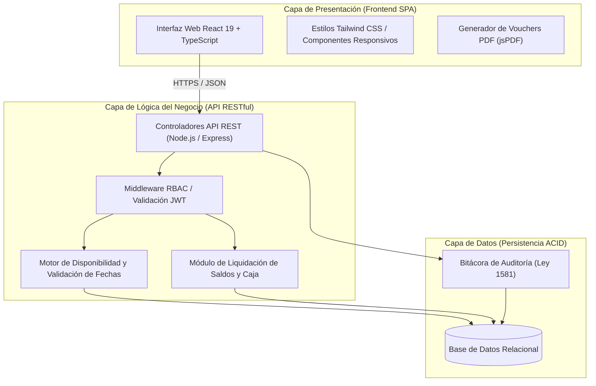
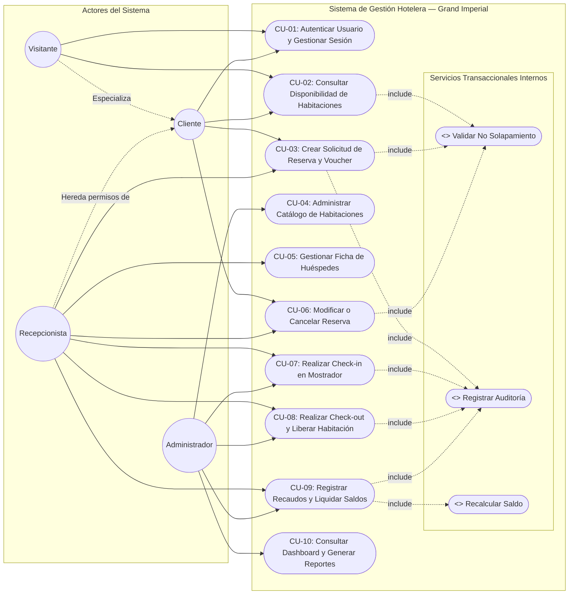

# ESPECIFICACIÓN DE REQUISITOS DE SOFTWARE (SRS)
## Sistema de Gestión y Reservas Hoteleras — Hotel Grand Imperial
**Estándar de Referencia:** IEEE Std 830-1998 / ISO/IEC/IEEE 29148:2018  

---

### Control Institucional y del Documento

| Campo | Detalle |
|---|---|
| **Proyecto** | Sistema de Gestión y Reservas Hoteleras — Hotel Grand Imperial |
| **Entidad Académica** | Servicio Nacional de Aprendizaje (SENA) |
| **Centro de Formación** | Centro de la Industria, la Empresa y los Servicios — Regional Huila |
| **Programa de Formación** | Tecnólogo en Análisis y Desarrollo de Software (ADSO) |
| **Ficha de Caracterización** | 3413988 |
| **Aprendiz / Desarrollador** | Alvaro Andrés Papamija Chala (Líder y Desarrollador de Software) |
| **Ubicación y Fecha** | Neiva, Huila — Noviembre de 2026 |
| **Versión del Documento** | 2.1.0 (Estructuración Integral Normalizada IEEE 830) |
| **Estado del Documento** | Aprobado / Línea Base de Requisitos |

---

## Contenido
1. [Introducción](#1-introducción)  
   1.1 [Planteamiento del Problema](#11-planteamiento-del-problema)  
   1.2 [Propósito del Documento](#12-propósito-del-documento)  
   1.3 [Justificación y Vigilancia Tecnológica](#13-justificación-y-vigilancia-tecnológica)  
   1.4 [Objetivos del Sistema](#14-objetivos-del-sistema)  
   1.5 [Alcance del Producto](#15-alcance-del-producto)  
   1.6 [Personal Involucrado y Matriz de Roles](#16-personal-involucrado-y-matriz-de-roles)  
   1.7 [Definiciones, Acrónimos y Abreviaturas](#17-definiciones-acrónimos-y-abreviaturas)  
   1.8 [Referencias Normativas y Marco Legal](#18-referencias-normativas-y-marco-legal)  
   1.9 [Resumen Ejecutivo](#19-resumen-ejecutivo)  
2. [Descripción General](#2-descripción-general)  
   2.1 [Perspectiva del Producto y Arquitectura](#21-perspectiva-del-producto-y-arquitectura)  
   2.2 [Características de los Usuarios](#22-características-de-los-usuarios)  
   2.3 [Restricciones Generales](#23-restricciones-generales)  
   2.4 [Suposiciones y Dependencias](#24-suposiciones-y-dependencias)  
3. [Requisitos de Interfaces Externas](#3-requisitos-de-interfaces-externas)  
   3.1 [Interfaces de Usuario](#31-interfaces-de-usuario)  
   3.2 [Interfaces de Hardware](#32-interfaces-de-hardware)  
   3.3 [Interfaces de Software](#33-interfaces-de-software)  
   3.4 [Interfaces de Comunicación](#34-interfaces-de-comunicación)  
4. [Historias de Usuario y Product Backlog](#4-historias-de-usuario-y-product-backlog)  
5. [Modelado Visual de Casos de Uso (UML)](#5-modelado-visual-de-casos-de-uso-uml)  
6. [Catálogo Detallado de Requerimientos Funcionales (RF-01 a RF-25)](#6-catálogo-detallado-de-requerimientos-funcionales-rf-01-a-rf-25)  
7. [Catálogo de Requerimientos No Funcionales (RNF-01 a RNF-10)](#7-catálogo-de-requerimientos-no-funcionales-rnf-01-a-rnf-10)  
8. [Reglas del Negocio (RN-01 a RN-14)](#8-reglas-del-negocio-rn-01-a-rn-14)  
9. [Matriz de Trazabilidad y Vacíos de Información (TBD)](#9-matriz-de-trazabilidad-y-vacíos-de-información-tbd)  

---

## 1. Introducción

### 1.1 Planteamiento del Problema
En el sector hotelero independiente y en hoteles boutique, tales como el **Hotel Grand Imperial**, la administración diaria de habitaciones, tarifas, huéspedes y cobros suele llevarse a cabo mediante canales informales y manuales: llamadas telefónicas, chats de mensajería instantánea (WhatsApp), libretas físicas de papel y hojas de cálculo no centralizadas.

Esta forma tradicional de operar genera cuatro problemas críticos:
1. **Sobreventa (Overbooking) por solapamiento de fechas:** Al no existir un motor transaccional que bloquee las habitaciones en tiempo real, se asigna con frecuencia una misma habitación a dos huéspedes distintos para períodos de fechas coincidentes o cruzadas.
2. **Descontrol financiero en mostrador y caja:** Dificultad para registrar abonos parciales, liquidar saldos pendientes al momento del check-out y conciliar recaudos efectuados en efectivo, transferencias bancarias o tarjetas manuales.
3. **Demoras y errores en la operación de recepción:** Procesos lentos de check-in (registro de llegada) y check-out (salida), pérdida de información de huéspedes y falta de trazabilidad en las llaves asignadas o habitaciones que requieren aseo o mantenimiento.
4. **Falta de visibilidad gerencial y auditoría:** Carencia de indicadores clave de desempeño (KPIs) en tiempo real, tales como tasa de ocupación diaria y mensual, ingreso promedio por habitación y cumplimiento normativo de la Ley 1581 de 2012 (Habeas Data) sobre los datos personales de los viajeros.

### 1.2 Propósito del Documento
El presente documento tiene como propósito describir de manera completa, verificable y rigurosa la Especificación de Requisitos de Software (SRS) para el desarrollo e implementación del **Sistema de Gestión y Reservas Hoteleras — Hotel Grand Imperial**. 

Constituye el acuerdo técnico y funcional formal entre los interesados del hotel (administración, recepción, clientes) y el equipo de desarrollo del programa **ADSO — SENA**, sirviendo como base contractual para el diseño de la arquitectura, la codificación, la suite de aseguramiento de calidad (QA) y el despliegue a producción.

### 1.3 Justificación y Vigilancia Tecnológica

#### 1.3.1 Justificación
En Colombia, el turismo es un eje estratégico de diversificación económica, impulsado por la **Ley 2068 de 2020 (Ley de Turismo)** y los lineamientos del **Ministerio de Comercio, Industria y Turismo (MinCIT, 2024)**. Según estadísticas del **DANE (2023)** sobre penetración digital, más del 70 % de los viajeros nacionales e internacionales consultan y reservan sus alojamientos a través de canales web.

Dotar al Hotel Grand Imperial de una plataforma web transaccional propia le permite:
- Eliminar el riesgo de dobles reservas mediante algoritmos matemáticos de no solapamiento.
- Preservar la soberanía sobre sus tarifas e inventario sin depender exclusivamente de comisiones de intermediarios.
- Profesionalizar la recepción con emisión de vouchers digitales con código QR y control de caja estricto.

#### 1.3.2 Vigilancia Tecnológica y Referentes de Mercado

| Referente de Mercado | Tipo de Solución | Aportes Identificados | Limitaciones Observadas | Diferenciador del Software Hotel Grand Imperial |
|---|---|---|---|---|
| **Agencias de Viajes Online (OTAs)** (Booking, Expedia, Despegar) | Marketplace multi-hotel global | Alcance masivo de viajeros internacionales | Comisiones elevadas (15 % a 25 % por reserva), pérdida de control directo sobre el cliente | Canal de reserva directa sin intermediarios, 0 % comisiones y contacto personalizado |
| **Sistemas PMS Tradicionales** (Cloudbeds, Opera, Sirvoy) | Software de gestión hotelera en la nube | Centralización de operaciones y reportería | Costos mensuales elevados en dólares, complejidad excesiva para hoteles pequeños y medianos | Sistema a la medida, ligero, ágil, en pesos colombianos (\$ COP) y adaptable |
| **Registros Manuales y Hojas de Cálculo** (Excel, libretas de recepción) | Registro manual de mostrador | Cero costo directo de software inicial | Errores humanos frecuentes, sobreventa, pérdida de datos y nula auditoría | Automatización transaccional total (ACID), validación matemática de fechas y reportes inmediatos |

### 1.4 Objetivos del Sistema
- **Objetivo General:**  
  Desarrollar e implementar una plataforma web transaccional centralizada para administrar habitaciones, tarifas, huéspedes, reservas en tiempo real, cobros y operaciones de mostrador (check-in/check-out) para el Hotel Grand Imperial, mitigando el error humano de sobreventa y registros físicos manuales.
- **Objetivos Específicos:**
  1. Diseñar e implementar un motor de consulta de disponibilidad que evalúe y bloquee el solapamiento de fechas con consistencia transaccional (ACID).
  2. Implementar un módulo de seguridad y autenticación mediante JSON Web Tokens (JWT) con separación estricta de privilegios por roles (Administrador, Recepcionista, Cliente).
  3. Automatizar la liquidación de costos de estadía multiplicando la tarifa base por el número exacto de noches de alojamiento.
  4. Gestionar el control de caja mediante registro de abonos parciales, liquidación de saldos y emisión de recibos oficiales y vouchers con código QR y PDF.
  5. Agilizar las operaciones de front-desk mediante flujos de Check-in con asignación de llave y Check-out con validación de saldo pendiente y cambio de estado de habitación.
  6. Proveer un tablero de control (Dashboard) con métricas en tiempo real (porcentaje de ocupación, ingresos por método de pago) y reportes ejecutivos consolidados.
  7. Garantizar la trazabilidad y auditoría de eventos críticos bajo el marco de la Ley 1581 de 2012 (Habeas Data).

### 1.5 Alcance del Producto

```
┌─────────────────────────────────────────────────────────────────────────┐
│                    ALCANCE DEL SISTEMA HOTEL GRAND IMPERIAL             │
├──────────────────────────┬─────────────────────────┬────────────────────┤
│   INCLUYE (VERSIÓN 1.0)  │  OPCIONAL CONFIRMADO    │  NO INCLUYE (FUT)  │
├──────────────────────────┼─────────────────────────┼────────────────────┤
│ • Registro y Auth (RBAC) │ • Asistente Virtual     │ • Pasarelas de     │
│ • Catálogo de cuartos    │   Chatbot Concierge FAQ │   pago automáticas │
│ • Motor disponibilidad   │ • Recomendador con IA   │   interbancarias   │
│ • Bloqueo de solapamiento│ • Cupones de descuento  │ • Cerraduras elec- │
│ • Vouchers con QR y PDF  │ • Calendario interactivo│   trónicas IoT     │
│ • Check-in y Check-out   │ • Reseñas y ratings de  │ • Channel Manager  │
│ • Control de caja/abonos │   huéspedes verificados │   multi-OTA        │
│ • Auditoría y reportes   │                         │                    │
└──────────────────────────┴─────────────────────────┴────────────────────┘
```

#### 1.5.1 Funcionalidades Incluidas (Versión 1.0 / Core)
- Módulo de autenticación con JWT, cifrado de contraseñas con bcrypt y roles de usuario (Administrador, Recepcionista, Cliente).
- Catálogo de habitaciones clasificadas por categoría, precio/noche, capacidad, piso e imágenes.
- Motor de disponibilidad en tiempo real con validación matemática contra dobles reservas.
- Registro de reservas con cálculo automático de costo por noches y emisión de voucher digital descargable en PDF con código QR dinámico.
- Registro de pagos y abonos (Efectivo, Transferencia o Tarjeta manual) con recálculo dinámico de saldos.
- Operaciones de recepción: Check-in (asociación de llave física y estado 'Ocupada') y Check-out (liquidación contable y liberación a 'Disponible').
- Tablero de control (Dashboard) con KPIs de ocupación y recaudos.
- Bitácora inmutable de auditoría para eventos críticos.

#### 1.5.2 Funcionalidades Opcionales (Fases Avanzadas Confirmadas)
- Asistente Virtual / Concierge Chatbot para responder preguntas frecuentes sobre servicios del hotel.
- Recomendador inteligente de habitaciones con IA basado en preferencias del huésped.
- Sistema de cupones promocionales de descuento y módulo de valoraciones de huéspedes.
- Calendario visual interactivo de ocupación para planeación de recepción.

#### 1.5.3 Exclusiones Explícitas (Mejoras Futuras)
- **Pasarelas de pago electrónico interbancarias automatizadas:** Los pagos con tarjeta o transferencia se asientan como comprobante manual verificado por el recepcionista; la integración directa con pasarelas (Wompi, PayU, Stripe) se contempla para fases posteriores.
- **Cerraduras inteligentes IoT:** El sistema gestiona llaves o tarjetas físicas en mostrador, sin apertura remota por radiofrecuencia o Bluetooth.
- **Channel Manager multi-OTA:** El sistema opera como motor de reservas propio del hotel, sin sincronización bidireccional automática con Booking o Airbnb en este release.

### 1.6 Personal Involucrado y Matriz de Roles

| Nombre | Rol en el Proyecto | Responsabilidades | Contacto |
|---|---|---|---|
| **Alvaro Andrés Papamija Chala** | Líder de Proyecto / Desarrollador Full Stack | Análisis de requisitos, diseño de arquitectura, codificación de frontend/backend, pruebas unitarias y documentación. | AAPC34882791@soy.sena.edu.co |
| **Administración del Hotel** | Stakeholder / Product Owner | Parametrización de tarifas, habitaciones, validación de reglas de negocio y aprobación final. | Hotel Grand Imperial |
| **Personal de Recepción** | Usuario Operativo | Pruebas de usabilidad en mostrador, check-in, check-out y liquidación de pagos. | Front-Desk Hotel |

### 1.7 Definiciones, Acrónimos y Abreviaturas
- **Check-in:** Procedimiento formal de registro de llegada física del huésped al hotel, verificación de identidad y entrega de llaves.
- **Check-out:** Procedimiento formal de entrega de la habitación por el huésped, liquidación de saldos pendientes y liberación de la habitación.
- **Overbooking (Sobreventa):** Venta de una misma habitación para fechas coincidentes que supera la capacidad física real del hotel.
- **Voucher:** Comprobante digital de reserva que acredita los datos de la estadía, fechas, titular, código alfanumérico y Código QR de verificación.
- **JWT:** JSON Web Token (RFC 7519), estándar para autenticación segura basada en tokens firmados.
- **RBAC:** Role-Based Access Control (Control de Acceso Basado en Roles).
- **SPA:** Single Page Application (Aplicación de Página Única construida en React).
- **ACID:** Atomicidad, Consistencia, Aislamiento y Durabilidad en transacciones de bases de datos.
- **KPI:** Key Performance Indicator (Indicador Clave de Desempeño).
- **Habeas Data:** Marco legal de protección de datos personales en Colombia (Ley 1581 de 2012).
- **COP:** Peso Colombiano (moneda oficial del sistema).

### 1.8 Referencias Normativas y Marco Legal
1. **IEEE Std 830-1998:** Recommended Practice for Software Requirements Specifications.
2. **ISO/IEC/IEEE 29148:2018:** Systems and software engineering — Requirements engineering.
3. **Ley 1581 de 2012 (Colombia):** Régimen General de Protección de Datos Personales (Habeas Data).
4. **Decreto 1377 de 2013 (Colombia):** Reglamentación para recolección y tratamiento de datos personales.
5. **Ley 2068 de 2020 (Ley de Turismo Colombia):** Obligaciones de registro hotelero y Registro Nacional de Turismo (RNT).

### 1.9 Resumen Ejecutivo
El Sistema de Gestión y Reservas Hoteleras para el Hotel Grand Imperial automatiza el ciclo de vida completo del huésped: desde la consulta pública de habitaciones y reserva en línea, hasta el control operativo de recepción y la toma de decisiones gerenciales. Su diseño modular y desacoplado garantiza cero condiciones de carrera en reservas simultáneas y asegura la confidencialidad de la información.

---

## 2. Descripción General

### 2.1 Perspectiva del Producto y Arquitectura
El sistema opera bajo una arquitectura cliente-servidor moderna desacoplada en tres capas:



### 2.2 Características de los Usuarios
1. **Visitante:** Usuario no autenticado que consulta el catálogo, prueba filtros de fechas y solicita registro como nuevo cliente.
2. **Cliente (Huésped):** Usuario con cuenta activa. Realiza reservas, visualiza vouchers con QR, descarga PDFs de confirmación y gestiona su historial de estadías.
3. **Recepcionista:** Usuario operativo en front-desk. Registra huéspedes presenciales, procesa entradas (Check-in), cobra abonos, liquida saldos y ejecuta salidas (Check-out).
4. **Administrador:** Superusuario con acceso global. Administra habitaciones, precios, categorías, usuarios recepcionistas, supervisa la bitácora de auditoría y analiza el dashboard y los reportes.

### 2.3 Restricciones Generales
- **Seguridad Criptográfica:** Contraseñas encriptadas con `bcrypt` (10 salt rounds). Sesiones manejadas exclusivamente con tokens JWT con expiración definida.
- **Prevención de Condiciones de Carrera:** Las consultas y reservas se ejecutan bajo transacciones atómicas para impedir que dos solicitudes simultáneas aparten la misma habitación en el mismo milisegundo.
- **Diseño Responsivo:** Compatibilidad desde teléfonos móviles (viewport mínimo de 360 px) hasta pantallas de escritorio Full HD (1920x1080 px).
- **Marco Legal:** Registro obligatorio de la aceptación de política de tratamiento de datos personales en el registro de usuarios.

### 2.4 Suposiciones y Dependencias
- Se asume que el personal del hotel y los clientes disponen de navegadores modernos con soporte de JavaScript habilitado.
- Se asume que los pagos electrónicos informados se cotejan con la cuenta bancaria del hotel antes de autorizar el check-in físico.
- Dependencia de un servidor de persistencia relacional con soporte transaccional ACID.

---

## 3. Requisitos de Interfaces Externas

### 3.1 Interfaces de Usuario
- Paleta de colores hotelera corporativa: Azul elegante (`#1e3a8a`) y Ámbar de acento (`#d97706`).
- Tipografía clara y legible, tarjetas de habitación con galería de fotos, insignias de estado destacadas (Disponible, Ocupada, Mantenimiento) y diálogos modales fluidos.

### 3.2 Interfaces de Hardware
- Dispositivos de escritorio o portátiles para el personal de recepción (resolución mínima 1024x768 px).
- Dispositivos móviles y tabletas para los clientes que reservan en línea (resolución mínima 360x640 px).

### 3.3 Interfaces de Software
- Entorno de ejecución Node.js (v18+) con Express para la API REST.
- Motor de base de datos relacional PostgreSQL o MySQL con transacciones ACID.
- Librería de generación de documentos `jsPDF` y librería de renderizado dinámico de Códigos QR.

### 3.4 Interfaces de Comunicación
- Toda la comunicación se realiza mediante protocolo seguro **HTTPS / TLS 1.3** sobre puerto estándar 443.
- Transmisión de datos en formato **JSON** estándar bajo arquitectura RESTful.
- Autorización de peticiones protegidas mediante encabezado HTTP: `Authorization: Bearer <token_jwt>`.

---

## 4. Historias de Usuario y Product Backlog

| Código | Requisito Relacionado | Historia de Usuario | Métricas y Prioridad | Criterios de Aceptación (Gherkin BDD) |
|---|---|---|:---:|---|
| **HU-01** | RF-01 | **Como** visitante,<br>**quiero** registrarme en el sistema,<br>**para** disponer de una cuenta privada y reservar habitaciones. | Prioridad: Alta<br>Est: 3 SP | **Dado** que ingreso datos personales válidos y correo nuevo,<br>**cuando** presiono 'Registrarse',<br>**entonces** el sistema crea mi cuenta 'Cliente' y encripta mi clave con bcrypt. |
| **HU-02** | RF-02 | **Como** usuario registrado,<br>**quiero** iniciar sesión con mis credenciales,<br>**para** acceder al panel de mi rol. | Prioridad: Alta<br>Est: 3 SP | **Dado** que mis credenciales son correctas y mi cuenta está activa,<br>**cuando** inicio sesión,<br>**entonces** recibo mi token JWT y accedo al panel correspondiente. |
| **HU-03** | RF-05 | **Como** administrador,<br>**quiero** registrar nuevas habitaciones,<br>**para** ampliar la oferta disponible del hotel. | Prioridad: Alta<br>Est: 5 SP | **Dado** que ingreso número no existente, tarifa y capacidad,<br>**cuando** guardo la habitación,<br>**entonces** queda creada en estado 'Disponible' en el inventario. |
| **HU-04** | RF-06, RF-07 | **Como** administrador,<br>**quiero** editar tarifas o desactivar habitaciones lógicamente,<br>**para** actualizar el catálogo sin romper reservas pasadas. | Prioridad: Media<br>Est: 5 SP | **Dado** que desactivo una habitación (`activo = 0`),<br>**cuando** se realizan búsquedas,<br>**entonces** no aparece disponible pero se preserva su historial de reservas. |
| **HU-05** | RF-08, RF-09 | **Como** recepcionista,<br>**quiero** registrar huéspedes verificando su documento,<br>**para** prevenir registros duplicados. | Prioridad: Alta<br>Est: 5 SP | **Dado** que ingreso tipo y número de documento nuevo,<br>**cuando** confirmo el registro,<br>**entonces** el huésped queda habilitado para asociarle estadías. |
| **HU-06** | RF-10, RF-11 | **Como** cliente o recepcionista,<br>**quiero** buscar disponibilidad por rango de fechas,<br>**para** conocer qué habitaciones están libres sin sobreventa. | Prioridad: Alta<br>Est: 8 SP | **Dado** que selecciono fechas válidas ($S > E$),<br>**cuando** consulto disponibilidad,<br>**entonces** el sistema excluye habitaciones ocupadas y calcula `Total = precio_noche * noches`. |
| **HU-07** | RF-12, RF-13, RF-14 | **Como** cliente autenticado,<br>**quiero** reservar una habitación y recibir mi voucher,<br>**para** asegurar mi estadía en el hotel. | Prioridad: Alta<br>Est: 8 SP | **Dado** que elijo una habitación desocupada,<br>**cuando** confirmo la reserva,<br>**entonces** se emite el código `RES-YYYYMM-XXXX` con su Voucher y Código QR. |
| **HU-08** | RF-15 | **Como** recepcionista o admin,<br>**quiero** modificar fechas de una reserva activa,<br>**para** atender solicitudes de huéspedes revalidando disponibilidad. | Prioridad: Media<br>Est: 5 SP | **Dado** que modifico las fechas sin cruces de ocupación,<br>**cuando** guardo cambios,<br>**entonces** se actualiza la reserva y se recalcula el costo total. |
| **HU-09** | RF-17, RF-24 | **Como** cliente,<br>**quiero** consultar únicamente mis reservas,<br>**para** verificar mis vouchers y pagos de forma privada. | Prioridad: Media<br>Est: 3 SP | **Dado** que inicio sesión como Cliente,<br>**cuando** entro a 'Mis Reservas',<br>**entonces** solo visualizo las reservas asociadas a mi identificador de usuario. |
| **HU-10** | RF-18, RF-19 | **Como** recepcionista,<br>**quiero** registrar abonos y pagos de una reserva,<br>**para** liquidar saldos y emitir comprobantes de caja. | Prioridad: Alta<br>Est: 5 SP | **Dado** que registro un abono de \$100.000 COP,<br>**cuando** guardo la transacción,<br>**entonces** el saldo se actualiza: `Saldo = Total - Pagos Realizados`. |
| **HU-11** | RF-20 | **Como** recepcionista,<br>**quiero** registrar el Check-in al llegar el huésped,<br>**para** entregar la llave y marcar la habitación ocupada. | Prioridad: Alta<br>Est: 5 SP | **Dado** que la reserva está 'Confirmada',<br>**cuando** registro el check-in con la llave asignada,<br>**entonces** la habitación pasa a 'Ocupada' y se registra en auditoría. |
| **HU-12** | RF-21 | **Como** recepcionista,<br>**quiero** registrar el Check-out a la salida del huésped,<br>**para** cerrar la cuenta y liberar la habitación a disponible. | Prioridad: Alta<br>Est: 5 SP | **Dado** que el huésped entrega la habitación y saldo es \$0 COP,<br>**cuando** confirmo la salida,<br>**entonces** la reserva pasa a 'Finalizada' y la habitación a 'Disponible'. |
| **HU-13** | RF-04, RF-25 | **Como** administrador,<br>**quiero** gestionar usuarios y sus roles (RBAC),<br>**para** garantizar que cada usuario acceda solo a lo autorizado. | Prioridad: Alta<br>Est: 5 SP | **Dado** que asigno rol 'Recepcionista' a un usuario,<br>**cuando** este inicia sesión,<br>**entonces** no puede acceder a reportes ejecutivos ni eliminar cuartos. |
| **HU-14** | RF-16 | **Como** cliente o recepcionista,<br>**quiero** cancelar una reserva activa,<br>**para** liberar inmediatamente el cupo si no se viajará. | Prioridad: Media<br>Est: 3 SP | **Dado** que la reserva está vigente y no ha finalizado,<br>**cuando** confirmo la cancelación con motivo,<br>**entonces** la habitación queda libre de inmediato en el motor de búsqueda. |
| **HU-15** | RF-23 | **Como** administrador,<br>**quiero** ver tarjetas con KPIs y gráficos de ocupación,<br>**para** conocer el estado general del hotel en tiempo real. | Prioridad: Media<br>Est: 5 SP | **Dado** que abro el Dashboard,<br>**cuando** carga la pantalla,<br>**entonces** veo la tasa de ocupación porcentual, ingresos por medio de pago y cuartos libres. |
| **HU-16** | RF-22 | **Como** administrador,<br>**quiero** generar reportes consolidados mensuales,<br>**para** soportar las conciliaciones contables y operativas. | Prioridad: Media<br>Est: 5 SP | **Dado** que selecciono un mes calendario,<br>**cuando** solicito el reporte,<br>**entonces** el sistema emite el consolidado de reservas, cancelaciones e ingresos totales. |
| **HU-17** | RF-03 | **Como** cualquier usuario autenticado,<br>**quiero** cerrar sesión de forma segura,<br>**para** proteger mi cuenta en equipos compartidos. | Prioridad: Alta<br>Est: 2 SP | **Dado** que presiono 'Cerrar Sesión',<br>**cuando** el sistema procesa la solicitud,<br>**entonces** destruye el token local y redirige a la página pública. |

---

## 5. Modelado Visual de Casos de Uso (UML)



---

## 6. Catálogo Detallado de Requerimientos Funcionales (RF-01 a RF-25)

| Identificador: RF-01 | Nombre: Registro de clientes |
|---|---|
| **Tipo:** Necesario (Must Have) | **Requerimiento relacionado:** RF-02 (Inicio de sesión), RF-25 (Control de acceso RBAC) | **¿Crítico?** Sí |
| **Prioridad de desarrollo:** Alta | **Documentos de visualización asociados:** Formulario de registro público / Modal de autenticación. |
| **Entradas:** • Nombres y apellidos completos.<br>• Correo electrónico válido.<br>• Contraseña en texto plano (mínimo 6 caracteres).<br>• Consentimiento de política de tratamiento de datos (Ley 1581 de 2012). | **Salidas:** • Cuenta creada con rol 'Cliente' y estado 'Activo'.<br>• Contraseña encriptada mediante bcrypt (10 rounds).<br>• Token JWT expedido para inicio de sesión inmediato.<br>• Mensaje de confirmación en pantalla. |
| **Descripción:** El sistema deberá permitir a personas externas registrarse como clientes para obtener una cuenta privada que les permita reservar habitaciones en línea y consultar sus vouchers de estadía. |
| **Manejo de situaciones anormales:** • Correo duplicado: emitir HTTP 400 con mensaje: "El correo electrónico ya se encuentra registrado".<br>• Contraseña menor a 6 caracteres: mostrar advertencia: "La contraseña debe tener al menos 6 caracteres".<br>• Sin aceptación de datos personales: bloquear el botón con alerta obligatoria. |
| **Criterios de aceptación:** • El usuario completa el registro exitosamente con datos válidos.<br>• Ninguna contraseña se guarda en texto plano.<br>• El sistema impide cuentas duplicadas con el mismo correo electrónico. |

| Identificador: RF-02 | Nombre: Inicio de sesión |
|---|---|
| **Tipo:** Necesario (Must Have) | **Requerimiento relacionado:** RF-01 (Registro), RF-03 (Cierre de sesión), RF-25 (RBAC) | **¿Crítico?** Sí |
| **Prioridad de desarrollo:** Alta | **Documentos de visualización asociados:** Modal / Pantalla de login. |
| **Entradas:** • Correo electrónico registrado.<br>• Contraseña del usuario. | **Salidas:** • Token JWT firmado con claims (`id`, `nombre`, `email`, `rol`).<br>• Redirección a la interfaz según rol (Dashboard para Admin, Recepción para Recepcionista, Mis Reservas para Cliente). |
| **Descripción:** El sistema deberá validar las credenciales suministradas contra la base de datos y expedir un token de autorización JWT con tiempo de expiración de 8 horas para proteger las transacciones. |
| **Manejo de situaciones anormales:** • Credenciales inválidas: responder con HTTP 401 Unauthorized: "Credenciales incorrectas" sin revelar si el error fue el correo o la contraseña.<br>• Cuenta inactiva (`activo = 0`): rechazar el acceso indicando que la cuenta ha sido deshabilitada. |
| **Criterios de aceptación:** • Credenciales válidas conceden acceso inmediato.<br>• Peticiones erróneas no filtran información sensible.<br>• El token se almacena en almacenamiento seguro de sesión. |

| Identificador: RF-03 | Nombre: Cierre de sesión |
|---|---|
| **Tipo:** Necesario (Must Have) | **Requerimiento relacionado:** RF-02 (Inicio de sesión) | **¿Crítico?** Sí |
| **Prioridad de desarrollo:** Alta | **Documentos de visualización asociados:** Barra de navegación / Menú de cuenta. |
| **Entradas:** • Solicitud explícita de cerrar sesión. | **Salidas:** • Token JWT eliminado del almacenamiento del cliente.<br>• Redirección inmediata a la vista pública de inicio. |
| **Descripción:** El sistema deberá permitir al usuario autenticado invalidar su sesión en cualquier momento, destruyendo el token de acceso local y restringiendo cualquier intento de navegación hacia rutas privadas. |
| **Manejo de situaciones anormales:** • Intento de navegación hacia rutas protegidas tras cerrar sesión: redirección automática a la vista de login. |
| **Criterios de aceptación:** • Al presionar 'Cerrar Sesión', el estado de autenticación se reinicia inmediatamente.<br>• El usuario no puede volver a rutas privadas mediante el botón 'Atrás' del navegador sin autenticarse. |

| Identificador: RF-04 | Nombre: Gestión de usuarios |
|---|---|
| **Tipo:** Necesario (Should Have) | **Requerimiento relacionado:** RF-01 (Registro), RF-25 (Control de acceso RBAC) | **¿Crítico?** Sí |
| **Prioridad de desarrollo:** Media | **Documentos de visualización asociados:** Módulo administrativo de usuarios y clientes. |
| **Entradas:** • Nombres, apellidos, correo, rol asignado (`Administrador`, `Recepcionista`, `Cliente`) y estado de cuenta (`activo = 1 / 0`). | **Salidas:** • Usuario registrado o actualizado en base de datos.<br>• Lista de usuarios filtrable por rol y estado. |
| **Descripción:** El administrador podrá crear, editar, listar y desactivar cuentas de usuarios del hotel, garantizando el principio de menor privilegio en la asignación de roles. |
| **Manejo de situaciones anormales:** • Intento de creación con correo existente: mostrar error de duplicidad.<br>• Intento de auto-desactivación del único administrador: el sistema bloquea la acción para evitar bloqueo total de la plataforma. |
| **Criterios de aceptación:** • El administrador crea recepcionistas con permisos operativos.<br>• La desactivación lógica de una cuenta impide inmediatamente su inicio de sesión sin eliminar sus registros históricos. |

| Identificador: RF-05 | Nombre: Creación de habitaciones |
|---|---|
| **Tipo:** Necesario (Must Have) | **Requerimiento relacionado:** RF-06 (Modificación de habitaciones), RF-08 (Tipos de habitación) | **¿Crítico?** Sí |
| **Prioridad de desarrollo:** Alta | **Documentos de visualización asociados:** Módulo de habitaciones / Formulario de nueva habitación. |
| **Entradas:** • Número de habitación (ej. 101, 204).<br>• Categoría o tipo de habitación.<br>• Precio base por noche en \$ COP.<br>• Capacidad máxima de personas.<br>• Piso de ubicación.<br>• Lista de comodidades (Wi-Fi, aire acondicionado, balcón, TV).<br>• URL o archivo de imagen representativa. | **Salidas:** • Registro de habitación guardado en la tabla `habitaciones` en estado inicial 'Disponible'.<br>• Visualización inmediata en el catálogo administrativo. |
| **Descripción:** El administrador podrá dar de alta nuevas habitaciones en el inventario del hotel suministrando sus especificaciones físicas y tarifarias. |
| **Manejo de situaciones anormales:** • Número de habitación repetido: rechazar con HTTP 400 indicando: "La habitación con el número X ya se encuentra registrada".<br>• Precio menor o igual a \$0 COP: bloquear guardado por tarifa inválida. |
| **Criterios de aceptación:** • El sistema valida la unicidad del número de habitación.<br>• Los campos obligatorios son validados antes de persistir en base de datos. |

| Identificador: RF-06 | Nombre: Modificación de habitaciones |
|---|---|
| **Tipo:** Necesario (Should Have) | **Requerimiento relacionado:** RF-05 (Creación de habitaciones) | **¿Crítico?** No |
| **Prioridad de desarrollo:** Media | **Documentos de visualización asociados:** Formulario de edición de habitación. |
| **Entradas:** • Nuevas tarifas, comodidades, capacidad o imágenes de la habitación. | **Salidas:** • Habitación actualizada en base de datos.<br>• Actualización en tiempo real del catálogo público. |
| **Descripción:** El administrador podrá actualizar los atributos de una habitación existente. Los cambios de tarifa solo aplicarán a futuras reservas, sin modificar el precio pactado en reservas ya confirmadas (RN-14). |
| **Manejo de situaciones anormales:** • Capacidad menor a 1 persona: mostrar error de validación. |
| **Criterios de aceptación:** • Las modificaciones se reflejan de inmediato en futuras consultas de disponibilidad. |

| Identificador: RF-07 | Nombre: Desactivación de habitaciones |
|---|---|
| **Tipo:** Necesario (Must Have) | **Requerimiento relacionado:** RF-05 (Creación), RF-10 (Motor de disponibilidad) | **¿Crítico?** Sí |
| **Prioridad de desarrollo:** Alta | **Documentos de visualización asociados:** Panel de habitaciones. |
| **Entradas:** • Selección de habitación y confirmación de desactivación. | **Salidas:** • Campo `activo = 0` o estado cambiado a 'En Mantenimiento'. |
| **Descripción:** El sistema deberá permitir la desactivación lógica de habitaciones para que no aparezcan disponibles ante los clientes, preservando la integridad referencial de reservas pasadas. |
| **Manejo de situaciones anormales:** • Si la habitación tiene reservas activas futuras: emitir alerta de advertencia al administrador antes de confirmar. |
| **Criterios de aceptación:** • La habitación desactivada queda excluida automáticamente del motor de búsqueda (RN-04).<br>• Ningún registro histórico de reservas se elimina físicamente. |

| Identificador: RF-08 | Nombre: Administración de tipos de habitación |
|---|---|
| **Tipo:** Necesario (Should Have) | **Requerimiento relacionado:** RF-05 (Creación de habitaciones) | **¿Crítico?** No |
| **Prioridad de desarrollo:** Media | **Documentos de visualización asociados:** Módulo de tipos de habitación. |
| **Entradas:** • Nombre del tipo (Sencilla, Doble, Matrimonial, Familiar, Suite Presidencial), descripción y tarifa sugerida. | **Salidas:** • Categoría registrada y disponible para asociar a habitaciones. |
| **Descripción:** El administrador podrá parametrizar y organizar las categorías de alojamiento del hotel para estructurar el catálogo. |
| **Manejo de situaciones anormales:** • Nombre de categoría duplicado: mostrar advertencia de registro existente. |
| **Criterios de aceptación:** • Las categorías creadas aparecen en los filtros del catálogo de búsqueda. |

| Identificador: RF-09 | Nombre: Registro de huéspedes |
|---|---|
| **Tipo:** Necesario (Must Have) | **Requerimiento relacionado:** RF-12 (Creación de reservas), RF-20 (Check-in) | **¿Crítico?** Sí |
| **Prioridad de desarrollo:** Alta | **Documentos de visualización asociados:** Módulo de recepción / Formulario de huéspedes. |
| **Entradas:** • Tipo de documento (CC, CE, Pasaporte), número de documento, nombres, apellidos, teléfono, correo electrónico y ciudad/país de procedencia. | **Salidas:** • Huésped registrado en la base de datos.<br>• Asociación automática con la reserva correspondiente. |
| **Descripción:** El sistema registrará la información de huéspedes titulares impidiendo la duplicidad en la combinación de `tipo_documento` y `numero_documento` para cumplir con la normatividad turística colombiana. |
| **Manejo de situaciones anormales:** • Documento ya registrado: cargar la ficha del huésped para reutilizar sus datos y agilizar el proceso. |
| **Criterios de aceptación:** • No se duplican fichas de huéspedes.<br>• Los datos de contacto son obligatorios para emitir el voucher y recibos. |

| Identificador: RF-10 | Nombre: Motor de disponibilidad |
|---|---|
| **Tipo:** Necesario (Must Have) | **Requerimiento relacionado:** RF-11 (Filtrado), RF-13 (Cronología), RF-12 (Creación de reservas) | **¿Crítico?** Sí |
| **Prioridad de desarrollo:** Alta | **Documentos de visualización asociados:** Barra de búsqueda de disponibilidad / Pantalla de catálogo. |
| **Entradas:** • Fecha de check-in ($E$).<br>• Fecha de check-out ($S$).<br>• Cantidad de huéspedes. | **Salidas:** • Lista de habitaciones físicamente libres en ese rango, excluyendo solapamientos y mantenimientos.<br>• Cálculo automático de número de noches y valor total. |
| **Descripción:** El sistema evaluará el inventario descartando habitaciones que tengan reservas activas (Pendientes o Confirmadas) cuyos intervalos temporales se crucen con el rango solicitado (RN-01). |
| **Manejo de situaciones anormales:** • Fecha de salida menor o igual a fecha de entrada: bloquear la búsqueda y mostrar: "La fecha de salida debe ser posterior a la fecha de entrada".<br>• Cero habitaciones disponibles: mostrar: "No hay habitaciones disponibles para esas fechas". |
| **Criterios de aceptación:** • Cero reservas superpuestas generadas.<br>• Exclusión estricta de habitaciones en mantenimiento. |

| Identificador: RF-11 | Nombre: Filtrado de inventario |
|---|---|
| **Tipo:** Necesario (Could Have) | **Requerimiento relacionado:** RF-10 (Motor de disponibilidad) | **¿Crítico?** No |
| **Prioridad de desarrollo:** Media | **Documentos de visualización asociados:** Filtros laterales del catálogo. |
| **Entradas:** • Rango de precio mínimo y máximo en \$ COP, categoría de habitación y capacidad de personas. | **Salidas:** • Cuadrícula de habitaciones actualizada de forma instantánea. |
| **Descripción:** El usuario podrá refinar la lista de habitaciones disponibles aplicando filtros combinados sin recargar la página. |
| **Manejo de situaciones anormales:** • Sin resultados: mostrar mensaje informativo ofreciendo reiniciar filtros. |
| **Criterios de aceptación:** • Los filtros se aplican en memoria con tiempo de respuesta inferior a 100 ms. |

| Identificador: RF-12 | Nombre: Creación de reservas |
|---|---|
| **Tipo:** Necesario (Must Have) | **Requerimiento relacionado:** RF-10 (Disponibilidad), RF-13 (Cronología), RF-14 (Liquidación de costo) | **¿Crítico?** Sí |
| **Prioridad de desarrollo:** Alta | **Documentos de visualización asociados:** Modal de reserva / Pantalla de confirmación. |
| **Entradas:** • Habitación seleccionada, fechas de estadía, datos del titular y anticipo opcional. | **Salidas:** • Registro en la tabla `reservas` en estado 'Confirmada'.<br>• Código único alfanumérico (ej. `RES-202611-9575`).<br>• Emisión de Voucher con Código QR dinámico. |
| **Descripción:** Vinculará una habitación disponible a un titular durante el período validado, revalidando la no existencia de carreras concurrentes antes de realizar la inserción. |
| **Manejo de situaciones anormales:** • Conflicto de concurrencia: si otro usuario reservó en el mismo instante, abortar y notificar al usuario (HTTP 409). |
| **Criterios de aceptación:** • La habitación queda bloqueada en el calendario para esas fechas.<br>• El voucher muestra fechas, titular, desglose de costos y QR. |

| Identificador: RF-13 | Nombre: Validación de cronología |
|---|---|
| **Tipo:** Necesario (Must Have) | **Requerimiento relacionado:** RF-10 (Disponibilidad), RF-12 (Creación de reservas) | **¿Crítico?** Sí |
| **Prioridad de desarrollo:** Alta | **Documentos de visualización asociados:** Validaciones de formularios de fecha. |
| **Entradas:** • Fecha de entrada y fecha de salida seleccionadas. | **Salidas:** • Aprobación de rango cronológico válido o bloqueo con mensaje de error. |
| **Descripción:** El sistema exigirá estrictamente que la fecha de check-out sea posterior a la de check-in, garantizando una estadía mínima de 1 noche ($S > E$, estadía mínima 1 noche). |
| **Manejo de situaciones anormales:** • Fecha de entrada en el pasado: bloquear fecha indicando que debe ser igual o posterior a la fecha actual. |
| **Criterios de aceptación:** • No se admiten reservas con fechas invertidas o con 0 noches de estadía. |

| Identificador: RF-14 | Nombre: Liquidación automática del costo |
|---|---|
| **Tipo:** Necesario (Must Have) | **Requerimiento relacionado:** RF-12 (Creación de reservas), RF-19 (Liquidación de saldos) | **¿Crítico?** Sí |
| **Prioridad de desarrollo:** Alta | **Documentos de visualización asociados:** Resumen de reserva / Voucher. |
| **Entradas:** • Tarifa por noche de la habitación y cantidad exacta de noches calculadas. | **Salidas:** • Valor total liquidado: `Total = precio_noche * noches`. |
| **Descripción:** El sistema computará el costo total multiplicando la tarifa diaria de la habitación por el número exacto de noches de alojamiento, sin intervención manual de cálculo. |
| **Manejo de situaciones anormales:** • Rango de fechas anómalo: recalcular automáticamente antes de persistir. |
| **Criterios de aceptación:** • El cálculo es exacto en pesos colombianos (\$ COP) y se congela en la reserva (RN-14). |

| Identificador: RF-15 | Nombre: Modificación de reservas |
|---|---|
| **Tipo:** Necesario (Should Have) | **Requerimiento relacionado:** RF-10 (Disponibilidad), RF-12 (Creación de reservas) | **¿Crítico?** No |
| **Prioridad de desarrollo:** Media | **Documentos de visualización asociados:** Detalle de reserva en recepción. |
| **Entradas:** • Nuevas fechas de check-in / check-out o cambio de habitación. | **Salidas:** • Reserva actualizada, nuevo costo liquidado y ajuste del saldo pendiente. |
| **Descripción:** El recepcionista o administrador podrá cambiar las fechas de una reserva activa revalidando la disponibilidad en tiempo real contra solapamientos. |
| **Manejo de situaciones anormales:** • Nuevas fechas ocupadas: impedir el guardado notificando conflicto de fechas. |
| **Criterios de aceptación:** • La modificación revalida disponibilidad y actualiza los saldos contables. |

| Identificador: RF-16 | Nombre: Cancelación de reservas |
|---|---|
| **Tipo:** Necesario (Must Have) | **Requerimiento relacionado:** RF-10 (Disponibilidad), RF-12 (Creación de reservas) | **¿Crítico?** Sí |
| **Prioridad de desarrollo:** Alta | **Documentos de visualización asociados:** Detalle de reserva / Mis reservas. |
| **Entradas:** • ID de reserva y motivo de anulación. | **Salidas:** • Reserva en estado 'Cancelada'.<br>• Intervalo de fechas liberado inmediatamente en el motor de búsqueda. |
| **Descripción:** Permitirá anular una reserva activa y liberar la habitación en el motor de disponibilidad de forma inmediata (RN-05). |
| **Manejo de situaciones anormales:** • Intento de cancelar reserva 'Finalizada': bloquear acción por inmutabilidad de estadías cerradas (RN-07). |
| **Criterios de aceptación:** • Las fechas quedan disponibles al instante para otros clientes. |

| Identificador: RF-17 | Nombre: Historial de reservas |
|---|---|
| **Tipo:** Necesario (Should Have) | **Requerimiento relacionado:** RF-24 (Aislamiento de reservas propias) | **¿Crítico?** No |
| **Prioridad de desarrollo:** Media | **Documentos de visualización asociados:** Vista 'Mis Reservas' (Cliente) / 'Gestión de Reservas' (Recepción). |
| **Entradas:** • Filtros de estado (`Pendiente`, `Confirmada`, `Ocupada`, `Finalizada`, `Cancelada`) y fechas. | **Salidas:** • Listado tabular de reservas con opción de ver voucher y detalle. |
| **Descripción:** Permitirá consultar el historial de reservas registradas con filtros por estado, respetando el aislamiento de privilegios según el rol autenticado. |
| **Manejo de situaciones anormales:** • Sin reservas registradas: mostrar mensaje informativo. |
| **Criterios de aceptación:** • Los clientes solo ven sus propias reservas (RF-24). Recepcionistas ven todas las reservas. |

| Identificador: RF-18 | Nombre: Registro de pagos |
|---|---|
| **Tipo:** Necesario (Must Have) | **Requerimiento relacionado:** RF-19 (Liquidación de saldos) | **¿Crítico?** Sí |
| **Prioridad de desarrollo:** Alta | **Documentos de visualización asociados:** Formulario de registro de pagos / Módulo de caja. |
| **Entradas:** • ID de reserva, monto abonado en \$ COP y método de pago (Efectivo, Transferencia o Tarjeta manual). | **Salidas:** • Registro en la tabla `pagos` con número de comprobante.<br>• Recibo oficial imprimible generado. |
| **Descripción:** El personal de recepción o administración podrá asentar abonos y pagos asociados a una reserva, actualizando el estado financiero de la cuenta. |
| **Manejo de situaciones anormales:** • Abono superior al saldo pendiente: el sistema valida y advierte sobre el cobro de excedentes no autorizados. |
| **Criterios de aceptación:** • Todo pago genera un comprobante con fecha, monto, método y usuario que recaudó. |

| Identificador: RF-19 | Nombre: Liquidación de saldos |
|---|---|
| **Tipo:** Necesario (Must Have) | **Requerimiento relacionado:** RF-18 (Registro de pagos), RF-21 (Check-out) | **¿Crítico?** Sí |
| **Prioridad de desarrollo:** Alta | **Documentos de visualización asociados:** Detalle de cuenta en reserva / Recibo de caja. |
| **Entradas:** • Valor total de la reserva y suma histórica de abonos registrados. | **Salidas:** • Cálculo del saldo: `Saldo Pendiente = Total - Pagos Realizados`.<br>• Estado de pago actualizado (`Pendiente`, `Parcial` o `Pagado`). |
| **Descripción:** El sistema calculará en tiempo real el saldo pendiente de una reserva. Si el saldo llega a \$0 COP, el estado de pago pasará automáticamente a 'Pagado'. |
| **Manejo de situaciones anormales:** • Errores de redondeo: cálculos manejados en enteros en pesos colombianos (\$ COP). |
| **Criterios de aceptación:** • El saldo se actualiza de manera instantánea tras asentar cada recaudo. |

| Identificador: RF-20 | Nombre: Ejecución de Check-in |
|---|---|
| **Tipo:** Necesario (Must Have) | **Requerimiento relacionado:** RF-09 (Huéspedes), RF-12 (Reservas) | **¿Crítico?** Sí |
| **Prioridad de desarrollo:** Alta | **Documentos de visualización asociados:** Módulo de recepción / Pestaña 'Llegadas'. |
| **Entradas:** • ID de reserva confirmada, número de llave o tarjeta física entregada y observaciones de llegada. | **Salidas:** • Registro de fecha y hora exacta en `fecha_checkin`.<br>• Estado de la habitación cambiado a 'Ocupada'.<br>• Evento registrado en auditoría. |
| **Descripción:** El recepcionista registrará la entrada física del huésped al hotel, asociando la llave y actualizando el estado de la habitación en el inventario. |
| **Manejo de situaciones anormales:** • Intento de check-in a reserva cancelada o finalizada: bloquear acción con mensaje de reserva inactiva. |
| **Criterios de aceptación:** • La habitación figura inmediatamente como 'Ocupada' en el dashboard y calendario. |

| Identificador: RF-21 | Nombre: Ejecución de Check-out |
|---|---|
| **Tipo:** Necesario (Must Have) | **Requerimiento relacionado:** RF-19 (Liquidación de saldos), RF-20 (Check-in) | **¿Crítico?** Sí |
| **Prioridad de desarrollo:** Alta | **Documentos de visualización asociados:** Módulo de recepción / Pestaña 'Salidas'. |
| **Entradas:** • Selección de habitación de salida y confirmación de entrega de llaves. | **Salidas:** • Registro de `fecha_checkout`.<br>• Estado de reserva cambiado a 'Finalizada'.<br>• Estado de habitación cambiado a 'Disponible' (o 'Limpieza'). |
| **Descripción:** El recepcionista registrará la salida del huésped al terminar su estadía, verificando previamente que el saldo pendiente sea \$0 COP. |
| **Manejo de situaciones anormales:** • Saldo pendiente mayor a \$0 COP: emitir alerta destacada exigiendo liquidación o autorización expresa antes de cerrar la cuenta. |
| **Criterios de aceptación:** • La reserva finalizada queda inmutable (RN-07) y la habitación queda liberada. |

| Identificador: RF-22 | Nombre: Reportes consolidados |
|---|---|
| **Tipo:** Necesario (Should Have) | **Requerimiento relacionado:** RF-23 (Dashboard gerencial) | **¿Crítico?** No |
| **Prioridad de desarrollo:** Media | **Documentos de visualización asociados:** Módulo de reportes administrativos. |
| **Entradas:** • Parámetros de consulta (mes, año, canal de reserva). | **Salidas:** • Informe consolidado de ocupación mensual, cancelaciones e ingresos discriminados por método de pago. |
| **Descripción:** Generará reportes ejecutivos consolidados para respaldar el análisis contable y financiero del Hotel Grand Imperial. |
| **Manejo de situaciones anormales:** • Período sin movimientos: emitir reporte con valores en \$0 COP y mensaje informativo. |
| **Criterios de aceptación:** • Los reportes calculan sumatorias exactas y coinciden con las transacciones de caja. |

| Identificador: RF-23 | Nombre: Tablero de mando (Dashboard) |
|---|---|
| **Tipo:** Necesario (Should Have) | **Requerimiento relacionado:** RF-22 (Reportes), RF-20 (Check-in), RF-21 (Check-out) | **¿Crítico?** No |
| **Prioridad de desarrollo:** Media | **Documentos de visualización asociados:** Dashboard principal del administrador. |
| **Entradas:** • Carga del panel gerencial. | **Salidas:** • Tarjetas de KPIs en tiempo real: tasa de ocupación porcentual `(Habitaciones Ocupadas / Total Habitaciones Activas) * 100`, ingresos totales y estado del inventario. |
| **Descripción:** Presentará indicadores clave de desempeño en tiempo real y gráficos de ocupación para facilitar la supervisión del establecimiento. |
| **Manejo de situaciones anormales:** • Error de conexión: mostrar estado de reintento en las tarjetas métricas. |
| **Criterios de aceptación:** • Las métricas se actualizan de forma reactiva al registrarse check-in, check-out o pagos. |

| Identificador: RF-24 | Nombre: Aislamiento de reservas propias |
|---|---|
| **Tipo:** Necesario (Must Have) | **Requerimiento relacionado:** RF-17 (Historial de reservas), RF-25 (Control de acceso RBAC) | **¿Crítico?** Sí |
| **Prioridad de desarrollo:** Alta | **Documentos de visualización asociados:** Vista de reservas del cliente. |
| **Entradas:** • Token JWT del cliente autenticado. | **Salidas:** • Consulta filtrada estrictamente por `usuario_id = req.user.id`. |
| **Descripción:** El sistema garantizará que los usuarios con rol Cliente solo puedan visualizar y gestionar sus propias reservas, rechazando peticiones de acceso a IDs ajenos con HTTP 403 Forbidden. |
| **Manejo de situaciones anormales:** • Manipulación de URL con ID de reserva ajena: denegar acceso y asentar alerta de seguridad. |
| **Criterios de aceptación:** • Aislamiento 100 % verificado entre cuentas de clientes distintos. |

| Identificador: RF-25 | Nombre: Control de acceso por roles (RBAC) |
|---|---|
| **Tipo:** Necesario (Must Have) | **Requerimiento relacionado:** RF-02 (Login), RF-04 (Gestión de usuarios) | **¿Crítico?** Sí |
| **Prioridad de desarrollo:** Alta | **Documentos de visualización asociados:** Middlewares de rutas en backend y guards de rutas en frontend. |
| **Entradas:** • Token JWT y rol adjunto en la cabecera `Authorization`. | **Salidas:** • Autorización concedida o rechazo con código HTTP 403 Forbidden. |
| **Descripción:** Restringirá el acceso a endpoints de la API y vistas del frontend según la matriz de privilegios: Administrador (acceso total), Recepcionista (operaciones de mostrador y caja) y Cliente (reserva y vouchers propios). |
| **Manejo de situaciones anormales:** • Usuario sin privilegios intentando invocar endpoints de reportes o administración: bloqueo inmediato con HTTP 403. |
| **Criterios de aceptación:** • Ninguna ruta administrativa es accesible sin el rol 'Administrador'. |

---

## 7. Catálogo de Requerimientos No Funcionales (RNF-01 a RNF-10)

| Código: RNF-01 | Nombre: Usabilidad de interfaz | Grado de necesidad: Alta |
|---|---|---|
| **Descripción:** Diseño UI/UX intuitivo basado en paleta hotelera (#1e3a8a / #d97706), tipografía legible y modales rápidos. |
| **Detalle cuantitativo:** Puntuación en escala System Usability Scale (SUS) > 80 puntos; tiempo promedio para completar una reserva inferior a 2 minutos. |
| **Efecto colateral:** Requiere diseño centrado en el usuario y pruebas con usuarios muestra. |

| Código: RNF-02 | Nombre: Seguridad de autenticación | Grado de necesidad: Alta |
|---|---|---|
| **Descripción:** Cifrado unidireccional de contraseñas con bcryptjs (10 salt rounds) y tokens JWT con firma criptográfica. |
| **Detalle cuantitativo:** 0 contraseñas en texto plano en base de datos; tokens firmados con caducidad de 8 horas y protección contra manipulación. |
| **Efecto colateral:** Costo computacional mínimo en el servidor durante el hashing de claves al iniciar sesión. |

| Código: RNF-03 | Nombre: Rendimiento de consultas | Grado de necesidad: Alta |
|---|---|---|
| **Descripción:** Consultas a la API resueltas con baja latencia gracias a índices relacionales en fechas y documentos. |
| **Detalle cuantitativo:** Latencia percentil 95 ($P_{95}$) menor a 300 ms con concurrencia nominal de 50 usuarios simultáneos. |
| **Efecto colateral:** Mantenimiento de índices B-tree sobre columnas `fecha_checkin`, `fecha_checkout` y `numero_documento`. |

| Código: RNF-04 | Nombre: Disponibilidad del servicio | Grado de necesidad: Alta |
|---|---|---|
| **Descripción:** Base de datos relacional transaccional (ACID) con persistencia y disponibilidad continua. |
| **Detalle cuantitativo:** Nivel de disponibilidad del servicio del 99.5 % en entorno productivo mensual. |
| **Efecto colateral:** Requiere copias de seguridad periódicas y monitoreo de procesos en el servidor. |

| Código: RNF-05 | Nombre: Compatibilidad entre navegadores | Grado de necesidad: Alta |
|---|---|---|
| **Descripción:** Soporte verificado en Chrome, Edge, Firefox y Safari sin requerir extensiones o plugins externos. |
| **Detalle cuantitativo:** 100 % de compatibilidad funcional en las últimas dos versiones mayores de navegadores evergreen. |
| **Efecto colateral:** Pruebas cruzadas multiplataforma en frontend. |

| Código: RNF-06 | Nombre: Responsividad y adaptación | Grado de necesidad: Alta |
|---|---|---|
| **Descripción:** Maquetación adaptativa mediante Tailwind CSS operable en dispositivos móviles, tabletas y computadores de escritorio. |
| **Detalle cuantitativo:** Cero desbordamientos horizontales en anchos de pantalla desde 360 px hasta resoluciones 4K. |
| **Efecto colateral:** Mayor tiempo de maquetación de componentes y pruebas de viewport. |

| Código: RNF-07 | Nombre: Mantenibilidad del código | Grado de necesidad: Media |
|---|---|---|
| **Descripción:** Arquitectura modular desacoplada: Frontend SPA en React y Backend REST API estructurado en 3 capas. |
| **Detalle cuantitativo:** Separación estricta de controladores, lógica de negocio y acceso a datos; suite de pruebas unitarias automatizadas. |
| **Efecto colateral:** Requiere respetar estándares de arquitectura limpia durante el ciclo de vida del software. |

| Código: RNF-08 | Nombre: Integridad contra condiciones de carrera | Grado de necesidad: Alta |
|---|---|---|
| **Descripción:** Control de transacciones atómicas para impedir dobles reservas de una misma habitación en rangos de fechas cruzados. |
| **Detalle cuantitativo:** Cero reservas superpuestas en pruebas automatizadas de estrés concurrente. |
| **Efecto colateral:** Uso de transacciones atómicas y bloqueos de fila o restricciones exclusivas en base de datos. |

| Código: RNF-09 | Nombre: Escalabilidad de la API | Grado de necesidad: Media |
|---|---|---|
| **Descripción:** Endpoints RESTful estandarizados listos para integraciones futuras con pasarelas de pago o motores channel manager. |
| **Detalle cuantitativo:** Respuestas con códigos de estado HTTP estándar (200, 201, 400, 401, 403, 404, 409, 500) y payloads JSON consistentes. |
| **Efecto colateral:** Definición estricta de contratos de API mediante esquemas de validación. |

| Código: RNF-10 | Nombre: Protección de datos y auditoría | Grado de necesidad: Alta |
|---|---|---|
| **Descripción:** Cumplimiento del principio de confidencialidad de la Ley 1581 de 2012 y registro de auditoría de eventos críticos. |
| **Detalle cuantitativo:** Tabla `auditoria` inmutable con logs de fecha, usuario, acción y timestamp para cada reserva, pago o check-in/out. |
| **Efecto colateral:** Incremento controlado en el volumen de almacenamiento histórico en base de datos. |

---

## 8. Reglas del Negocio (RN-01 a RN-14)

- **RN-01 (Solapamiento de Fechas):** Una habitación no puede tener dos reservas activas (Pendiente o Confirmada) cuyos intervalos temporales se crucen:
  $$E_{\text{nueva}} < S_{\text{existente}} \quad \land \quad S_{\text{nueva}} > E_{\text{existente}}$$
  Donde $E$ representa la fecha de entrada (check-in) y $S$ representa la fecha de salida (check-out).
- **RN-02 (Cronología Mínima):** La fecha de check-out debe ser estrictamente posterior al check-in. Estadía mínima: 1 noche ($S > E$).
- **RN-03 (Límite de Capacidad Física):** El número total de ocupantes no puede superar la `capacidad_maxima` física configurada para la habitación seleccionada.
- **RN-04 (Inhabilitación por Mantenimiento):** Una habitación con estado 'En mantenimiento' o desactivada (`activo = 0`) queda excluida de disponibilidad en el motor de búsqueda.
- **RN-05 (Liberación por Cancelación):** Si una reserva pasa a estado 'Cancelada', su intervalo de fechas queda inmediatamente liberado para otros clientes en el motor de disponibilidad.
- **RN-06 (Vinculación Obligatoria de Titular):** Toda reserva requiere obligatoriamente un huésped titular con tipo y número de documento, nombres, teléfono y correo verificados.
- **RN-07 (Inmutabilidad de Reservas Finalizadas):** Una reserva en estado 'Finalizada' (tras la ejecución formal del check-out) no puede regresar a estado pendiente o confirmada ni ser alterada.
- **RN-08 (Protección Privada de Datos):** Los usuarios con rol Cliente solo tienen acceso a sus propias reservas (`usuario_id = req.user.id`). Los intentos de consulta a registros ajenos son rechazados con HTTP 403 Forbidden.
- **RN-09 (Bitácora de Auditoría Obligatoria):** Toda creación de reserva, cambio de estado, registro de pago, check-in o check-out se almacena de forma inmutable con usuario, acción y timestamp en la tabla `auditoria`.
- **RN-10 (Política de Anticipos y Pagos):** Toda reserva confirmada requiere el registro de al menos un abono inicial o liquidación completa al momento del check-in antes de habilitar la entrada a la habitación.
- **RN-11 (Horarios Estándar de Entrada y Salida):** El horario oficial de Check-in inicia a partir de las 15:00 horas del día de llegada; el Check-out se ejecuta hasta las 12:00 horas del día de salida. El motor liquida noches completas de estadía.
- **RN-12 (Políticas y Plazos de Cancelación):** El cliente puede solicitar cancelación de su reserva con al menos 24 horas de antelación a la fecha de llegada pactada. Las cancelaciones extemporáneas quedan a criterio de la administración.
- **RN-13 (Validación de Documentos Legales de Huéspedes):** Todo huésped registrado debe suministrar un documento de identidad legal válido en Colombia (Cédula de Ciudadanía, Cédula de Extranjería, Pasaporte) para el cumplimiento de normatividad turística del Registro Nacional de Turismo.
- **RN-14 (Inmutabilidad de Tarifas Pactadas):** El precio por noche pactado en una reserva confirmada se mantiene fijo durante toda la estadía, aun cuando la administración modifique posteriormente el catálogo general de tarifas del hotel.

---

## 9. Matriz de Trazabilidad y Vacíos de Información (TBD)

### 9.1 Matriz de Trazabilidad de Requisitos (RF vs HU vs RNF)

| Requisito Funcional (RF) | Historia de Usuario (HU) | Requisito No Funcional Asociado | Estado |
|---|---|---|:---:|
| RF-01: Registro de clientes | HU-01 | RNF-01 (Usabilidad), RNF-02 (Seguridad) | Aprobado |
| RF-02: Inicio de sesión | HU-02 | RNF-02 (Seguridad), RNF-03 (Rendimiento) | Aprobado |
| RF-03: Cierre de sesión | HU-17 | RNF-02 (Seguridad) | Aprobado |
| RF-04: Gestión de usuarios | HU-13 | RNF-02 (Seguridad), RNF-10 (Auditoría) | Aprobado |
| RF-05: Creación de habitaciones | HU-03 | RNF-04 (Disponibilidad), RNF-08 (Integridad) | Aprobado |
| RF-06: Modificación de habitaciones | HU-04 | RNF-07 (Mantenibilidad) | Aprobado |
| RF-07: Desactivación de habitaciones | HU-04 | RNF-08 (Integridad contra carreras) | Aprobado |
| RF-08: Tipos de habitación | HU-05 | RNF-07 (Mantenibilidad) | Aprobado |
| RF-09: Registro de huéspedes | HU-05 | RNF-03 (Rendimiento), RNF-10 (Auditoría) | Aprobado |
| RF-10: Motor de disponibilidad | HU-06 | RNF-03 (Rendimiento), RNF-08 (Integridad) | Aprobado |
| RF-11: Filtrado de inventario | HU-06 | RNF-01 (Usabilidad), RNF-06 (Responsividad) | Aprobado |
| RF-12: Creación de reservas | HU-07 | RNF-04 (Disponibilidad), RNF-08 (Integridad) | Aprobado |
| RF-13: Validación de cronología | HU-06, HU-07 | RNF-08 (Integridad de datos) | Aprobado |
| RF-14: Liquidación automática de costo | HU-06, HU-07 | RNF-03 (Rendimiento) | Aprobado |
| RF-15: Modificación de reservas | HU-08 | RNF-08 (Integridad contra carreras) | Aprobado |
| RF-16: Cancelación de reservas | HU-14 | RNF-08 (Integridad), RNF-10 (Auditoría) | Aprobado |
| RF-17: Historial de reservas | HU-09 | RNF-01 (Usabilidad), RNF-03 (Rendimiento) | Aprobado |
| RF-18: Registro de pagos | HU-10 | RNF-02 (Seguridad), RNF-10 (Auditoría) | Aprobado |
| RF-19: Liquidación de saldos | HU-10 | RNF-03 (Rendimiento) | Aprobado |
| RF-20: Ejecución de Check-in | HU-11 | RNF-01 (Usabilidad), RNF-10 (Auditoría) | Aprobado |
| RF-21: Ejecución de Check-out | HU-12 | RNF-01 (Usabilidad), RNF-10 (Auditoría) | Aprobado |
| RF-22: Reportes consolidados | HU-16 | RNF-03 (Rendimiento), RNF-09 (Escalabilidad) | Aprobado |
| RF-23: Tablero de mando (Dashboard) | HU-15 | RNF-01 (Usabilidad), RNF-03 (Rendimiento) | Aprobado |
| RF-24: Aislamiento de reservas propias | HU-09 | RNF-02 (Seguridad), RNF-10 (Habeas Data) | Aprobado |
| RF-25: Control de acceso por roles (RBAC) | HU-13 | RNF-02 (Seguridad), RNF-09 (Escalabilidad) | Aprobado |

---

### 9.2 Vacíos de Información Técnicos y Decisiones Pendientes (TBD)

1. **[TBD-01] Integración de Pasarela de Pago Electrónico Automatizada (Release 2.0):**  
   *Vacío:* La administración del hotel debe seleccionar formalmente el proveedor de pasarela de pago bancario (Wompi, PayU, Bold o ePayco) y suministrar las credenciales de prueba Sandbox para su incorporación en la siguiente fase.  
   *Solución aplicada en versión 1.0:* El sistema liquida saldos y registra pagos mediante verificación manual de comprobantes de efectivo, transferencia o tarjeta en recepción (RF-18).

2. **[TBD-02] Generación de Archivo Plano para SIRE (Migración Colombia):**  
   *Vacío:* Definir si la recepción requiere que el sistema exporte directamente el archivo de texto estructurado para el Sistema de Información para el Reporte de Extranjeros (SIRE).  
   *Acción acordada:* Se mantiene la captura del país de procedencia y documento en la ficha del huésped (RF-09) para su posterior exportación.

3. **[TBD-03] Política de Penalidades por No Show (Incomparecencia):**  
   *Vacío:* Definir el porcentaje de penalización sobre el anticipo cuando un cliente no se presenta en la fecha de check-in sin cancelar previamente.  
   *Solución aplicada:* La habitación se mantiene reservada durante la primera noche y queda a criterio del recepcionista marcarla como cancelada o liberada.

4. **[TBD-04] Parametrización de Impuestos Hoteleros (IVA / Impoconsumo):**  
   *Vacío:* Confirmar si las tarifas parametrizadas en el catálogo ya incluyen el impuesto al valor agregado (IVA) o si debe desglosarse en el recibo de caja.  
   *Solución aplicada:* En el MVP, los precios por noche se tratan como valor final en pesos colombianos (\$ COP).

---

**Fin del Documento de Especificación de Requisitos de Software (SRS — IEEE 830 / ISO/IEC/IEEE 29148)**  
*Sistema de Gestión y Reservas Hoteleras — Hotel Grand Imperial | ADSO — SENA*
