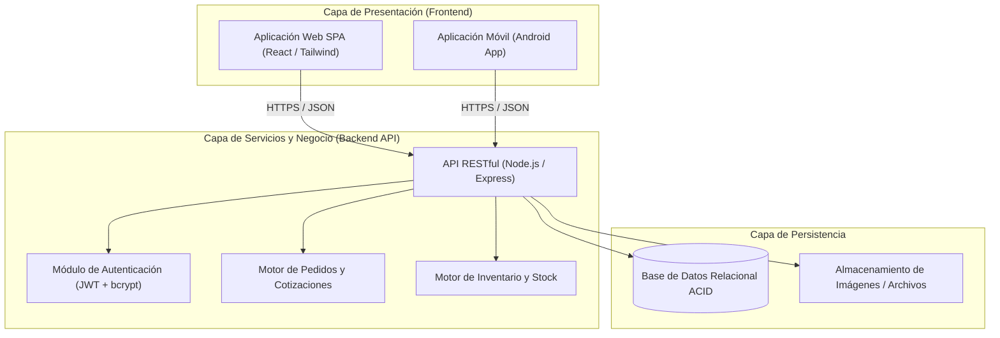
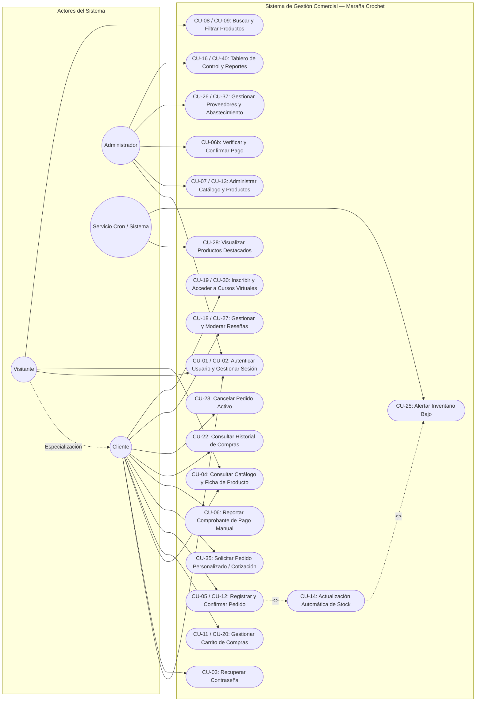

# ESPECIFICACIÓN DE REQUISITOS DE SOFTWARE (SRS)
## Sistema de Gestión Comercial Integral — Maraña Crochet
**Estándar de Referencia:** IEEE Std 830-1998 / ISO/IEC/IEEE 29148:2018  

---

### Información del Proyecto y Control del Documento

| Campo | Detalle |
|---|---|
| **Proyecto** | Maraña Crochet — Sistema de Gestión Comercial Integral (Web y Móvil) |
| **Entidad Académica** | Servicio Nacional de Aprendizaje (SENA) |
| **Centro de Formación** | Centro de la Industria, la Empresa y los Servicios — Regional Huila |
| **Programa de Formación** | Tecnólogo en Análisis y Desarrollo de Software (ADSO) |
| **Ficha de Caracterización** | 3413988 |
| **Integrantes del Equipo** | • Alvaro Andrés Papamija Chala (Líder de Proyecto)<br>• William Jiménez Vélez (Desarrollador Full Stack)<br>• Juan Fernando Bahamón Ramírez (Analista de Datos) |
| **Instructor Asesor** | Carlos Fabián Martínez Mora |
| **Ubicación y Fecha** | Neiva, Huila — Noviembre de 2026 |
| **Versión del Documento** | 2.0.0 (Revisión Técnica y Normalización IEEE 830) |
| **Estado del Documento** | Aprobado / Listo para Construcción |

---

## 1. Introducción

### 1.1 Propósito del Documento
El presente documento tiene como propósito formalizar la Especificación de Requisitos de Software (SRS) para el **Sistema de Gestión Comercial Integral del emprendimiento artesanal Maraña Crochet**, siguiendo los lineamientos internacionales del estándar **IEEE Std 830-1998** y la norma evolutiva **ISO/IEC/IEEE 29148:2018**.

Este documento establece la línea base técnica y funcional acordada entre el equipo de desarrollo del SENA, el instructor técnico y los propietarios del emprendimiento. Sirve como referencia contractual y técnica para las fases de arquitectura, desarrollo de software, aseguramiento de la calidad (QA), pruebas de validación y despliegue del sistema.

### 1.2 Planteamiento del Problema
El emprendimiento **Maraña Crochet** se dedica al diseño, confección y comercialización de productos artesanales tejidos en crochet (amigurumis, prendas de vestir, flores tejidas, accesorios y artículos personalizados para ocasiones especiales). Actualmente, su comercialización depende de redes sociales externas (Instagram, TikTok, WhatsApp y Facebook).

Esta dependencia operativa genera las siguientes problemáticas críticas comprobadas en la operación diaria:
1. **Pérdida de trazabilidad de pedidos y cotizaciones:** Los pedidos a medida y cotizaciones se negocian en chats dispersos y se asientan de forma manual en libretas físicas de papel, provocando omisión de pedidos, extravío de especificaciones de diseño y retrasos en los tiempos de entrega.
2. **Inexistencia de control formal de inventario:** No existe un registro centralizado que sincronice el stock en tiempo real con las solicitudes de compra. Esto conduce a la venta accidental de artículos agotados o a desabastecimiento de materia prima (hilos, vellón siliconado, ganchillos).
3. **Fuga de clientes potenciales y baja retención:** El público joven que interactúa en redes sociales abandona el proceso de compra ante la falta de un catálogo interactivo con disponibilidad y precios transparentes.
4. **Desarticulación en la verificación de recaudos:** Los pagos mediante transferencias bancarias (Nequi, Daviplata, transferencias) se gestionan por capturas de pantalla enviadas al chat, sin validación contable estructurada ni historial de recaudo para el cliente.

### 1.3 Justificación y Vigilancia Tecnológica

#### 1.3.1 Justificación
En Colombia, la digitalización de las micro y pequeñas empresas artesanales representa un motor estratégico de reactivación económica. Según datos del **DANE (2023)**, más del 70 % de los hogares colombianos cuenta con acceso a internet. A pesar de que el comercio electrónico creció a un ritmo anual del 13 %, estudios del sector artesanal (Econexia, 2020; YouTube, 2024) revelan que el 67 % de los pequeños artesanos enfrenta serias barreras de conversión comercial debido a la dispersión de canales y la carencia de plataformas propias de venta directa.

El Ministerio de Comercio, Industria y Turismo (**MinCIT, 2024**) impulsa la modernización de las MIPYMES bajo leyes como la **Ley 590 de 2000** y la **Ley 905 de 2004**. Dotar a Maraña Crochet de un sistema comercial integral propio (sitio web responsivo y aplicación móvil Android) fortalece su identidad de marca, optimiza sus costos operativos y garantiza soberanía tecnológica sobre sus datos y clientes.

#### 1.3.2 Vigilancia Tecnológica y Comparativa de Mercado

| Referente de Mercado | Tipo de Solución | Aportes Identificados | Limitaciones Observadas | Diferenciador de Maraña Crochet |
|---|---|---|---|---|
| **Tiendas en Redes Sociales** (Instagram / FB Shopping) | Catálogo superficial sobre red social | Facilidad de publicación y alcance viral orgánico | Sin control de inventario, sin historial estructurado, sin soporte a pedidos personalizados formales | Gestión unificada de catálogo, pedidos personalizados, inventario y cuentas privadas |
| **Marketplaces Artesanales** (Etsy, MercadoLibre) | Plataforma multi-vendedor de terceros | Alta visibilidad ante audiencias internacionales | Altas comisiones por transacción, pérdida de identidad de marca | 0 % comisiones a terceros, relación directa cliente-artesano y personalización |
| **Plataformas E-commerce Genéricas** (Shopify, WooCommerce) | Tienda virtual estándar con carrito | Catálogo escalable y pasarelas de pago | Costos mensuales en dólares, curvas de aprendizaje elevadas y nula orientación a crochet | Adaptado al modelo artesanal: cotizaciones, cursos virtuales y pagos locales |
| **Software de Inventario Aislado** | Sistemas ERP / POS tradicionales | Control estricto de existencias | Desconectado de la experiencia de compra del cliente | Inventario integrado nativamente al catálogo y pedidos en tiempo real |

### 1.4 Objetivos del Sistema
- **Objetivo General:**  
  Diseñar e implementar un Sistema de Gestión Comercial Integral compuesto por una plataforma web y una aplicación móvil para el emprendimiento Maraña Crochet, que centralice la exhibición de productos, el registro de pedidos estándar y personalizados, el control de inventario y la emisión de reportes operativos.

- **Objetivos Específicos:**
  1. Diseñar una arquitectura cliente-servidor modular y segura con base de datos relacional transaccional.
  2. Implementar un módulo de autenticación y autorización basado en roles (Administrador y Cliente).
  3. Desarrollar un catálogo digital responsivo con búsqueda, filtrado y detalle de artículos artesanales.
  4. Proveer un flujo de registro de pedidos con carrito de compras y verificación manual de pagos (efectivo y transferencia bancaria).
  5. Automatizar el control de stock, deducciones de inventario y generación de alertas de bajo inventario.
  6. Permitir la solicitud y cotización formal de pedidos a medida con seguimiento de estado.
  7. Incorporar módulos de valor agregado: sistema de reseñas calificadas, favoritos y cursos virtuales de técnicas de crochet.
  8. Construir un tablero administrativo con métricas operativas y reportes exportables en formatos estándar (PDF/Excel).

---

### 1.5 Alcance del Producto

```
┌────────────────────────────────────────────────────────────────────────┐
│                        ALCANCE DEL SISTEMA MARAÑA CROCHET              │
├──────────────────────────┬────────────────────────┬────────────────────┤
│   INCLUYE (VERSIÓN 1.0)  │  OPCIONAL CONFIRMADO   │  NO INCLUYE (FUT)  │
├──────────────────────────┼────────────────────────┼────────────────────┤
│ • Registro y Auth (RBAC) │ • Cursos virtuales     │ • Pasarelas de     │
│ • Catálogo interactivo   │ • Cupones y descuentos │   pago automáticas │
│ • Carrito y Checkout     │ • Productos favoritos  │ • Envíos automá-   │
│ • Verificación de pagos  │ • Compartir en redes   │   ticos (APIs)     │
│ • Control de inventario  │ • Dashboard y reportes │ • Algoritmos de IA │
│ • Pedidos personalizados │   exportables (PDF/XLS)│   o analítica      │
│ • Reseñas y calificaciones│                        │   predictiva       │
└──────────────────────────┴────────────────────────┴────────────────────┘
```

#### 1.5.1 Funcionalidades Incluidas (Versión Inicial / Core)
- Registro, inicio de sesión, recuperación de credenciales y gestión de perfil de usuario.
- Catálogo interactivo de productos con categorización, búsqueda y detalle técnico de cada artesanía.
- Carrito de compras y emisión de pedidos con código único de trazabilidad.
- Registro y verificación manual de pagos soportados en efectivo o transferencia bancaria local.
- Control de inventario con actualización de stock tras cada pedido, umbrales mínimos y alertas automáticas.
- Flujo formal para pedidos personalizados y solicitudes de cotización a medida.
- Módulo de proveedores y registro de órdenes de abastecimiento de materias primas.
- Sistema de reseñas y calificaciones con validación de compra previa.
- Centro de notificaciones operativas (pedidos, novedades, inventario).

#### 1.5.2 Funcionalidades Opcionales (Sujetas a Confirmación del Emprendimiento)
- Módulo de formación: inscripción y visualización de clases virtuales de crochet con soporte de materiales.
- Sistema de cupones de descuento temporal y promociones por categoría.
- Lista de productos favoritos por usuario autenticado.
- Dashboard administrativo con gráficos de rendimiento e indicadores KPI.
- Exportación de reportes tabulares y gráficos a PDF y hojas de cálculo Excel (.xlsx).

#### 1.5.3 Exclusiones Explícitas (Fuera de Alcance del Presente Release)
- **Pasarelas de pago electrónico automatizadas:** En este release no se realiza integración directa con pasarelas tipo Stripe, Wompi o PayU; los comprobantes se validan manualmente por la administración.
- **Motores de recomendación basados en Inteligencia Artificial o Machine Learning:** Los productos destacados se calculan mediante un conteo determinístico de ventas y visitas.
- **Logística automatizada con transportadoras:** El sistema registra estados de envío informativos, sin generar guías automáticas con APIs de empresas de mensajería (Coordinadora, Servientrega, Interrapidísimo).

---

### 1.6 Personal Involucrado y Matriz de Roles

| Nombre | Rol en el Proyecto | Responsabilidades Principales | Contacto |
|---|---|---|---|
| **Alvaro Andrés Papamija Chala** | Líder de Proyecto / Product Owner | Gestión del cronograma, análisis de requisitos, arquitectura general y validación funcional. | alvaroandrespapamija@gmail.com |
| **William Jiménez Vélez** | Desarrollador Full Stack | Construcción de la API REST backend, interfaces web y móvil, integración de base de datos. | williamjimenezvelez123@gmail.com |
| **Juan Fernando Bahamón Ramírez** | Analista de Datos / QA | Modelado entidad-relación, lógica de reportes, pruebas unitarias y de integración. | juanfernandobahamonramirez@gmail.com |
| **Carlos Fabián Martínez Mora** | Instructor Técnico SENA | Asesoría metodológica, revisión de estándares IEEE y evaluación técnica de entregables. | Formación SENA Huila |

---

### 1.7 Definiciones, Acrónimos y Abreviaturas

#### 1.7.1 Definiciones
- **Amigurumi:** Técnica artesanal de origen japonés que consiste en tejer pequeños muñecos o figuras tridimensionales mediante crochet.
- **Pedido Personalizado:** Solicitud de confección de un producto que no existe en stock físico o que requiere especificaciones exclusivas de tamaño, color o personaje, sujeta a cotización previa.
- **Verificación Manual de Pago:** Proceso mediante el cual el administrador coteja el comprobante o referencia de pago adjunta por el cliente contra los movimientos de su cuenta bancaria.
- **Desactivación Lógica:** Marcar un registro como inactivo (`activo = 0`) para suspender su visualización sin eliminarlo físicamente, preservando la integridad referencial histórica.
- **Stock de Seguridad (Umbral Mínimo):** Cantidad mínima predefinida de unidades de un producto antes de que el sistema dispare alertas de reposición al administrador.

#### 1.7.2 Acrónimos y Abreviaturas
- **SRS:** Software Requirements Specification (Especificación de Requisitos de Software).
- **IEEE:** Institute of Electrical and Electronics Engineers.
- **ISO:** International Organization for Standardization.
- **ADSO:** Análisis y Desarrollo de Software (programa técnico SENA).
- **RBAC:** Role-Based Access Control (Control de Acceso Basado en Roles).
- **API:** Application Programming Interface.
- **SPA:** Single Page Application.
- **JWT:** JSON Web Token (RFC 7519).
- **CRUD:** Create, Read, Update, Delete.
- **SUS:** System Usability Scale.
- **MoSCoW:** Must have, Should have, Could have, Won't have (método de priorización de requisitos).
- **TBD:** To Be Determined (vacío de información pendiente por resolver por los interesados).

### 1.8 Referencias Normativas y Marco Legal
1. **IEEE Std 830-1998:** IEEE Recommended Practice for Software Requirements Specifications.
2. **ISO/IEC/IEEE 29148:2018:** Systems and software engineering — Life cycle processes — Requirements engineering.
3. **Ley 1581 de 2012 (Colombia):** Ley General de Protección de Datos Personales (Habeas Data).
4. **Ley 1480 de 2011 (Colombia):** Estatuto del Consumidor (regulaciones sobre comercio electrónico, derecho de retracto y garantías).
5. **Ley 590 de 2000 y Ley 905 de 2004 (Colombia):** Promoción y formalización del desarrollo microempresarial.

---

## 2. Descripción General del Sistema

### 2.1 Perspectiva del Producto
El sistema para **Maraña Crochet** se concibe como una solución integral desacoplada compuesta por:
1. **Capa de Presentación Web:** Single Page Application (SPA) responsiva para clientes y administración.
2. **Capa de Presentación Móvil:** Aplicación para dispositivos móviles Android para clientes del emprendimiento.
3. **Capa de Negocio (Backend):** API RESTful que implementa las reglas de negocio, autenticación JWT y controladores.
4. **Capa de Datos:** Sistema Gestor de Bases de Datos Relacional (RDBMS) transaccional con persistencia ACID.



### 2.2 Características de los Usuarios (Perfiles)
1. **Visitante (Anónimo):** Puede navegar el catálogo, usar la barra de búsqueda, aplicar filtros, consultar reseñas de productos y registrarse como cliente.
2. **Cliente (Autenticado):** Puede gestionar su carrito, registrar pedidos estándar, solicitar pedidos personalizados, reportar comprobantes de pago, calificar productos comprados, guardar favoritos e inscribirse a cursos.
3. **Administrador del Emprendimiento:** Cuenta con privilegios completos para gestionar catálogo, ajustar stock, dar de alta proveedores, procesar estados de pedidos, moderar reseñas, emitir reportes y configurar promociones.
4. **Proveedor (Entidad Indirecta):** Registrado como contacto para trazabilidad de compras de materias primas; no tiene acceso interactivo a la plataforma en la versión 1.0.

### 2.3 Restricciones Generales
- **Compatibilidad de Navegadores:** Versiones evergreen de Google Chrome, Mozilla Firefox, Microsoft Edge y Safari.
- **Plataforma Móvil:** Dispositivos Android 8.0 (Oreo) o superior con conexión a internet mínima 3G/4G/Wi-Fi.
- **Protección de Datos Personales:** Cifrado unidireccional de contraseñas con `bcrypt` (10 rondas de salteo) y cláusula de consentimiento explícito según Ley 1581 de 2012.
- **Restricción de Recursos:** Por tratarse de un entorno de formación SENA, los despliegues de prueba se soportarán sobre servidores virtuales (VPS o PaaS gratuitos/educativos), por lo que las imágenes de productos se limitarán a un peso máximo de 2 MB por archivo.

### 2.4 Suposiciones y Dependencias
- Se asume que el usuario cuenta con conectividad a internet estable para consultar el catálogo y confirmar pedidos.
- Se asume que los pagos por transferencia serán validados contra las cuentas oficiales del emprendimiento antes de autorizar la entrega de mercancía.
- Dependencia de un servicio de mensajería SMTP externo para la entrega de correos de confirmación y recuperación de claves.

---

## 3. Requisitos de Interfaces Externas

### 3.1 Interfaces de Usuario (UI/UX)
- Interfaz adaptativa con maquetación fluida y soporte responsive para pantallas móviles (desde 360 px de ancho) hasta monitores de escritorio (1920x1080 px).
- Paleta cromática corporativa coherente con el estilo artesanal (tonos pastel, cálidos y contrastes aprobados bajo WCAG 2.1 AA para legibilidad).
- Componentes modulares claros: catálogo con cuadrículas de productos, modales rápidos para detalle de artículo, checkout paso a paso y panel de control tabular para el administrador.

### 3.2 Interfaces de Hardware
- **Lado Cliente:** Computadores personales, tablets o teléfonos inteligentes con al menos 2 GB de memoria RAM y resolución mínima de pantalla de 360x640 píxeles.
- **Lado Servidor:** Servidor físico o máquina virtual con arquitectura x86_64, mínimo 1 vCPU, 1 GB de RAM y 10 GB de almacenamiento en disco SSD.

### 3.3 Interfaces de Software
- **Servidor Web / API:** Entorno de ejecución Node.js (v18+) o equivalente con protocolo HTTP/1.1 y HTTP/2.
- **Motor de Base de Datos:** PostgreSQL 14+ o MariaDB/MySQL 8.0+ con motor de almacenamiento InnoDB/ACID.
- **Servicio de Notificación por Correo:** Integración vía protocolo SMTP estándar (Gmail API, Nodemailer, SendGrid o similar).
- **Manejo de Documentos:** Librería cliente/servidor para la generación de reportes en PDF (`jsPDF` o `PDFKit`) y exportación a hojas de cálculo Excel (`xlsx` / `SheetJS`).

### 3.4 Interfaces de Comunicación
- Toda comunicación entre la aplicación cliente (web/móvil) y la API REST se realizará obligatoriamente mediante el protocolo cifrado **HTTPS** sobre puerto 443 con certificado TLS 1.2 o superior.
- Intercambio de datos estandarizado en formato **JSON** con cabecera `Content-Type: application/json`.
- Esquema de autorización de solicitudes protegidas mediante cabecera HTTP: `Authorization: Bearer <JWT>`.

---

## 4. Requisitos Específicos

### 4.1 Reglas del Negocio (RN)

| Código | Nombre de la Regla | Formulación / Restricción Lógica |
|---|---|---|
| **RN-01** | Unicidad de Credenciales | No se permiten dos cuentas de usuario con el mismo correo electrónico o con la misma combinación (`tipo_documento`, `numero_documento`). |
| **RN-02** | Deducción Automática de Stock | Al confirmarse un pedido, el sistema disminuye inmediatamente las existencias del producto: $\text{Stock}_{\text{nuevo}} = \text{Stock}_{\text{actual}} - \text{Cantidad}_{\text{pedida}}$. |
| **RN-03** | Bloqueo por Desabastecimiento | Si el stock de un producto llega a 0 unidades, el producto se etiqueta automáticamente como 'Agotado' y se deshabilita el botón de compra en el catálogo. |
| **RN-04** | Disparo de Alerta de Bajo Inventario | Se emite una alerta administrativa cuando $\text{Stock}_{\text{actual}} \le \text{Umbral Mínimo}_{\text{producto}}$ (por defecto 3 unidades si no se parametriza). |
| **RN-05** | Verificación Obligatoria de Pago | Ningún pedido en estado 'Pendiente de Pago' podrá pasar al estado 'En Preparación' o 'Enviado' sin la verificación y confirmación previa del administrador. |
| **RN-06** | Restricción Estricta de Reseñas | Solo los usuarios autenticados que hayan recibido efectivamente un producto (`estado_pedido = 'Entregado'`) pueden emitir una calificación y comentario. Límite: 1 reseña por producto por cliente. |
| **RN-07** | Uso de Cupones de Descuento | Se permite máximo un (1) cupón de descuento por pedido. El cupón debe encontrarse activo y dentro de su rango de vigencia $[\text{fecha\_inicio}, \text{fecha\_fin}]$. No es acumulable. |
| **RN-08** | Algoritmo Determinístico de Destacados | Los productos destacados se ordenan de mayor a menor según el índice de popularidad: $\text{Score} = (\text{Total Pedidos} \times 2) + (\text{Visitas Únicas})$. No utiliza algoritmos de Machine Learning. |
| **RN-09** | Derecho de Retracto y Devolución | El cliente podrá radicar solicitudes de devolución dentro de los cinco (5) días hábiles siguientes a la entrega del producto, según lo estipulado en la Ley 1480 de 2011 (Estatuto del Consumidor en Colombia). |
| **RN-10** | Cotización de Pedidos a Medida | Todo pedido personalizado nace en estado 'Solicitado' y requiere que el administrador ingrese un valor cotizado en pesos colombianos (\$ COP) y tiempo estimado de elaboración antes de que el cliente pueda confirmarlo. |
| **RN-11** | Control de Cupos en Cursos Virtuales | Un usuario solo puede inscribirse en un curso virtual si $\text{Inscritos}_{\text{actuales}} < \text{Cupo Máximo}$. Una vez copado, el sistema bloquea nuevas admisiones. |
| **RN-12** | Inmutabilidad de Pedidos Despachados | Un pedido en estado 'Enviado' o 'Entregado' no puede ser cancelado unilateralmente por el cliente desde la interfaz de usuario. |
| **RN-13** | Aislamiento de Historial de Clientes | Un usuario con rol Cliente únicamente tiene autorización para consultar sus propios pedidos, cotizaciones y comprobantes (`WHERE pedido.cliente_id = auth.user_id`). |
| **RN-14** | Moderación Preventiva de Contenidos | Toda reseña o comentario registrado por un usuario pasa por moderación del administrador o filtro de palabras inadecuadas antes de su publicación en el catálogo público. |
| **RN-15** | Integridad Referencial de Catálogo | No se permite la eliminación física (`DELETE`) de un producto si tiene pedidos o registros contables asociados; en su lugar, se aplica desactivación lógica (`activo = 0`). |

---

### 4.2 Catálogo Detallado de Requisitos Funcionales (RF-01 a RF-50)

> **Nota Metodológica:** Los 50 requisitos funcionales han sido estandarizados con identificadores formales `RF-01` a `RF-50`, eliminando ambigüedades del borrador inicial y vinculando entradas, salidas, tratamiento de errores y criterios verificables.

#### Subsistema 1: Seguridad, Autenticación y Cuentas de Usuario

| ID | Requisito Funcional | Módulo | Prioridad | Entradas / Salidas | Descripción y Criterios de Aceptación |
|---|---|---|:---:|---|---|
| **RF-01** | Registro de nuevos usuarios | Seguridad | **Must** | **E:** Tipo doc, número doc, nombres, apellidos, correo, teléfono, dirección, contraseña, aceptación de Habeas Data.<br>**S:** Registro persistido, rol asignado, mensaje de confirmación. | El sistema registra usuarios como 'Cliente'. Valida unicidad de correo y documento (RN-01). Cifra la clave con bcrypt. Rechaza peticiones incompletas o duplicadas con error HTTP 400. |
| **RF-02** | Inicio de sesión con autenticación | Seguridad | **Must** | **E:** Correo electrónico y contraseña.<br>**S:** Token JWT firmado, datos de perfil, redirección según rol. | Valida credenciales contra la BD. Si la cuenta está activa, emite token JWT con vigencia de 8 horas. Con credenciales inválidas emite HTTP 401 sin revelar cuál dato falló. |
| **RF-03** | Recuperación y restablecimiento de contraseña | Seguridad | **Must** | **E:** Correo registrado, código de verificación, nueva contraseña.<br>**S:** Correo con código temporal (vigencia 10 min), confirmación de actualización. | Envía token numérico al correo del usuario. Valida caducidad de 10 minutos. Obliga a ingresar contraseña segura (mínimo 8 caracteres) y actualiza el hash en la BD. |
| **RF-17** | Gestión de perfil de usuario | Usuarios | **Should** | **E:** Nombres, teléfono, dirección, imagen de perfil opcional.<br>**S:** Registro de usuario actualizado en BD y mensaje de éxito. | Permite al usuario autenticado consultar y editar sus datos de contacto y entrega. Valida formato de teléfono y actualiza la sesión en caliente. |
| **RF-31** | Cierre de sesión seguro | Seguridad | **Must** | **E:** Solicitud explícita de logout.<br>**S:** Token destruido en cliente, sesión finalizada, redirección a Home. | Invalida el token JWT localmente, limpia el almacenamiento seguro del cliente y redirige a la vista pública de inicio. |
| **RF-32** | Activación y desactivación de cuentas de usuario | Usuarios | **Should** | **E:** Identificador de usuario, estado destino (`activo = 0 / 1`).<br>**S:** Estado actualizado en BD y bitácora de auditoría. | El Administrador suspende o reactiva cuentas de clientes. Un usuario desactivado no puede iniciar sesión; el sistema le indica contactar soporte. |
| **RF-49** | Gestión de preferencias de notificación | Usuarios | **Could** | **E:** Checkboxes de preferencia (pedidos, ofertas, cursos).<br>**S:** Preferencias guardadas en el perfil. | Permite al cliente configurar qué notificaciones desea recibir por correo o en la app, respetando su decisión en envíos masivos. |

---

#### Subsistema 2: Catálogo de Productos y Navegación

| ID | Requisito Funcional | Módulo | Prioridad | Entradas / Salidas | Descripción y Criterios de Aceptación |
|---|---|---|:---:|---|---|
| **RF-04** | Consulta del catálogo público de productos | Catálogo | **Must** | **E:** Paginación, ordenamiento.<br>**S:** Lista de productos con foto, nombre, precio (\$ COP), categoría y stock. | Despliega los productos activos. Refleja en tiempo real la disponibilidad física y muestra la etiqueta 'Agotado' si el stock es cero. |
| **RF-08** | Búsqueda de productos por texto y palabras clave | Catálogo | **Must** | **E:** Cadena de texto de búsqueda.<br>**S:** Resultados coincidentes en nombre, descripción o etiquetas. | Búsqueda predictiva insensible a mayúsculas y acentos. Permite coincidencias parciales con latencia menor a 300 ms. |
| **RF-09** | Filtrado multifactorial del catálogo | Catálogo | **Should** | **E:** Rango de precio, categoría, disponibilidad, calificación mínima.<br>**S:** Listado filtrado en tiempo real. | Permite combinar múltiples filtros simultáneos. Si no hay coincidencias, muestra mensaje informativo invitando a limpiar filtros. |
| **RF-10** | Visualización de ficha técnica de producto | Catálogo | **Must** | **E:** Selección de ID de producto.<br>**S:** Galería de imágenes, descripción de materiales, dimensiones, precio y stock. | Presenta la ficha completa del artículo, tiempo estimado de confección si es bajo pedido y promedio de valoraciones de clientes. |
| **RF-13** | Administración de productos (CRUD de Catálogo) | Catálogo | **Must** | **E:** Nombre, descripción, precio, categoría, stock inicial, dimensiones.<br>**S:** Producto creado, editado o desactivado lógicamente. | Permite al administrador crear y modificar artículos. No permite eliminación física si existen órdenes asociadas (RN-15). |
| **RF-24** | Gestión de categorías del catálogo | Catálogo | **Should** | **E:** Nombre de categoría, descripción, imagen representativa.<br>**S:** Categoría persistida y disponible para filtrado. | Permite crear categorías como Amigurumis, Prendas, Accesorios, Decoración y Temporada, validando no duplicar nombres. |
| **RF-28** | Exhibición de productos destacados por popularidad | Catálogo | **Should** | **E:** Registro de ventas y visualizaciones.<br>**S:** Sección 'Más Populares' en la página de inicio. | Ordena los productos según la regla determinística de popularidad (RN-08). Si no hay histórico, muestra los artículos más recientes. |
| **RF-33** | Compartir productos en redes sociales | Catálogo | **Could** | **E:** Clic en botón compartir (WhatsApp, Facebook, Enlace directo).<br>**S:** URL pública con OpenGraph generado. | Genera enlace con metadatos (foto, título y precio) para compartir en mensajería instantánea y redes sociales. |
| **RF-38** | Carga de múltiples imágenes por producto | Catálogo | **Should** | **E:** Archivos de imagen (JPG, PNG, WebP) hasta 2 MB.<br>**S:** Archivos almacenados y URLs asociadas en BD. | El administrador sube hasta 5 fotos por producto, selecciona una como portada principal y previsualiza las miniaturas antes de guardar. |
| **RF-45** | Asignación de productos a múltiples categorías | Catálogo | **Could** | **E:** Selección de una o más categorías para un producto.<br>**S:** Relación many-to-many actualizada en BD. | Permite que un producto (ej. 'Llavero Soldado Amigurumi') aparezca simultáneamente en 'Llaveros' y en 'Personalizados'. |

---

#### Subsistema 3: Carrito de Compras, Pedidos y Cotizaciones

| ID | Requisito Funcional | Módulo | Prioridad | Entradas / Salidas | Descripción y Criterios de Aceptación |
|---|---|---|:---:|---|---|
| **RF-05** | Registro de pedidos en línea (Checkout) | Pedidos | **Must** | **E:** Ítems del carrito, datos de entrega, método de pago seleccionado.<br>**S:** Orden creada con código alfanumérico, inventario descontado. | Registra la orden de compra, reserva los artículos (RN-02) y deja el pedido en estado 'Pendiente de Pago'. Emite confirmación en pantalla. |
| **RF-11** | Adición de productos al carrito de compras | Pedidos | **Must** | **E:** ID de producto, cantidad solicitada.<br>**S:** Carrito actualizado con cálculo de subtotal. | Valida que la cantidad agregada no sobrepase el stock disponible en bodega. Si sobrepasa, limita la selección al máximo disponible. |
| **RF-12** | Emisión y confirmación de orden de pedido | Pedidos | **Must** | **E:** Confirmación formal del checkout por el cliente.<br>**S:** Resumen digital con ID único de pedido (ej. `MC-2026-00421`). | Genera la ficha del pedido con desglose de ítems, subtotal, descuento aplicado y datos para transferir por Nequi/Daviplata. |
| **RF-15** | Control y actualización de estados de pedidos | Pedidos | **Must** | **E:** Selección de nuevo estado (`Pendiente`, `En Preparación`, `Enviado`, `Entregado`, `Cancelado`).<br>**S:** Estado actualizado y notificación al cliente. | El administrador actualiza el estado según el ciclo de vida del producto. El cliente consulta en tiempo real el progreso de su orden. |
| **RF-20** | Edición y modificación de ítems en el carrito | Pedidos | **Must** | **E:** Incremento/decremento de cantidades o eliminación de ítems.<br>**S:** Recálculo instantáneo de subtotales y totales. | Permite ajustar cantidades o vaciar el carrito antes de proceder a la confirmación de la compra. |
| **RF-22** | Consulta de historial de compras del cliente | Pedidos | **Should** | **E:** Autenticación de cliente.<br>**S:** Lista de pedidos pasados con fecha, total, estado y detalle. | El cliente visualiza exclusivamente sus pedidos (RN-13) con acceso a ver comprobantes y estados de entrega. |
| **RF-23** | Cancelación oportuna de pedidos | Pedidos | **Should** | **E:** ID de pedido, justificación de cancelación.<br>**S:** Pedido marcado 'Cancelado', stock reintegrado automáticamente. | El cliente puede cancelar su orden únicamente si se encuentra en estado 'Pendiente de Pago' o 'Solicitado' (RN-12). Reintegra el stock. |
| **RF-34** | Aplicación de cupones de descuento comercial | Pedidos | **Could** | **E:** Código alfanumérico del cupón.<br>**S:** Descuento deducido del total del pedido. | Valida vigencia, cupo de uso y mínimo de compra (RN-07). Aplica descuento porcentual o fijo en pesos (\$ COP). |
| **RF-35** | Solicitud y cotización de pedidos personalizados | Pedidos | **Must** | **E:** Descripción del diseño, fotos de referencia, dimensiones, fecha deseada.<br>**S:** Solicitud de cotización radicada para el administrador. | Permite solicitar amigurumis a medida (ej. fotos de uniformados o mascotas). El admin revisa y emite cotización en \$ COP (RN-10). |
| **RF-43** | Seguimiento y rastreo de envíos de pedidos | Pedidos | **Should** | **E:** Número de guía y transportadora ingresados por el admin.<br>**S:** Visualización del estado del despacho para el cliente. | Informa al cliente la transportadora utilizada y el número de guía para seguimiento externo del paquete. |
| **RF-44** | Radicación de solicitudes de devolución o cambio | Pedidos | **Could** | **E:** ID de pedido, motivo de inconformidad, fotos de evidencia.<br>**S:** Ticket de reclamación con estado 'En Revisión'. | Habilita el derecho de retracto conforme a la Ley 1480 de 2011 dentro del plazo de 5 días hábiles posteriores a la entrega (RN-09). |

---

#### Subsistema 4: Control Financiero y Pagos Manuales

| ID | Requisito Funcional | Módulo | Prioridad | Entradas / Salidas | Descripción y Criterios de Aceptación |
|---|---|---|:---:|---|---|
| **RF-06** | Registro y verificación de comprobantes de pago | Pagos | **Must** | **E:** Método (Efectivo/Transferencia), referencia bancaria, comprobante adjunto.<br>**S:** Estado del pago actualizado (`Pendiente` a `Verificado`). | El cliente adjunta foto o captura del pago. El administrador valida el ingreso en su cuenta y confirma el recaudo para iniciar elaboración (RN-05). |
| **RF-36** | Consulta de historial de pagos y recaudos | Pagos | **Should** | **E:** ID de cliente / ID de orden.<br>**S:** Resumen de pagos registrados, referencias y estados de verificación. | Permite al cliente y al administrador verificar las transacciones realizadas sobre cada pedido, evitando cobros dobles o confusiones. |

---

#### Subsistema 5: Inventario, Abastecimiento y Proveedores

| ID | Requisito Funcional | Módulo | Prioridad | Entradas / Salidas | Descripción y Criterios de Aceptación |
|---|---|---|:---:|---|---|
| **RF-07** | Módulo de gestión integral de inventario | Inventario | **Must** | **E:** Consultas de existencias, ajustes manuales de stock.<br>**S:** Kardex de movimientos, inventario valorizado. | Permite auditar las entradas y salidas de mercancía terminada, clasificadas por categoría y estado de conservación. |
| **RF-14** | Actualización automática de stock por pedidos | Inventario | **Must** | **E:** Evento de confirmación o cancelación de pedido.<br>**S:** Deducción o reposición matemática de unidades en BD. | Aplica la deducción transaccional (RN-02). Si el stock llega a 0, marca el producto como agotado automáticamente (RN-03). |
| **RF-25** | Generación de alertas de inventario bajo | Inventario | **Should** | **E:** Verificación de stock contra umbrales mínimos.<br>**S:** Notificación destacada en el dashboard administrativo. | Dispara avisos automáticos cuando las existencias caen al límite crítico (RN-04) para evitar quiebres de inventario. |
| **RF-26** | Registro y directorio de proveedores de insumos | Proveedores | **Should** | **E:** Nombre de proveedor, NIT/Cédula, contacto, insumos provistos.<br>**S:** Ficha de proveedor registrada. | Administra los contactos de distribuidores de lanas, hilos de algodón, ojitos de seguridad, empaques y accesorios para crochet. |
| **RF-37** | Registro de entradas de inventario por proveedor | Inventario | **Should** | **E:** Proveedor seleccionado, producto, cantidad ingresada, costo unitario.<br>**S:** Stock incrementado y registro de compra asentado. | Permite registrar ingresos de nuevos lotes de productos o materias primas, recalculando el stock disponible. |
| **RF-46** | Parametrización de umbral mínimo de stock por producto | Inventario | **Could** | **E:** ID de producto, cantidad mínima deseada.<br>**S:** Parámetro actualizado en BD. | Permite definir umbrales personalizados según rotación (ej. llaveros mínimo 5 unidades; muñecos grandes mínimo 1 unidad). |
| **RF-47** | Registro de órdenes de compra a proveedores | Proveedores | **Could** | **E:** Proveedor, lista de insumos solicitados, fecha estimada.<br>**S:** Orden de compra en estado 'Emitida' / 'Recibida'. | Formaliza los pedidos de abastecimiento de lana e insumos para el taller de confección de Maraña Crochet. |
| **RF-48** | Creación y activación de promociones temporales | Catálogo | **Could** | **E:** Producto o categoría, porcentaje de descuento, fecha inicio y fin.<br>**S:** Precios promocionales publicados en catálogo. | Activa descuentos por tiempo limitado. Al expirar la fecha final, el sistema restaura los precios habituales automáticamente. |

---

#### Subsistema 6: Reseñas, Calificaciones y Fidelización

| ID | Requisito Funcional | Módulo | Prioridad | Entradas / Salidas | Descripción y Criterios de Aceptación |
|---|---|---|:---:|---|---|
| **RF-18** | Publicación de reseñas y calificaciones de clientes | Comunidad | **Should** | **E:** ID producto, puntuación (1 a 5 estrellas), reseña de texto.<br>**S:** Reseña registrada, promedio del producto recalculado. | Exige compra previa confirmada (RN-06). Actualiza la calificación promedio del producto visible para la comunidad. |
| **RF-21** | Gestión de productos favoritos (Wishlist) | Fidelización | **Could** | **E:** Selección de producto para guardar en favoritos.<br>**S:** Lista personal de favoritos persistida en la cuenta. | Permite al cliente marcar artículos para compra futura y consultarlos desde su panel personal. |
| **RF-27** | Moderación administrativa de reseñas | Comunidad | **Should** | **E:** Selección de reseña, acción (`Aprobar` / `Rechazar` / `Eliminar`).<br>**S:** Estado de visibilidad de la reseña actualizado. | Permite al administrador revisar comentarios antes o después de ser expuestos al público para prevenir spam o faltas de respeto (RN-14). |
| **RF-41** | Respuesta oficial del administrador a reseñas | Comunidad | **Could** | **E:** ID de reseña, texto de respuesta del emprendimiento.<br>**S:** Respuesta oficial visible bajo el comentario del cliente. | Permite al emprendimiento agradecer comentarios o resolver quejas públicas directamente en la ficha del producto. |

---

#### Subsistema 7: Cursos y Formación Virtual en Crochet (Opcional)

| ID | Requisito Funcional | Módulo | Prioridad | Entradas / Salidas | Descripción y Criterios de Aceptación |
|---|---|---|:---:|---|---|
| **RF-19** | Visualización y acceso a clases virtuales de crochet | Formación | **Could** | **E:** Usuario autenticado con inscripción activa.<br>**S:** Reproducción de videos, descarga de guías PDF y patrones. | Permite acceder a lecciones interactivas para aprender técnicas de tejido amigurumi. Acceso exclusivo para usuarios matriculados. |
| **RF-30** | Inscripción de usuarios a cursos virtuales | Formación | **Could** | **E:** Selección de curso, confirmación de inscripción.<br>**S:** Matrícula registrada, cupo descontado, correo de confirmación. | Valida disponibilidad de cupos (RN-11). Si los cupos se agotan, impide nuevas inscripciones y muestra aviso informativo. |
| **RF-42** | Gestión y publicación de contenidos de cursos | Formación | **Could** | **E:** Título, descripción, enlaces de video, documentos PDF adjuntos.<br>**S:** Curso publicado en el catálogo educativo. | El administrador crea y estructura módulos formativos, organiza lecciones y asigna cupos máximos por taller. |
| **RF-50** | Calificación y evaluación de cursos virtuales | Formación | **Could** | **E:** Calificación del curso (1 a 5 estrellas) y opinión escrita.<br>**S:** Calificación del curso asentada y promedio visible. | Disponible exclusivamente para estudiantes que hayan completado al menos el 80 % del contenido del curso virtual. |

---

#### Subsistema 8: Notificaciones, Reportes y Métricas Operativas

| ID | Requisito Funcional | Módulo | Prioridad | Entradas / Salidas | Descripción y Criterios de Aceptación |
|---|---|---|:---:|---|---|
| **RF-16** | Generación de reportes operativos básicos | Reportes | **Should** | **E:** Parámetros de consulta (rango de fechas, módulo).<br>**S:** Tablas consolidadas de ventas, pedidos y stock. | Genera resúmenes de ventas totales en \$ COP, pedidos despachados, productos con mayor rotación e inventario actual. |
| **RF-29** | Envío de notificaciones transaccionales | Notificaciones | **Should** | **E:** Evento del sistema (cambio de estado de orden, pago recibido).<br>**S:** Notificación en app y correo electrónico enviado. | Notifica oportunamente al cliente cuando su pago es verificado, cuando su pedido está en preparación o cuando es despachado. |
| **RF-39** | Exportación de reportes a PDF y hojas de cálculo Excel | Reportes | **Could** | **E:** Reporte generado en pantalla, formato deseado (PDF/XLSX).<br>**S:** Archivo binario descargable estructurado y formateado. | Exporta los datos consolidados con encabezados, sumatorias e identidad visual de Maraña Crochet para soporte contable. |
| **RF-40** | Tablero de mando con indicadores clave (Dashboard) | Gerencia | **Should** | **E:** Carga del panel administrativo.<br>**S:** Tarjetas de KPIs (Ventas del mes, pedidos pendientes, alertas stock). | Presenta métricas consolidadas en tiempo real para apoyar la toma de decisiones comerciales de la artesana líder. |

---

### 4.3 Requisitos No Funcionales (RNF-01 a RNF-10)

| Código | Atributo de Calidad | Especificación Técnica | Métrica Cuantitativa y Criterio de Aceptación |
|---|---|---|---|
| **RNF-01** | Rendimiento (Latencia) | Optimización de consultas SQL, indexación en claves foráneas y compresión de respuestas JSON con Gzip/Brotli. | Carga de vistas principales en menos de 3.0 segundos bajo conexiones estándar; respuesta de API ($P_{95}$) menor a 350 ms. |
| **RNF-02** | Usabilidad (UI/UX) | Diseño centrado en el usuario con flujos de navegación directos (máximo 3 clics para iniciar una compra). | Puntuación en escala System Usability Scale (SUS) superior a 80 puntos en pruebas de usabilidad con clientes muestra. |
| **RNF-03** | Seguridad | Cifrado unidireccional de contraseñas con `bcrypt` (factor de costo 10). Autenticación stateless mediante JWT firmado criptográficamente. | 0 contraseñas almacenadas en texto plano en la base de datos; todas las rutas privadas protegidas contra inyección SQL y XSS. |
| **RNF-04** | Disponibilidad | Arquitectura diseñada para despliegue en contenedores o servicios de nube con monitoreo de caídas. | Disponibilidad de servicio mínima del 99.0 % en horario operativo mensual (excluyendo ventanas de mantenimiento informadas). |
| **RNF-05** | Escalabilidad | Arquitectura modular desacoplada con separación de responsabilidades (capa de datos independiente de la API). | Capacidad de soportar hasta 100 usuarios concurrentes sin degradación de la latencia media por encima de 1 segundo. |
| **RNF-06** | Compatibilidad | Interfaz web construida con estándares HTML5/CSS3 responsivos y compatibilidad con navegadores evergreen. | 100 % operativa en Chrome 100+, Firefox 100+, Edge 100+ y Safari 15+; app móvil compatible con Android 8.0+. |
| **RNF-07** | Fiabilidad | Manejo global de excepciones en el servidor y transaccionalidad ACID en operaciones de base de datos. | Cero transacciones corruptas o pedidos huérfanos durante interrupciones inesperadas; logging de fallos en archivo de errores. |
| **RNF-08** | Mantenibilidad | Código fuente estructurado en módulos con buenas prácticas de arquitectura y documentación técnica. | Índice de mantenibilidad superior a 75/100; separación estricta de controladores, servicios y repositorios de datos. |
| **RNF-09** | Portabilidad | Diseño adaptativo móvil-first compatible con múltiples resoluciones de pantalla y sistemas operativos cliente. | Visualización correcta en pantallas desde 360 px hasta monitores 4K sin desbordamientos horizontales de contenido. |
| **RNF-10** | Integridad de Datos | Restricciones de integridad referencial con llaves foráneas (`ON DELETE RESTRICT`), validaciones de esquema y copias de seguridad. | Validación obligatoria de esquemas de entrada antes de persistir; backups automáticos periódicos de la base de datos. |

---

## 5. Historias de Usuario y Product Backlog (Scrum Ágil)

> **Estructura:**  
> - **Código:** Identificador único (`HU-01` a `HU-50`), trazable con su respectivo `RF-01` a `RF-50`.  
> - **Narrativa:** Como [rol], quiero [funcionalidad], para [beneficio de negocio].  
> - **Criterios de Aceptación:** Sintaxis BDD / Gherkin (*Dado - Cuando - Entonces*).  
> - **Estimación:** Escala Fibonacci en Story Points (SP).

| Código | Requisito Asociado | Historia de Usuario (Narrativa) | Estimación | Criterios de Aceptación (Gherkin BDD) |
|---|---|---|:---:|---|
| **HU-01** | RF-01 | **Como** visitante del sitio,<br>**quiero** registrarme con mis datos personales,<br>**para** disponer de una cuenta y realizar compras. | 3 SP | **Dado** que ingreso datos válidos y correo no registrado,<br>**cuando** envío el formulario,<br>**entonces** el sistema crea mi cuenta 'Cliente' y encripta mi clave con bcrypt. |
| **HU-02** | RF-02 | **Como** usuario registrado,<br>**quiero** iniciar sesión con mi correo y contraseña,<br>**para** acceder a las funciones de mi rol. | 3 SP | **Dado** que ingreso credenciales correctas y cuenta activa,<br>**cuando** presiono 'Ingresar',<br>**entonces** el sistema entrega mi token JWT y me dirige a mi panel. |
| **HU-03** | RF-03 | **Como** usuario con cuenta,<br>**quiero** recuperar mi contraseña olvidada,<br>**para** reestablecer mi acceso de forma segura. | 3 SP | **Dado** que solicito restablecimiento,<br>**cuando** ingreso el código temporal enviado a mi correo (vigencia 10 min),<br>**entonces** puedo definir una nueva contraseña segura. |
| **HU-04** | RF-04 | **Como** cliente,<br>**quiero** navegar por el catálogo interactivo de crochet,<br>**para** explorar los productos disponibles. | 5 SP | **Dado** que ingreso a la tienda,<br>**cuando** consulto el catálogo,<br>**entonces** veo fotos, nombres, precios y disponibilidad en tiempo real. |
| **HU-05** | RF-05 | **Como** cliente con productos en carrito,<br>**quiero** finalizar mi pedido en línea,<br>**para** asegurar la confección o entrega de mis artesanías. | 8 SP | **Dado** que mi carrito contiene productos con stock,<br>**cuando** completo mis datos de entrega y confirmo la orden,<br>**entonces** se genera el pedido `MC-XXXX` y se descuenta el stock. |
| **HU-06** | RF-06 | **Como** cliente que realizó un pedido,<br>**quiero** reportar mi comprobante de pago por transferencia,<br>**para** que la artesana verifique y procese mi orden. | 5 SP | **Dado** que realicé mi transferencia a Nequi/Daviplata,<br>**cuando** adjunto la captura del comprobante en mi pedido,<br>**entonces** el estado pasa a 'Pendiente de Verificación'. |
| **HU-07** | RF-07 | **Como** administradora del taller,<br>**quiero** gestionar las existencias en el inventario,<br>**para** mantener información verídica de disponibilidad. | 5 SP | **Dado** que accedo con rol Administrador,<br>**cuando** consulto el inventario,<br>**entonces** puedo auditar entradas, salidas y realizar ajustes manuales. |
| **HU-08** | RF-08 | **Como** visitante o cliente,<br>**quiero** buscar productos mediante palabras clave,<br>**para** encontrar de inmediato el muñeco o accesorio deseado. | 3 SP | **Dado** que escribo 'militar' o 'llavero' en el buscador,<br>**cuando** presiono enter,<br>**entonces** visualizo todos los productos con coincidencia en su título o descripción. |
| **HU-09** | RF-09 | **Como** cliente,<br>**quiero** filtrar productos por rango de precio y categoría,<br>**para** ajustar las opciones a mi presupuesto de compra. | 3 SP | **Dado** que selecciono la categoría 'Flores' y precio hasta \$50.000 COP,<br>**cuando** aplico el filtro,<br>**entonces** la cuadrícula se actualiza al instante sin recargar la página. |
| **HU-10** | RF-10 | **Como** cliente interesado,<br>**quiero** ver la ficha técnica detallada del amigurumi,<br>**para** conocer dimensiones, materiales y cuidados. | 3 SP | **Dado** que selecciono un producto en el catálogo,<br>**cuando** carga su ficha,<br>**entonces** puedo ver su galería de fotos ampliables y detalles de elaboración a mano. |
| **HU-11** | RF-11 | **Como** cliente,<br>**quiero** añadir artículos al carrito indicando la cantidad,<br>**para** consolidar mi compra en una sola orden. | 3 SP | **Dado** que el producto tiene 3 unidades en stock,<br>**cuando** intento agregar 4 unidades,<br>**entonces** el sistema restringe la selección a 3 y notifica el límite existente. |
| **HU-12** | RF-12 | **Como** cliente que confirmó compra,<br>**quiero** recibir el resumen oficial de mi pedido,<br>**para** tener soporte escrito con número de radicado. | 2 SP | **Dado** que confirmo el pedido,<br>**cuando** finaliza la transacción,<br>**entonces** recibo un correo con el detalle de los artículos y el valor total a transferir. |
| **HU-13** | RF-13 | **Como** administradora,<br>**quiero** crear, editar y desactivar productos del catálogo,<br>**para** actualizar la oferta comercial del taller. | 5 SP | **Dado** que registro un nuevo producto con fotos y precio,<br>**cuando** lo publico,<br>**entonces** queda inmediatamente disponible para compra en el catálogo público. |
| **HU-14** | RF-14 | **Como** administradora,<br>**quiero** que el stock se actualice de forma automática,<br>**para** prevenir compras de artículos ya vendidos. | 5 SP | **Dado** que un cliente compra la última unidad disponible,<br>**cuando** se asienta la orden,<br>**entonces** el producto pasa automáticamente a estado 'Agotado'. |
| **HU-15** | RF-15 | **Como** administradora,<br>**quiero** cambiar el estado operativo de los pedidos,<br>**para** informar al cliente sobre la preparación de su paquete. | 3 SP | **Dado** que verifico el pago de una orden,<br>**cuando** cambio su estado a 'En Preparación',<br>**entonces** el cliente recibe una notificación y lo visualiza en su cuenta. |
| **HU-16** | RF-16 | **Como** administradora,<br>**quiero** consultar reportes de ventas mensuales,<br>**para** conocer los ingresos y la rentabilidad del negocio. | 5 SP | **Dado** que selecciono el mes actual,<br>**cuando** genero el reporte,<br>**entonces** veo el valor total recaudado y los productos con mayor número de pedidos. |
| **HU-17** | RF-17 | **Como** usuario registrado,<br>**quiero** actualizar mi teléfono y dirección de entrega,<br>**para** que mis pedidos lleguen al lugar correcto. | 2 SP | **Dado** que modifico mi dirección en mi perfil,<br>**cuando** guardo cambios,<br>**entonces** los próximos pedidos toman automáticamente los nuevos datos. |
| **HU-18** | RF-18 | **Como** cliente que recibió su pedido,<br>**quiero** calificar y reseñar el producto,<br>**para** compartir mi experiencia con la comunidad. | 3 SP | **Dado** que mi pedido está en estado 'Entregado',<br>**cuando** asigno 5 estrellas y escribo un comentario,<br>**entonces** se publica en la ficha del producto y actualiza el promedio. |
| **HU-19** | RF-19 | **Como** usuario inscrito en un taller virtual,<br>**quiero** acceder a los videos y patrones de tejido,<br>**para** aprender crochet desde mi celular o computador. | 5 SP | **Dado** que tengo inscripción aprobada,<br>**cuando** ingreso al módulo de formación,<br>**entonces** puedo ver las clases grabadas y descargar los archivos PDF. |
| **HU-20** | RF-20 | **Como** cliente en el carrito de compras,<br>**quiero** modificar cantidades o quitar artículos,<br>**para** corregir mi pedido antes de pagarlo. | 2 SP | **Dado** que tengo 2 artículos en el carrito,<br>**cuando** elimino uno de ellos,<br>**entonces** el total a pagar se recalcula de forma inmediata. |
| **HU-21** | RF-21 | **Como** cliente,<br>**quiero** guardar productos en mi lista de favoritos,<br>**para** revisarlos en fechas especiales o quincena. | 3 SP | **Dado** que hago clic en el icono de corazón de un amigurumi,<br>**cuando** voy a mi perfil,<br>**entonces** lo encuentro guardado en mi lista personalizada de deseos. |
| **HU-22** | RF-22 | **Como** cliente,<br>**quiero** ver mis compras anteriores,<br>**para** verificar el estado de entrega y descargar comprobantes. | 3 SP | **Dado** que ingreso a 'Mis Pedidos',<br>**cuando** selecciono una orden pasada,<br>**entonces** veo la fecha de entrega, los productos y el comprobante de recaudo. |
| **HU-23** | RF-23 | **Como** cliente con pedido pendiente de pago,<br>**quiero** cancelar la solicitud oportunamente,<br>**para** no generar compromisos si cambio de opinión. | 3 SP | **Dado** que el pedido no ha sido verificado ni despachado,<br>**cuando** presiono 'Cancelar Pedido',<br>**entonces** la orden se anula y los artículos vuelven al inventario libre. |
| **HU-24** | RF-24 | **Como** administradora,<br>**quiero** crear y ordenar categorías de productos,<br>**para** que la tienda virtual esté visualmente clasificada. | 3 SP | **Dado** que creo la categoría 'Ramos de Flores Tejidas',<br>**cuando** la guardo,<br>**entonces** aparece disponible en el menú superior de navegación. |
| **HU-25** | RF-25 | **Como** administradora,<br>**quiero** recibir alertas de stock bajo en mi panel,<br>**para** adquirir lanas y tejer unidades de reposición. | 3 SP | **Dado** que un producto llega a 2 unidades (umbral $\le 3$),<br>**cuando** abro el panel,<br>**entonces** una alerta roja me indica reabastecer el inventario de ese artículo. |
| **HU-26** | RF-26 | **Como** administradora,<br>**quiero** guardar los datos de mis distribuidores de lana,<br>**para** contactarlos rápidamente cuando necesite material. | 3 SP | **Dado** que ingreso nombre, teléfono y ciudad del proveedor,<br>**cuando** lo guardo,<br>**entonces** queda registrado en la agenda de abastecimiento del taller. |
| **HU-27** | RF-27 | **Como** administradora,<br>**quiero** moderar reseñas antes de que se muestren,<br>**para** asegurar que no contengan lenguaje ofensivo o spam. | 3 SP | **Dado** que un cliente deja un comentario,<br>**cuando** el admin lo aprueba en el panel,<br>**entonces** se hace visible para todos los visitantes de la tienda. |
| **HU-28** | RF-28 | **Como** cliente indeciso,<br>**quiero** ver la sección de los muñecos más populares,<br>**para** inspirarme con las tendencias más pedidas. | 3 SP | **Dado** que ingreso a la página principal,<br>**cuando** miro 'Destacados',<br>**entonces** veo los productos con mayor número acumulado de compras. |
| **HU-29** | RF-29 | **Como** cliente,<br>**quiero** recibir notificaciones de promociones y estados de pedido,<br>**para** estar al tanto de mis compras y ofertas. | 3 SP | **Dado** que mi pedido cambia a 'Enviado',<br>**cuando** el sistema detecta el cambio,<br>**entonces** me envía una notificación emergente o por correo electrónico. |
| **HU-30** | RF-30 | **Como** usuario aficionado al crochet,<br>**quiero** inscribirme en talleres virtuales con cupo limitado,<br>**para** aprender nuevas puntadas y confección de flores. | 5 SP | **Dado** que el taller cuenta con cupos libres,<br>**cuando** presiono 'Inscribirme',<br>**entonces** se registra mi matrícula y se descuenta un cupo disponible. |
| **HU-31** | RF-31 | **Como** usuario conectado en un equipo público,<br>**quiero** cerrar sesión con un solo botón,<br>**para** evitar que otras personas utilicen mi cuenta. | 2 SP | **Dado** que presiono 'Salir',<br>**cuando** el sistema procesa el cierre,<br>**entonces** se borran las credenciales locales y se deniega el acceso a rutas protegidas. |
| **HU-32** | RF-32 | **Como** administradora,<br>**quiero** inhabilitar el acceso a usuarios conflictivos,<br>**para** proteger la seguridad y los términos de servicio. | 3 SP | **Dado** que selecciono una cuenta y marco 'Inactiva',<br>**cuando** el usuario intenta loguearse,<br>**entonces** el sistema le bloquea el ingreso informándole la suspensión. |
| **HU-33** | RF-33 | **Como** cliente,<br>**quiero** compartir el botón directo a WhatsApp de un producto,<br>**para** mostrárselo a un amigo o pedirlo de regalo. | 2 SP | **Dado** que presiono 'Compartir en WhatsApp',<br>**cuando** abre la aplicación,<br>**entonces** se genera un mensaje predeterminado con el enlace al amigurumi. |
| **HU-34** | RF-34 | **Como** cliente,<br>**quiero** ingresar un cupón como `AMORFAMILIA10`,<br>**para** recibir un descuento en el subtotal de mi compra. | 3 SP | **Dado** que ingreso un cupón activo y vigente,<br>**cuando** presiono 'Aplicar',<br>**entonces** el resumen de mi carrito descuenta el porcentaje autorizado. |
| **HU-35** | RF-35** | **Como** cliente,<br>**quiero** diligenciar un formulario con fotos de mi mascota o uniforme,<br>**para** recibir una cotización de amigurumi a medida. | 8 SP | **Dado** que describo las características y adjunto fotos,<br>**cuando** radico la cotización,<br>**entonces** el admin recibe la solicitud y me devuelve el precio cotizado en \$ COP. |
| **HU-36** | RF-36 | **Como** cliente,<br>**quiero** consultar las referencias de los comprobantes que he subido,<br>**para** verificar que mis pagos fueron aprobados. | 3 SP | **Dado** que ingreso a mi panel de pagos,<br>**cuando** reviso el historial,<br>**entonces** observo la fecha, el monto en \$ COP y si el admin ya lo aprobó. |
| **HU-37** | RF-37 | **Como** administradora,<br>**quiero** registrar la llegada de un pedido de 20 ovillos de lana,<br>**para** que el inventario aumente con el nuevo material. | 3 SP | **Dado** que selecciono el proveedor y la cantidad recibida,<br>**cuando** confirmo la entrada,<br>**entonces** el stock del insumo aumenta automáticamente en bodega. |
| **HU-38** | RF-38 | **Como** administradora,<br>**quiero** cargar varias fotos desde diferentes ángulos de un muñeco,<br>**para** que los clientes aprecien el trabajo artesanal. | 3 SP | **Dado** que cargo 3 imágenes en formato PNG/JPG,<br>**cuando** guardo el producto,<br>**entonces** se visualizan en un carrusel dinámico en la tienda. |
| **HU-39** | RF-39 | **Como** administradora,<br>**quiero** descargar en PDF el balance de pedidos de la semana,<br>**para** organizar las entregas con el mensajero local. | 5 SP | **Dado** que filtro los pedidos pendientes de entrega,<br>**cuando** descargo el PDF,<br>**entonces** obtengo un archivo imprimible con direcciones y nombres de clientes. |
| **HU-40** | RF-40 | **Como** administradora,<br>**quiero** mirar un tablero gráfico con las ventas del día y el mes,<br>**para** monitorear las metas de mi emprendimiento. | 5 SP | **Dado** que ingreso al Dashboard,<br>**cuando** carga la página principal,<br>**entonces** visualizo tarjetas con totales de venta en \$ COP y gráficos de pedidos. |
| **HU-41** | RF-41 | **Como** administradora,<br>**quiero** responder públicamente a las dudas dejadas en una reseña,<br>**para** orientar al cliente sobre el cuidado del tejido. | 2 SP | **Dado** que un cliente pregunta por el lavado del muñeco en su reseña,<br>**cuando** publico mi respuesta oficial,<br>**entonces** aparece destacada bajo su opinión. |
| **HU-42** | RF-42 | **Como** administradora,<br>**quiero** subir lecciones con patrones en PDF a los cursos,<br>**para** brindar material exclusivo a mis alumnas inscritas. | 5 SP | **Dado** que creo la 'Lección 1: Anillo Mágico',<br>**cuando** adjunto el video y el PDF,<br>**entonces** los usuarios matriculados pueden estudiarlo desde la app o web. |
| **HU-43** | RF-43 | **Como** cliente con pedido enviado,<br>**quiero** consultar la empresa de transporte y número de guía,<br>**para** calcular cuándo recibiré mi paquete en Neiva o el Huila. | 3 SP | **Dado** que mi pedido fue entregado a mensajería,<br>**cuando** consulto el detalle de mi orden,<br>**entonces** veo la empresa transportadora y el número de guía asignado. |
| **HU-44** | RF-44 | **Como** cliente inconforme por daño en el transporte,<br>**quiero** radicar una reclamación adjuntando fotos,<br>**para** solicitar el cambio o arreglo de mi artículo. | 5 SP | **Dado** que el artículo llegó defectuoso dentro de los 5 días hábiles,<br>**cuando** radico la solicitud con fotos,<br>**entonces** el admin la evalúa bajo la Ley 1480 de 2011. |
| **HU-45** | RF-45 | **Como** administradora,<br>**quiero** clasificar un producto en varias categorías,<br>**para** que un cliente lo encuentre fácil por distintos caminos. | 2 SP | **Dado** que edito un 'Ramo de Tulipanes',<br>**cuando** marco 'Flores' y 'Regalos para Grado',<br>**entonces** el producto se visualiza en ambas secciones de la tienda. |
| **HU-46** | RF-46 | **Como** administradora,<br>**quiero** definir que de los 'Llaveros Oso' no queden menos de 4 en stock,<br>**para** tejerlos antes de que se agoten por completo. | 2 SP | **Dado** que asigno el umbral mínimo en 4 unidades,<br>**cuando** el stock baja a ese número,<br>**entonces** el sistema dispara la alerta preventiva de reabastecimiento. |
| **HU-47** | RF-47 | **Como** administradora,<br>**quiero** generar una orden de compra digital a la fábrica de hilos,<br>**para** llevar control de cuánto dinero invierto en materiales. | 3 SP | **Dado** que registro 10 ovillos con el proveedor 'Lanas del Huila',<br>**cuando** emito la orden,<br>**entonces** queda archivada para conciliar el gasto al recibir la factura. |
| **HU-48** | RF-48 | **Como** administradora,<br>**quiero** rebajar los amigurumis de Navidad un 15 % en noviembre,<br>**para** rotar el inventario de temporada. | 3 SP | **Dado** que configuro la promoción con fecha límite al 30 de noviembre,<br>**cuando** el cliente ingresa,<br>**entonces** ve el precio tachado y el valor promocional con descuento. |
| **HU-49** | RF-49 | **Como** cliente,<br>**quiero** desactivar las notificaciones de promociones masivas,<br>**para** recibir únicamente alertas urgentes sobre el envío de mis compras. | 2 SP | **Dado** que desmarco 'Correos comerciales' en mi cuenta,<br>**cuando** se envían promociones,<br>**entonces** el sistema respeta mi preferencia y no me envía correos de spam. |
| **HU-50** | RF-50 | **Como** estudiante de crochet que terminó un taller,<br>**quiero** calificar la claridad de las explicaciones de la profesora,<br>**para** recomendar el curso a otras personas. | 3 SP | **Dado** que completé el 100 % de las lecciones del curso,<br>**cuando** asigno mi valoración de 5 estrellas,<br>**entonces** mi reseña se muestra en el catálogo de cursos. |

---

## 6. Modelado Visual de Casos de Uso (UML)

### 6.1 Diagrama General de Casos de Uso del Sistema



---

## 7. Matriz de Trazabilidad y Vacíos de Información (TBD)

### 7.1 Matriz Resumida de Trazabilidad Integral

| Requisito Funcional (RF) | Historia de Usuario (HU) | Requisito No Funcional Asociado | Estado en el Proyecto |
|---|---|---|:---:|
| RF-01 a RF-03 | HU-01 a HU-03 | RNF-02 (Usabilidad), RNF-03 (Seguridad) | Especificado |
| RF-04, RF-08, RF-09, RF-10 | HU-04, HU-08, HU-09, HU-10 | RNF-01 (Velocidad), RNF-06 (Compatibilidad) | Especificado |
| RF-05, RF-11, RF-12, RF-20 | HU-05, HU-11, HU-12, HU-20 | RNF-07 (Fiabilidad), RNF-10 (Integridad) | Especificado |
| RF-06, RF-36 | HU-06, HU-36 | RNF-03 (Seguridad), RNF-10 (Integridad) | Especificado |
| RF-07, RF-14, RF-25, RF-46 | HU-07, HU-14, HU-25, HU-46 | RNF-07 (Fiabilidad), RNF-10 (Integridad) | Especificado |
| RF-13, RF-24, RF-38, RF-45 | HU-13, HU-24, HU-38, HU-45 | RNF-08 (Mantenibilidad), RNF-09 (Portabilidad) | Especificado |
| RF-15, RF-22, RF-23, RF-43 | HU-15, HU-22, HU-23, HU-43 | RNF-02 (Usabilidad), RNF-04 (Disponibilidad) | Especificado |
| RF-18, RF-27, RF-41 | HU-18, HU-27, HU-41 | RNF-02 (Usabilidad), RNF-03 (Seguridad) | Especificado |
| RF-19, RF-30, RF-42, RF-50 | HU-19, HU-30, HU-42, HU-50 | RNF-04 (Disponibilidad), RNF-05 (Escalabilidad) | Opcional |
| RF-16, RF-39, RF-40 | HU-16, HU-39, HU-40 | RNF-01 (Velocidad), RNF-08 (Mantenibilidad) | Especificado |
| RF-26, RF-37, RF-47 | HU-26, HU-37, HU-47 | RNF-10 (Integridad de Datos) | Especificado |
| RF-28, RF-33, RF-34, RF-48 | HU-28, HU-33, HU-34, HU-48 | RNF-01 (Velocidad), RNF-02 (Usabilidad) | Especificado |
| RF-29, RF-49 | HU-29, HU-49 | RNF-04 (Disponibilidad), RNF-07 (Fiabilidad) | Especificado |
| RF-31, RF-32 | HU-31, HU-32 | RNF-03 (Seguridad), RNF-10 (Integridad) | Especificado |
| RF-35 | HU-35 | RNF-02 (Usabilidad), RNF-07 (Fiabilidad) | Especificado |
| RF-44 | HU-44 | RNF-03 (Seguridad), RNF-07 (Fiabilidad) | Especificado |

---

### 7.2 Vacíos de Información Técnicos y Decisiones Pendientes (TBD)
Para garantizar la integridad del ciclo de vida del software, el equipo de desarrollo ADSO y los propietarios del emprendimiento deberán resolver los siguientes puntos explícitos marcados como **TBD**:

1. **[TBD-01] Modelo de Cobro y Acceso a Cursos Virtuales:**  
   *Vacío:* No se define si los cursos virtuales de crochet son 100 % gratuitos para clientes fidelizados o si tendrán un valor de matrícula independiente que deba validarse por comprobante manual antes de habilitar el acceso.  
   *Responsable:* Alvaro Andrés Papamija (Product Owner) y Emprendimiento.  
   *Fecha límite:* Fase de Diseño Detallado.

2. **[TBD-02] Política de Envíos y Fletes Intermunicipales:**  
   *Vacío:* La plataforma registra la dirección de entrega pero no liquida automáticamente el costo del flete (contraentrega vs pago anticipado para despachos fuera de Neiva, Huila).  
   *Responsable:* Equipo de Desarrollo y Logística del Emprendimiento.  
   *Acción acordada:* Se manejará leyenda informativa "Costo de envío a convenir con el artesano según transportadora" hasta el Release 2.0.

3. **[TBD-03] Almacenamiento en la Nube de Videos de Clases:**  
   *Vacío:* La capacidad del servidor VPS gratuito/educativo de pruebas no permite almacenar archivos de video de alta definición directamente en disco local.  
   *Solución técnica propuesta:* Integración mediante incrustación (embed) de videos privados alojados en YouTube o Vimeo.

4. **[TBD-04] Especificación de Tiempos de Cancelación:**  
   *Vacío:* En el borrador inicial no se definía el tiempo máximo para que un cliente cancele un pedido personalizado antes de que el artesano inicie a tejer.  
   *Solución aplicada en este SRS:* Se estableció la regla de negocio **RN-12**, que restringe la cancelación si la orden ya fue aprobada y entró a estado 'En Preparación'.

5. **[TBD-05] Selección Formal del Motor RDBMS en Producción:**  
   *Vacío:* Debe validarse con el instructor técnico si el despliegue final en los servidores del SENA se realizará sobre PostgreSQL 15 o MySQL 8.0.  
   *Acción:* Se mantiene diseño relacional ANSI-SQL estándar compatible con ambos motores.

---

**Fin del Documento de Especificación de Requisitos de Software (SRS — IEEE 830 / ISO 29148)**  
*Elaborado por el Equipo ADSO — Regional Huila (Ficha 3413988)*
