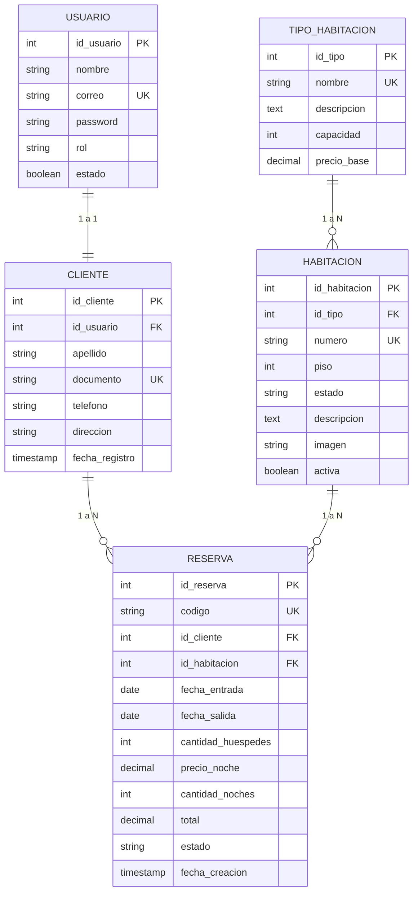

# TRD - Especificación Técnica y Arquitectura

**Hotel:** Alborada Hotel Boutique  
**Responsable:** Alvaro Andrés  
**Versión del documento:** 1.0 (Noviembre de 2026)  
**Documentos relacionados:** [PRD.md](./PRD.md), [USER_FLOW.md](./USER_FLOW.md), [QA_TEST_REPORT.md](./QA_TEST_REPORT.md)

---

## 1. Stack Tecnológico

| Componente | Tecnología | Justificación |
|---|---|---|
| **Frontend** | React 19 + Vite | Interfaz declarativa de alto rendimiento, recarga rápida (HMR) y tipado estricto. |
| **Estilos & UI** | Tailwind CSS v4 + Motion UI | Diseño responsivo, tema visual hotel boutique de lujo y animaciones fluidas. |
| **Backend** | Node.js + Express | API REST liviana, modular y basada en JavaScript/TypeScript. |
| **Base de datos** | PostgreSQL | Integridad referencial, transaccionalidad ACID y soporte de exclusión temporal con `btree_gist`. |
| **Autenticación** | JWT (JSON Web Tokens) | Sesiones stateless seguras con roles (`CLIENTE`, `ADMINISTRADOR`). |
| **Criptografía** | bcrypt | Hash unidireccional con salt para contraseñas de usuarios. |
| **Validación** | Zod (Backend) / TypeScript | Esquemas y contratos de datos seguros tanto en cliente como en servidor. |
| **Testing** | Vitest | Suite automatizada para lógica de negocio y pruebas unitarias/integración. |
| **Control de versiones** | Git + GitHub | Flujo de ramas `dev` $\rightarrow$ `qa` $\rightarrow$ `main`. |
| **Despliegue** | Render | Alojamiento para frontend estático, API Express y PostgreSQL administrado. |

---

## 2. Arquitectura de Software

### 2.1 Enfoque Arquitectónico
Se adopta una **arquitectura en tres capas con backend monolítico modular**:

```
┌────────────────────────────────────────────────────────┐
│                        FRONTEND                        │
│            React + Vite + Tailwind CSS                │
│    (Vistas: Catálogo, Búsqueda, Reservas, Admin)       │
└───────────────────────────┬────────────────────────────┘
                            │  HTTPS / JSON (REST API)
                            ▼
┌────────────────────────────────────────────────────────┐
│                        BACKEND                         │
│               Node.js + Express (API REST)             │
│   Rutas ──► Middlewares (Auth, Roles) ──► Servicios    │
└───────────────────────────┬────────────────────────────┘
                            │  Consultas Parametrizadas
                            ▼
┌────────────────────────────────────────────────────────┐
│                     BASE DE DATOS                      │
│                      PostgreSQL                        │
│  (Restricción btree_gist contra reservas superpuestas) │
└────────────────────────────────────────────────────────┘
```

> **Regla de oro:** El frontend nunca se conecta directamente a la base de datos PostgreSQL. Toda transacción pasa por la capa de servicios del backend.

---

## 3. Modelo de Datos y Esquema Relacional

### 3.1 Diagrama Entidad-Relación (ERD)



### 3.2 Definición de Tablas

#### Tabla: `USUARIO`
| Columna | Tipo | Restricción | Notas |
|---|---|---|---|
| `id_usuario` | SERIAL | PRIMARY KEY | Identificador autoincremental |
| `nombre` | VARCHAR(100) | NOT NULL | Nombre del usuario |
| `correo` | VARCHAR(150) | NOT NULL, UNIQUE | Correo electrónico de inicio de sesión |
| `password` | VARCHAR(255) | NOT NULL | Hash generado con bcrypt (costo 10+) |
| `rol` | VARCHAR(20) | NOT NULL | Valores permitidos: `ADMINISTRADOR`, `CLIENTE` |
| `estado` | BOOLEAN | DEFAULT TRUE | Estado de la cuenta (activo/inactivo) |

#### Tabla: `CLIENTE`
| Columna | Tipo | Restricción | Notas |
|---|---|---|---|
| `id_cliente` | SERIAL | PRIMARY KEY | Identificador del cliente |
| `id_usuario` | INT | NOT NULL, UNIQUE, FK $\rightarrow$ USUARIO | Vínculo 1 a 1 con la cuenta |
| `apellido` | VARCHAR(100) | NOT NULL | Apellido |
| `documento` | VARCHAR(20) | NOT NULL, UNIQUE | Documento de identidad (cédula o pasaporte) |
| `telefono` | VARCHAR(20) | NOT NULL | Número de contacto |
| `direccion` | VARCHAR(200) | NULL | Dirección opcional |
| `fecha_registro` | TIMESTAMP | DEFAULT CURRENT_TIMESTAMP | Fecha de creación del perfil |

#### Tabla: `TIPO_HABITACION`
| Columna | Tipo | Restricción | Notas |
|---|---|---|---|
| `id_tipo` | SERIAL | PRIMARY KEY | Identificador del tipo |
| `nombre` | VARCHAR(50) | NOT NULL, UNIQUE | `Individual`, `Doble`, `Triple`, `Familiar`, `Suite` |
| `descripcion` | TEXT | NOT NULL | Descripción de confort y atractivos |
| `capacidad` | SMALLINT | NOT NULL, CHECK > 0 | Huéspedes máximos permitidos |
| `precio_base` | NUMERIC(12,2) | NOT NULL, CHECK > 0 | Tarifa por noche en COP |

#### Tabla: `HABITACION`
| Columna | Tipo | Restricción | Notas |
|---|---|---|---|
| `id_habitacion` | SERIAL | PRIMARY KEY | Identificador de la habitación |
| `id_tipo` | INT | NOT NULL, FK $\rightarrow$ TIPO_HABITACION | Tipo asignado |
| `numero` | VARCHAR(10) | NOT NULL, UNIQUE | Número de puerta (ej. `101`, `204`, `305`) |
| `piso` | SMALLINT | NOT NULL | Piso donde se ubica (Piso 1, 2 o 3) |
| `estado` | VARCHAR(20) | NOT NULL | `DISPONIBLE`, `RESERVADA`, `OCUPADA`, `MANTENIMIENTO` |
| `descripcion` | TEXT | NULL | Detalle de ubicación o vista |
| `imagen` | VARCHAR(255) | NULL | URL o ruta de la imagen representativa |
| `activa` | BOOLEAN | DEFAULT TRUE | Desactivación lógica sin perder reservas históricas |

#### Tabla: `RESERVA`
| Columna | Tipo | Restricción | Notas |
|---|---|---|---|
| `id_reserva` | SERIAL | PRIMARY KEY | Identificador de la reserva |
| `codigo` | VARCHAR(12) | NOT NULL, UNIQUE | Código único (ej. `ALB-72941`) |
| `id_cliente` | INT | NOT NULL, FK $\rightarrow$ CLIENTE | Huésped que reserva |
| `id_habitacion` | INT | NOT NULL, FK $\rightarrow$ HABITACION | Habitación asignada |
| `fecha_entrada` | DATE | NOT NULL | Check-in (15:00) |
| `fecha_salida` | DATE | NOT NULL, CHECK > entrada | Check-out (12:00) |
| `cantidad_huespedes`| SMALLINT | NOT NULL, CHECK > 0 | Ocupantes confirmados |
| `precio_noche` | NUMERIC(12,2) | NOT NULL | Tarifa fija copiada al momento de reservar |
| `cantidad_noches` | SMALLINT | NOT NULL | Calculado en backend |
| `total` | NUMERIC(12,2) | NOT NULL | `cantidad_noches * precio_noche` |
| `estado` | VARCHAR(20) | NOT NULL | `PENDIENTE`, `CONFIRMADA`, `FINALIZADA`, `CANCELADA` |
| `fecha_creacion` | TIMESTAMP | DEFAULT CURRENT_TIMESTAMP | Momento exacto de reserva |

---

## 4. Garantía Técnica contra Reservas Superpuestas (RN01)

El sistema implementa una **estrategia de defensa en dos capas**:

### Capa 1: Base de Datos (PostgreSQL Exclusion Constraint)
Mediante la extensión `btree_gist`, PostgreSQL rechaza a nivel de motor de datos cualquier intento de reserva simultánea o en carrera para el mismo rango $[fecha\_entrada, fecha\_salida)$:

```sql
CREATE EXTENSION IF NOT EXISTS btree_gist;

ALTER TABLE RESERVA
ADD CONSTRAINT no_reservas_superpuestas
EXCLUDE USING gist (
    id_habitacion WITH =,
    daterange(fecha_entrada, fecha_salida, '[)') WITH &&
)
WHERE (estado IN ('PENDIENTE', 'CONFIRMADA'));
```

### Capa 2: Backend (Validación Previa en Transacción)
El servicio de reservas verifica la condición antes de insertar para retornar un mensaje claro y comprensible al cliente (código HTTP 409 Conflict):

$$\text{Existe Solapamiento} \iff (r_{\text{entrada}} < \text{nuevaSalida}) \land (r_{\text{salida}} > \text{nuevaEntrada})$$

---

## 5. Especificación de la API REST

### Endpoints Principales

#### 🔐 Autenticación
- `POST /api/auth/register`: Registro de nuevos usuarios y creación de cliente asociado.
- `POST /api/auth/login`: Autenticación con email y contraseña, retorno de token JWT.

#### 🛏️ Habitaciones
- `GET /api/habitaciones`: Catálogo completo de habitaciones con tipo y servicios.
- `GET /api/habitaciones/disponibles`: Búsqueda por parámetros (`fecha_entrada`, `fecha_salida`, `huespedes`, `id_tipo`).
- `GET /api/habitaciones/:id`: Detalle de una habitación específica.
- `POST /api/habitaciones`: [ADMIN] Crear una nueva habitación.
- `PUT /api/habitaciones/:id`: [ADMIN] Modificar datos de una habitación.
- `PATCH /api/habitaciones/:id/estado`: [ADMIN] Alternar estado (`DISPONIBLE`, `MANTENIMIENTO`, etc.).

#### 📅 Reservas
- `GET /api/reservas`: Listar reservas (filtrado automático: administradores ven todas; clientes solo las propias).
- `GET /api/reservas/:id`: Detalle de una reserva con código único.
- `POST /api/reservas`: Crear reserva con validación estricta de solapamiento y cálculo de importe en backend.
- `PATCH /api/reservas/:id/estado`: Cambio de estado (`CONFIRMADA`, `FINALIZADA`, `CANCELADA`).

#### 📊 Reportes y Dashboard
- `GET /api/reportes/dashboard`: [ADMIN] KPIs de ocupación, total habitaciones, disponibles, mantenimiento e ingresos acumulados en COP.

