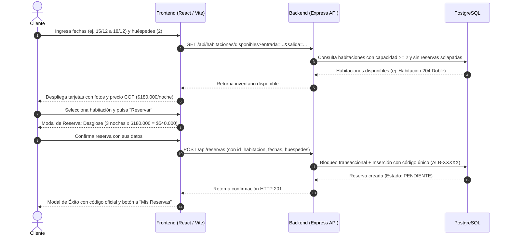
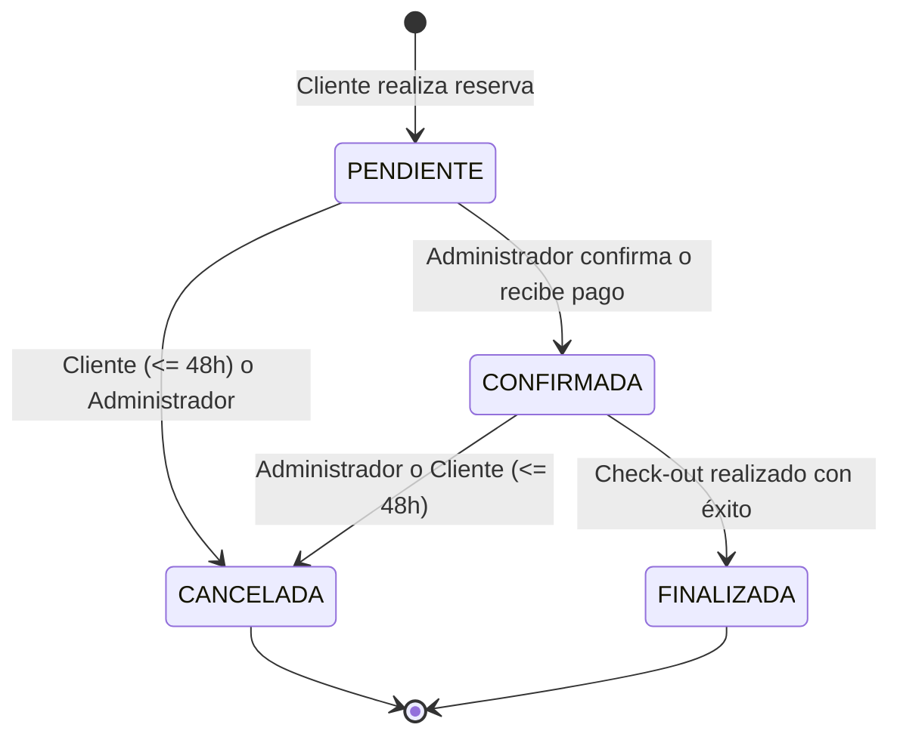
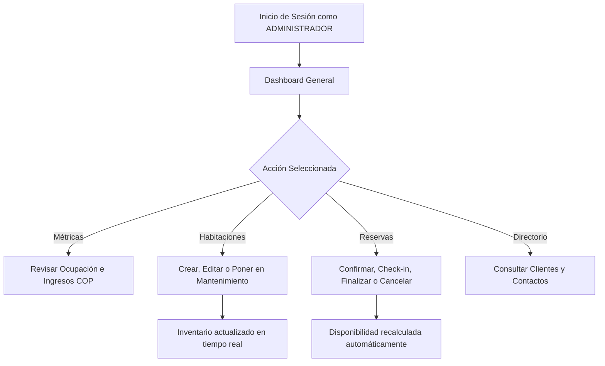

# USER FLOW - Flujos de Usuario y Experiencia

**Hotel:** Alborada Hotel Boutique  
**Responsable:** Alvaro Andrés  
**Versión del documento:** 1.0 (Noviembre de 2026)  
**Documentos relacionados:** [PRD.md](./PRD.md), [TRD.md](./TRD.md)

---

## 1. Experiencia de Usuario y Puntos de Partida

### 1.1 Matriz de Accesibilidad por Perfil

| Elemento o Función | Visitante Anónimo | Cliente Autenticado | Administrador |
|---|:---:|:---:|:---:|
| Página de inicio y buscador de fechas | Sí | Sí | Sí |
| Catálogo visual de habitaciones y fotos | Sí | Sí | Sí |
| Consulta en vivo de disponibilidad | Sí | Sí | Sí |
| Botón "Reservar" | Solicita iniciar sesión | Activo (reserva directa) | Activo |
| Mis Reservas | No | Sí (solo sus reservas) | No aplica |
| Panel Administrativo (Dashboard, Habitaciones, Clientes, Reportes) | No | No (acceso bloqueado) | Sí (completo) |

---

## 2. Camino Crítico del Cliente (Happy Path)

---

## 3. Máquina de Estados de Reservas (RN06)

El ciclo de vida de una reserva sigue una máquina de estados estricta para garantizar la integridad operativa del hotel:

### Reglas de Transición
1. **PENDIENTE $\rightarrow$ CONFIRMADA**: La reserva es validada por el hotel.
2. **CONFIRMADA $\rightarrow$ FINALIZADA**: El huésped completa su estadía y realiza check-out.
3. **PENDIENTE / CONFIRMADA $\rightarrow$ CANCELADA**:
   - Por el cliente: Permitido únicamente si faltan más de 48 horas para la fecha de check-in (15:00 del día de entrada).
   - Por el administrador: Permitido en cualquier momento por causas justificadas.
4. **Liberación de inventario**: En el momento exacto en que una reserva pasa a `CANCELADA`, la habitación queda disponible para ser reservada por otros clientes.

---

## 4. Flujo Operativo del Administrador

